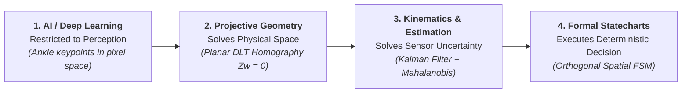
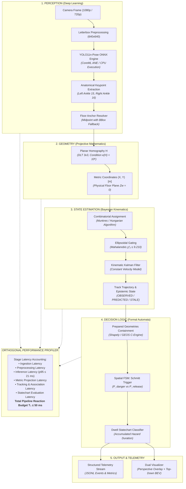
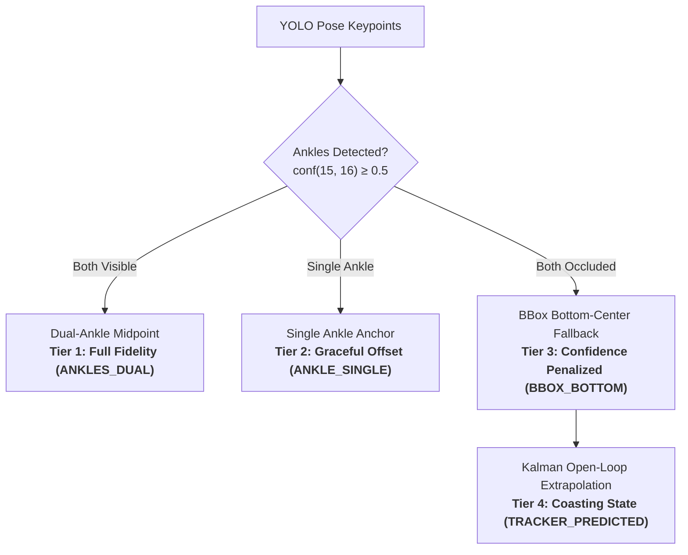
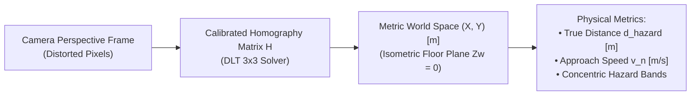
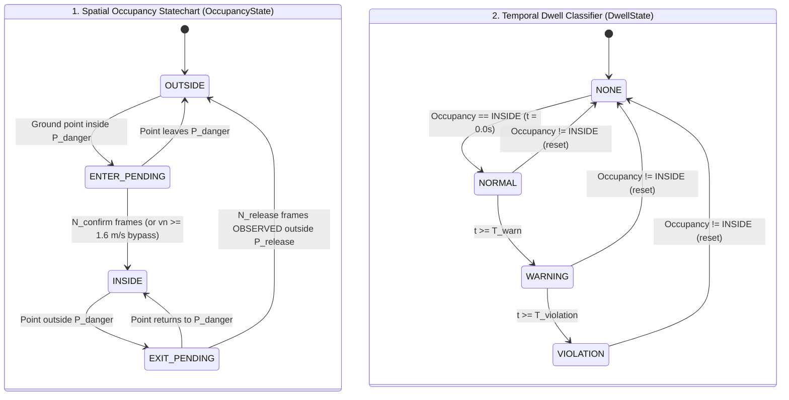

# Why You Shouldn’t Use Neural Networks to Stop Industrial Machinery: An Edge AI Architecture Deep Dive

> **Subtitle:** *How combining YOLO-Pose, planar DLT homography, kinematic Kalman filtering, and formal statecharts delivers deterministic <22ms reaction budgets.*  
> **Target Audience:** Senior Software Engineers, Edge AI Architects, Roboticists, and Applied Machine Learning Practitioners.  
> **Canonical Source:** [https://github.com/LeanoA/edge-vision-zone-monitor](https://github.com/LeanoA/edge-vision-zone-monitor)

---

> [!CAUTION]
> **Safety Scope & Regulatory Boundary (Disclaimer):**  
> *Experimental vision-based spatial monitoring prototype inspired by industrial safety-zone concepts and ISO 13855 response-time modeling. Not a safety-rated protective device.*  
> This case study reflects applied engineering research. The software is not an Electro-Sensitive Protective Equipment (ESPE) nor a Vision-Based Protective Device (VBPD) certified under IEC 61496, ISO 13849 (PL), or IEC 61508 (SIL). It must not be deployed as an autonomous safety trip mechanism on hazardous machinery without certified physical interlocks.

---

## The Black-Box Temptation in Mission-Critical Systems

In contemporary Edge AI development, there is an omnipresent temptation: treat deep neural networks as universal black-box decision engines. When engineering spatial safety and intrusion monitoring around industrial robotics, computer vision teams frequently attempt to train end-to-end models that predict whether an operator "is committing a safety violation" or "has dwelled too long in a danger zone."

In real-world plants, this approach fails catastrophically:
1. **Unquantifiable Edge Cases:** Probabilistic classifiers cannot reason about geometric topology or camera perspective.
2. **Spurious Hallucinations:** An operator bending over or gesturing with an arm can artificially expand their detected bounding box by 40%, triggering spurious machine shutdowns.
3. **Contact Chattering:** Workers operating near boundary lines cause rapid, oscillating alarms that damage heavy physical contactors and destroy operator trust.
4. **Latency Tail Jitter:** End-to-end architectures introduce variable batching and queueing delays, violating industrial real-time budgets ($t_1 \le 50\text{ ms}$).

The solution isn't larger datasets or heavier transformer backbones. The solution is **architectural boundary discipline**:

> **"Restricting AI strictly to perception, while delegating physical space to projective geometry, uncertainty to Kalman filtering, and safety actions to formal statecharts."**

---

## 1. The Full Pipeline Architecture

The system executes as a deterministic, synchronous pipeline on Apple Silicon (via ONNX Runtime `CoreMLExecutionProvider`) and Linux Edge (via `CPUExecutionProvider` / CUDA):

---

## 2. Pillar I: The Floor Contact Anchor (Ankles vs Bounding Boxes)

Standard object detection frameworks identify humans through rectangular bounding boxes. In elevated or oblique factory camera perspectives, using the bounding box center or centroid creates severe geometric errors:

* **Torso Lean Errors:** An operator standing securely outside a perimeter fence who leans forward will project their centroid deep into the hazardous area.
* **Aspect Ratio Skew:** Reaching with arms or carrying tools stretches the bounding box boundaries unpredictably.

### The First-Principles Anchor
Physical intrusion into a machine zone occurs when the operator makes contact with the floor plane ($Z_w = 0$). By utilizing a 17-keypoint pose estimation model (YOLO11n-Pose), we isolate the anatomical ankles:

$$p_{\text{ground}} = \frac{p_{\text{left\_ankle}} + p_{\text{right\_ankle}}}{2}$$

---

## 3. Pillar II: Planar Homography ($Z_w = 0$) & Numerical Safety Gates

Defining safety zones as 2D pixel polygons produces extreme non-linear perspective distortion. In typical industrial CCTV cameras:
* **Bottom of frame:** 10 pixels $\approx 0.15\text{ m}$ on the factory floor.
* **Top horizon:** 10 pixels $\approx 3.0\text{ m}$ on the factory floor.

Any Euclidean distance metric or velocity calculation calculated directly in pixels is physically meaningless.

### The Homography Transformation
Since contact occurs on the ground plane, the mapping from image coordinates $(u, v)$ to metric floor coordinates $(X, Y)$ is a planar homography $H \in \mathbb{R}^{3 \times 3}$:

$$\begin{bmatrix} X' \\ Y' \\ W \end{bmatrix} = H \begin{bmatrix} u \\ v \\ 1 \end{bmatrix}, \quad X = \frac{X'}{W}, \quad Y = \frac{Y'}{W}$$

### Numerical Conditioning Safety Gate
Calibration matrices estimated via Direct Linear Transformation (DLT) can degenerate under grazing camera angles or near-collinear points. Small pixel noise then produces massive metric errors. We enforce a strict condition number threshold:

$$\kappa(H) = \frac{\sigma_{\max}(H)}{\sigma_{\min}(H)} < 10^6$$

If $\kappa(H) \ge 10^6$, the calibration is rejected preventively at initialization.

---

## 4. Pillar III: Kinematic Kalman Filtering & Epistemological Validity

Attempting to compute operator velocity via discrete numerical differentiation ($\vec{v} = \frac{\Delta \mathbf{x}}{\Delta t}$) catastrophically magnifies high-frequency detection jitter:

$$\text{Jitter: } \Delta x = 2\text{ cm} \quad \implies \quad v_{\text{spurious}} = \frac{0.02\text{ m}}{0.033\text{ s}} = 0.60\text{ m/s} \quad (2.16\text{ km/h})$$

In safety systems evaluating approach speed thresholds ($K = 1.6\text{ m/s}$ modeled after ISO 13855), high-frequency noise alone triggers false emergency stops.

### Epistemological Observation States
A predicted state from a mathematical filter is **not** physical ground truth. Without photons hitting the sensor, dead reckoning diverges quadratically:

$$\|\Delta \mathbf{p}(t)\| \le \frac{1}{2} a_{\max} t^2 + v_0 t (1 - \cos \theta)$$

By frame 4 ($> 100\text{ ms}$), physical uncertainty exceeds our spatial hysteresis margin ($\Delta d = 200\text{ mm}$). We formalize this epistemological boundary:

| State | Temporal Freshness | Physical Validity | Permitted Safety Action |
| :--- | :--- | :--- | :--- |
| **`OBSERVED`** | Frame $k = 0$ ($0\text{ ms}$) | Verified by physical camera sensor | Escalation to Danger & De-escalation to Safe |
| **`PREDICTED`** | Frames $1 \le k \le 3$ ($\le 100\text{ ms}$) | Safe kinematic divergence bound | Escalation to Danger only (De-escalation BLOCKED) |
| **`STALE`** | Frames $4 \le k \le 5$ ($133\text{--}167\text{ ms}$) | Speculative open-loop extrapolation | Escalation to Danger only (De-escalation BLOCKED) |

---

## 5. Pillar IV: Deterministic Statecharts & The Spatial Schmitt Trigger

An operator working near the edge of a danger zone naturally oscillates across the line. A single-boundary system produces *chattering* (rapid alert toggling), destroying mechanical relays and industrial trust.

### The Spatial Schmitt Trigger
We implement a dual-polygon concentric boundary:
* **$P_{\text{danger}}$:** Inner critical perimeter.
* **$P_{\text{release}}$:** Outer boundary expanded by a physical hysteresis band $\Delta d = 0.20\text{ m}$ ($P_{\text{release}} = P_{\text{danger}} \oplus \Delta d$).

### Entry / Exit Asymmetry
* **Entry Policy (Fast & Conservative):** Normal approach ($v_n < 1.6\text{ m/s}$) requires $N_{\text{confirm}} = 3$ consecutive frames. Rapid approach ($v_n \ge 1.6\text{ m/s}$) executes an **instantaneous single-frame bypass ($N_{\text{confirm}} = 1$)** on frame 1.
* **Exit Policy (Hysteretic & Strict):** Requires $N_{\text{release}} = 5$ consecutive frames strictly outside $P_{\text{release}}$. De-escalation is blocked if the target is occluded (`PREDICTED` or `STALE`).

### Orthogonal Decoupling of Space and Time

The safety trip signal (`trip = True`) triggers in memory at $t = 0.0\text{ s}$ upon confirmed entry into `INSIDE`. The dwell timer classifies duration (`NORMAL`, `WARNING`, `VIOLATION`) purely for auditing and telemetry without introducing decision latency.

---

## 6. Closing the Synthetic Domain Gap

To validate edge cases that cannot be safely reproduced with real workers (such as high-speed sprints towards a running robotic arm or complete foot occlusions), we constructed an internal synthetic video generator.

Early attempts using geometric vector drawings yielded a **0% detection rate** in YOLO-Pose due to the complete lack of realistic skin textures, fabric gradients, and natural shadows.

By implementing a **Single-Identity Tracklet Engine** with continuous alpha-feathering, synthetic Gaussian contact shadows, and calibrated pinhole scaling ($h = \frac{480}{1.0 + 0.165 \cdot Y}$), we achieved a **100% detection rate** with an average confidence of **0.835 – 0.861**, enabling fully automated CI/CD regression testing.

---

## 7. Empirical Benchmarks & Hardware Performance

The complete pipeline was benchmarked across standard academic and real-world industrial datasets:

| Benchmark Dataset | Scenario | Resolution | Frames | Pipeline Throughput | Latency Mean ($T_1$) | $p_{95}$ Latency | Outcome |
| :--- | :--- | :---: | :---: | :---: | :---: | :---: | :--- |
| **`synthetic_sequence_a`** | Clean Incursion | $1280 \times 720$ | 180 | $51.4\text{ FPS}$ | $16.24\text{ ms}$ | $24.68\text{ ms}$ | ✅ Exact Ground Truth ($\text{err} = 0.0\text{ mm}$) |
| **`synthetic_sequence_b`** | Ankle Occlusion | $1280 \times 720$ | 180 | $36.5\text{ FPS}$ | $24.07\text{ ms}$ | $28.94\text{ ms}$ | ✅ Graceful Degradation & Kalman Coasting |
| **`synthetic_sequence_c`** | Dwell Accumulation | $1280 \times 720$ | 300 | $37.4\text{ FPS}$ | $23.44\text{ ms}$ | $28.02\text{ ms}$ | ✅ Decoupled Dwell Transition Verified |
| **`mendeley_industrial`** | Machine Intervention | $1920 \times 1080$ | 173 | $37.5\text{ FPS}$ | $15.35\text{ ms}$ | $18.26\text{ ms}$ | ✅ High-Res Pose & Pre-alert Verified |
| **`opencv_vtest`** | Pedestrian Surveillance | $768 \times 576$ | 795 | $40.8\text{ FPS}$ | $21.26\text{ ms}$ | $29.31\text{ ms}$ | ✅ Intrusion & Lockout Invariants Verified |
| **`pets2009_s2_l1`** | Multi-Target Crowd | $768 \times 576$ | 795 | $40.6\text{ FPS}$ | $21.38\text{ ms}$ | $30.53\text{ ms}$ | ✅ Munkres Association & Zero ID Swaps |

On Apple Silicon (M-Series ANE via CoreML Execution Provider), total perception-to-decision latency remains strictly bounded under $22\text{ ms}$ ($p_{95}$), well within the total industrial reaction budget of $T_1 \le 50\text{ ms}$ ($\ge 20\text{ FPS}$).

---

## Conclusion & Architectural Principles

1. **AI belongs at the perceptual boundary:** Treat neural networks as noisy, unstructured-to-structured converters. Never permit probabilistic outputs to trigger physical safety actuators directly.
2. **Lift coordinates to metric space immediately:** The moment image points are mapped to physical coordinates on the floor plane ($Z_w = 0$), classical geometry and kinematics solve problems that break pixel heuristics.
3. **Observation is an epistemological status:** Sensor measurements and open-loop extrapolations are fundamentally different classes of data. Safety logic must enforce asymmetric de-escalation when physical observations are absent.

---

### Open Source Repository & Architecture Decision Records (ADRs)
The complete Python codebase, 218 unit/integration tests, dataset ingestion utilities, and 12 Architecture Decision Records are available on GitHub:

👉 **[github.com/LeanoA/edge-vision-zone-monitor](https://github.com/LeanoA/edge-vision-zone-monitor)**
