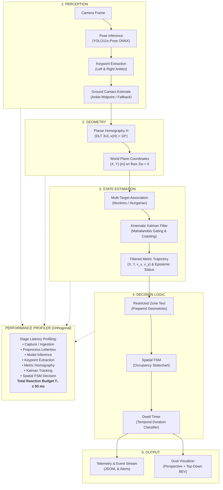
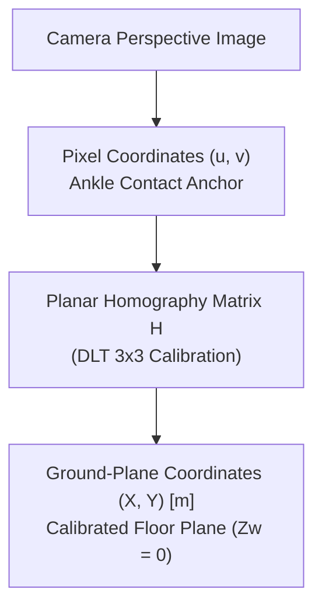
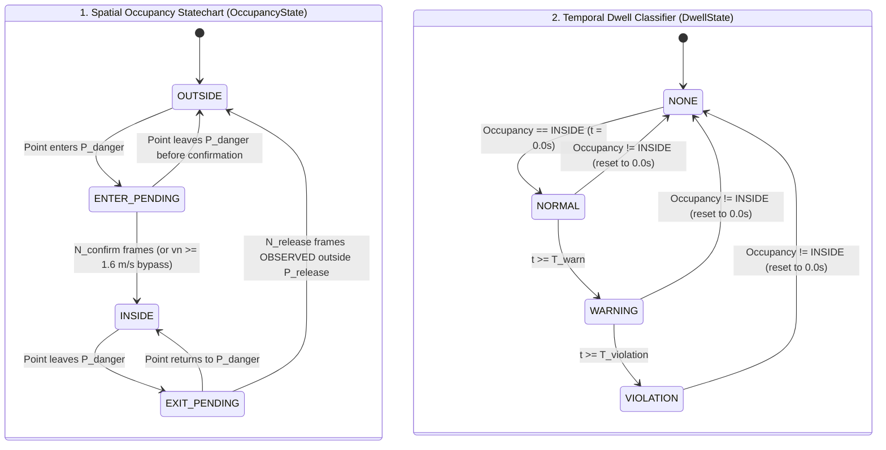
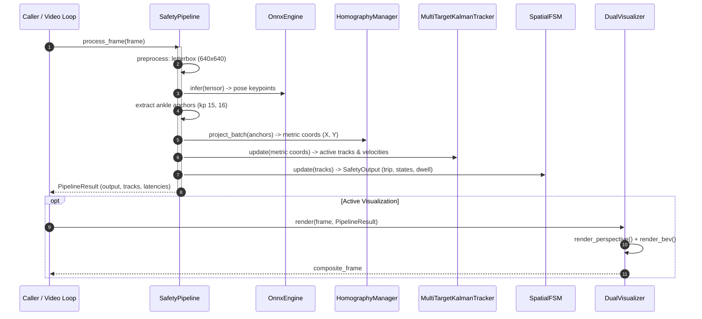

<div align="center">

# Vision-Based Restricted Zone Monitoring: Intrusion Detection & Dwell Time Analysis

[](https://www.python.org/)
[](https://onnxruntime.ai/)
[](https://opencv.org/)
[](https://github.com/LeanoA/edge-vision-zone-monitor/actions/workflows/deploy.yml)
[-success?logo=pytest&logoColor=white)](#)
[-%3C%2022ms%20(T1%20budget)-00b4d8?logo=speedtest&logoColor=white)](#)

<br/>

[](#)

</div>

Experimental computer vision prototype for real-time restricted zone incursion monitoring and dwell time analysis, combining **YOLO Pose**, **Planar Homography Transformation (2D Pixel to Metric Floor Plane)**, **2D Kinematic Kalman Filtering**, and **Orthogonal Spatial Statecharts (Spatial FSM)**.

---

## 🎯 Formal Problem Definition

> *Given a video stream from a fixed monocular camera observing an approximately planar floor, estimate the ground-plane position of visible workers, determine whether they enter a configured metric restricted zone, and emit temporally stable intrusion and dwell events while characterizing end-to-end processing latency.*

> [!CAUTION]
> **Safety Scope & Regulatory Boundary (Disclaimer):**  
> *Experimental vision-based spatial monitoring prototype inspired by industrial safety-zone concepts and ISO 13855 response-time modeling. Not a safety-rated protective device.*  
> This software is an experimental engineering and research prototype. It does not constitute an Electro-Sensitive Protective Equipment (ESPE) nor a Vision-Based Protective Device (VBPD) functionally certified under IEC 61496, ISO 13849 (PL), or IEC 61508 (SIL). It must not be deployed as an autonomous safety trip mechanism on hazardous industrial machinery without certified physical interlocks.

---

## 📌 Scope & Architectural Boundaries (Scope Freeze)

To ensure the delivery of a robust, deterministic, and verifiable system without overengineering, the project scope is formally categorized into the following tiers:

### 1. Core End-to-End Pipeline & Data Flow

The architecture is structured across 5 sequential perception and decision stages, accompanied by an orthogonal **Performance Profiler** to empirically evaluate real-time budgets inspired by the **ISO 13855** response-time model:



#### Architectural Mapping & Implementation Status

| Architectural Layer | Component / Flow | Code Module | Implementation Status (Edge AI) |
| :--- | :--- | :--- | :--- |
| **1. PERCEPTION** | Camera Frame $\to$ Pose Inference $\to$ Keypoints $\to$ Ground Contact | `src/inference/onnx_engine.py`<br>`src/pipeline/safety_pipeline.py` | **100% Implemented**<br>• YOLO11n-Pose ONNX inference (`CoreMLExecutionProvider` / CPU / CUDA).<br>• Anatomical ankle extraction (`left_ankle: 15`, `right_ankle: 16`) with fallback to bounding box base ([ADR-001](docs/decisions/adr-001-yolo-pose-vs-bbox.md), [ADR-007](docs/decisions/adr-007-occlusion-handling-confidence-propagation.md)). |
| **2. GEOMETRY** | Homography Projection $\to$ Metric $(X, Y)$ on floor plane ($Z_w = 0$) | `src/core/homography.py` | **100% Implemented**<br>• Planar DLT $3 \times 3$ mapping with collinearity verification and numerical condition threshold $\kappa(H) < 10^6$ ([ADR-002](docs/decisions/adr-002-homography-vs-monocular-3d.md), [ADR-005](docs/decisions/adr-005-homography-vectorization-geometric-validation.md)). |
| **3. STATE ESTIMATION** | 2D Kinematic Kalman Filter $\to$ Filtered Metric Trajectory | `src/core/kalman_filter.py` | **100% Implemented**<br>• Constant Velocity (CV) kinematic state model with Kalman gain $K_k$.<br>• Three-tier observation epistemology (`OBSERVED`, `PREDICTED`, `STALE`) with quadratic divergence bounding ([ADR-004](docs/decisions/adr-004-spatial-fsm-hysteresis.md), [ADR-008](docs/decisions/adr-008-kalman-epistemology-noise-divergence.md)).<br>• Global combinatorial assignment (Munkres / Hungarian) with Mahalanobis validation gate $\chi^2_2(0.99) \le 9.21$ and World-Space Spatial Birth NMS ($0.6\text{ m}$) ([ADR-011](docs/decisions/adr-011-mahalanobis-hungarian-mot.md)). |
| **4. DECISION LOGIC** | Zone Containment $\to$ Spatial FSM $\to$ Dwell Classifier | `src/core/spatial_fsm.py` | **100% Implemented**<br>• Orthogonal Statecharts regions: `OccupancyState` (`OUTSIDE`, `ENTER_PENDING`, `INSIDE`, `EXIT_PENDING`) $\times$ `DwellState` (`NONE`, `NORMAL`, `WARNING`, `VIOLATION`) ([ADR-009](docs/decisions/adr-009-decoupled-spatial-dwell-statecharts.md)).<br>• Instant fail-safe trip on confirmed `INSIDE` ($t = 0\text{ s}$) and dynamic velocity bypass for $v_n \ge 1.6\text{ m/s}$ (ISO 13855). |
| **5. OUTPUT** | Dual Overlay $\to$ Telemetry Stream $\to$ Metrics | `src/utils/visualizer.py`<br>`scripts/run_demo.py` | **100% Implemented**<br>• Real-time dual compositor (Annotated Perspective + Top-Down Metric BEV).<br>• Structured JSONL telemetry emission and latency percentile reporting.<br>*(Edge AI Roadmap: Industrial telemetry exporter for MQTT / ZeroMQ / gRPC plant protocols)*. |
| **6. PROFILER (Orthogonal)** | Granular stage profiling $\to$ End-to-End Latency ($T_1$) | `src/pipeline/safety_pipeline.py`<br>`src/inference/benchmark.py` | **95% Implemented**<br>• High-resolution timer across all pipeline stages ($T_1 = t_{\text{pre}} + t_{\text{inf}} + t_{\text{pose}} + t_{\text{proj}} + t_{\text{track}} + t_{\text{fsm}}$) reporting p50, p95, and p99 percentiles.<br>*(Next step 5%: Hardware timestamp ingestion via V4L2 ring buffer)*. |

### 2. Secondary Scope (Evaluation Extensions)
* **PyTorch vs ONNX Runtime Comparison:** Empirical throughput and latency benchmarking between native PyTorch and ONNX Runtime.
* **CoreML Execution Provider Profiling:** Granular profiling of Apple Silicon Neural Engine (ANE) vs GPU execution.
* **Alternative Detector Baseline:** Latency and accuracy trade-off benchmarks comparing alternative lightweight pose detectors.

### 3. Explicitly Out of MVP Scope
* **Pascal INT8 TensorRT Engine:** Specialized post-training INT8 quantization for Pascal GPUs without native Tensor Cores.
* **DeepStream Zero-Copy Pipelines:** GStreamer/DeepStream C++ zero-copy shared memory pipelines.
* **Dedicated Embedded Hardware:** Hardware-specific adaptations for NVIDIA Jetson Orin/Nano and Raspberry Pi compute modules.
* **Multi-Modal Sensor Fusion:** Integration of physical LiDAR, radar, or physical light curtain inputs.
* **Multi-Camera Topology:** Extrinsic calibration across distributed multi-camera nodes and cross-camera person re-identification.
* **Domain Re-Training:** Fine-tuning models on domain-specific datasets featuring heavy protective personal equipment (PPE).

---

## 🔬 Core Engineering Studies & Validation

This project serves as an experimental platform to rigorously resolve engineering dilemmas regarding computer vision applied to kinematic estimation and spatial safety zone monitoring:

### 1. Theoretical Formulations & Metrology
* **Q1: How does perception latency ($t_1$) impact physical safety separation distance?**
  * *Theoretical Framework:* Under the safety distance formulation $S = K \cdot T + C = K(t_1 + t_2 + t_3) + C$, each $10\text{ ms}$ of pipeline latency at a human walking speed of $K = 1.6\text{ m/s}$ ($1600\text{ mm/s}$) adds $16\text{ mm}$ directly to the required separation distance. Running at 10 FPS ($100\text{ ms}$) adds $160\text{ mm}$ compared to 30 FPS ($33.3\text{ ms}$), needlessly reducing usable plant floor space.
  * *Validation:* [`tests/test_pipeline.py`](tests/test_pipeline.py) and [`scripts/benchmark.py`](scripts/benchmark.py).
* **Q2: Why does velocity estimation via simple discrete differentiation ($\Delta x / \Delta t$) fail in industrial vision?**
  * *Theoretical Framework:* Numerical differentiation severely amplifies high-frequency measurement noise. At 30 FPS ($\Delta t = 0.033\text{ s}$), a stochastic keypoint detection jitter of just $2\text{ cm}$ produces a spurious velocity spike of $0.6\text{ m/s}$ ($2.16\text{ km/h}$).
  * *Solution & Validation:* The Kalman filter decouples noisy measurements via optimal gain $K_k$, producing smooth continuous velocity and position vectors with bounded covariance ([`tests/test_kalman.py`](tests/test_kalman.py)).
* **Q3: What is the true reprojection error of a planar homography and how does matrix conditioning impact safety?**
  * *Theoretical Framework:* With $N=4$ coplanar landmarks, the DLT linear system is exactly determined ($8 \times 8$), making algebraic training residual identically 0. However, a matrix condition number $\kappa(H) > 10^5$ reveals severe projective degeneration (nearly collinear points or grazing angles), amplifying metric errors under tiny pixel perturbations.
  * *Validation:* [`tests/test_homography.py`](tests/test_homography.py) audits collinearity, condition number $\kappa(H)$, and inverse isometric invariance.

### 2. Applied Dynamics & Temporal Hysteresis
* **Q4: How do we prevent boundary alarm chattering without delaying critical intrusion response?**
  * *Applied Framework:* An operator working near the edge of a danger zone causes erratic alarm oscillations (*chattering*) under single-threshold systems. The solution implements **dual hysteresis**:
    1. *Spatial:* Danger polygon $P_{\text{danger}}$ vs expanded release polygon $P_{\text{release}} = P_{\text{danger}} \oplus \Delta d$ ($\Delta d = 0.20\text{ m}$).
    2. *Temporal:* Debounce requires $N_{\text{confirm}} \ge 3$ consecutive frames for normal pace.
    3. *Kinematic Bypass:* If the normal approach speed towards the hazard satisfies $v_n \ge 1.6\text{ m/s}$, debounce is bypassed immediately on frame 1 ($N_{\text{confirm}} = 1$) for instant emergency trip.
  * *Validation:* [`tests/test_fsm.py`](tests/test_fsm.py) tests tangential motion, boundary oscillations, and high-speed incursions.
* **Q5: Do ankle keypoints justify the compute overhead over a bounding box base? ([See ADR-001](docs/decisions/adr-001-yolo-pose-vs-bbox.md))**
  * *Applied Framework:* The practical baseline is the bounding box bottom-center:
    $$p_{\text{ground-bbox}} = \left( \frac{x_{\min} + x_{\max}}{2}, y_{\max} \right)$$
    In contrast, pose estimation isolates anatomical floor contact:
    $$p_{\text{ground-pose}} = \operatorname{mean}\left(\text{valid-ankles}(k_{15}, k_{16})\right)$$
  * *Experimental Trade-Off:* Pose provides anatomical fidelity invariant to torso lean or camera tilt, but incurs higher computational cost. Bounding box bottom-center is $\approx 30\text{–}40\%$ faster but severely deforms when an operator bends forward over a barrier.
* **Q6: How does the system behave when feet or ankles are occluded by machinery or pallets? ([See ADR-007](docs/decisions/adr-007-occlusion-handling-confidence-propagation.md))**
  * *Failure Mode:* If machinery blocks an operator's feet, the pose model reports low confidence (`conf < 0.5`) on both ankles. Dropping detections creates a blind hazard; using low-confidence points injects catastrophic noise into the homography.
  * *Graceful Degradation Hierarchy:*
    1. *Dual Ankles ($\text{conf} \ge 0.5$):* Direct midpoint projection $\to$ full fidelity (`source="ankles_dual"`).
    2. *Single Ankle:* Fallback to visible ankle $\to$ bounded lateral offset (`source="ankle_single"`).
    3. *Both Occluded:* The kinematic Kalman filter enters *coasting mode*, extrapolating trajectory $[\dot{X}, \dot{Y}]$ for up to 5 frames ($\approx 160\text{ ms}$) (`source="tracker_predicted"`).
    4. *Extended Occlusion:* Fallback to confidence-penalized bounding box bottom-center or controlled track termination.
  * *Validation:* [`tests/test_pipeline.py`](tests/test_pipeline.py) and [`tests/test_kalman.py`](tests/test_kalman.py).
* **Q7: Why are Kalman predictions not physical truth and why must safety de-escalation be asymmetric? ([See ADR-008](docs/decisions/adr-008-kalman-epistemology-noise-divergence.md))**
  * *Epistemic Conflation:* In the absence of sensor photons, state prediction $\hat{\mathbf{x}}_k = F\hat{\mathbf{x}}_{k-1}$ is open-loop speculation. A worker may halt or trip unseen; maximum quadratic divergence $\|\Delta \mathbf{p}(t)\| \le \frac{1}{2} a_{\max} t^2 + v_0 t (1 - \cos \theta)$ exceeds the hysteresis margin ($\Delta d = 200\text{ mm}$) by frame 4 ($> 100\text{ ms}$).
  * *Three-Tier Observation States:* Formalized as `OBSERVED` ($k=0$), `PREDICTED` ($1 \le k \le 3$), and `STALE` ($4 \le k \le 5$).
  * *Asymmetric Safeguard:* Escalating to danger (`DANGER_INTRUSION`) is fail-safe and permitted under any state. De-escalating to `SAFE` strictly requires $N_{\text{release}} = 5$ consecutive frames that are `OBSERVED` outside $P_{\text{release}}$.
  * *Disappearance Lockout:* A worker who disappears inside the danger zone latches into `LOCKOUT` until manual inspection and reset (`SpatialFSM.reset()`).
  * *Validation:* [`tests/test_kalman.py`](tests/test_kalman.py) and [`tests/test_fsm.py`](tests/test_fsm.py).

---

## 📐 Mathematical Formulation & Systems Architecture

### 1. Planar Homography: Lifting Pixels to Physical Metric Space

#### Why Homography Instead of 2D Pixel ROIs? ([See ADR-002](docs/decisions/adr-002-homography-vs-monocular-3d.md))
In naive computer vision pipelines, a safety zone is drawn as a polygon directly in 2D image pixels:
```
pixel ROI: [(327, 412), (598, 390), (620, 580), (280, 560)] px
```
This naive approach suffers from severe projective distortion: it fails to preserve Euclidean distances, angles, or parallelism, making physical velocity calculations impossible.

By calibrating a planar homography $H \in \mathbb{R}^{3 \times 3}$, the pipeline lifts camera detections to real metric coordinates:



This transforms restricted zones into **physically interpretable and auditable entities**:
```yaml
danger_zone:
  X: [1.0, 2.5] m
  Y: [0.5, 2.0] m
```

Enabling deterministic engineering metrics:
* **True Euclidean distance** to hazardous machinery ($d_{\text{hazard}} = \|\mathbf{x} - \mathbf{x}_{\text{hazard}}\|$).
* **Kinematic approach speed** ($\vec{v} = [\dot{X}, \dot{Y}]$) in $\text{m/s}$.
* **Dwell distance** and boundary proximity.
* **Concentric warning zones** with certified metric separation margins.
* **Time-to-Collision (TTC)** projected along the kinematic trajectory.

#### Error Propagation Chain
Metric coordinates $\hat{P}_{\text{world}}$ represent an estimated compound measurement:
$$\hat{P}_{\text{world}} = H(\hat{p}_{\text{feet}})$$
Where five stochastic and systematic error sources converge:
```
pose estimation error (ankle keypoint jitter)
        +
pixel quantization (camera sensor resolution)
        +
camera calibration error (ground-truth landmark survey noise)
        +
ground-plane assumption (floor irregularities where Zw ≠ 0)
        +
homography numerical condition (matrix condition number κ(H))
```

#### Homography Formulation
$$\begin{bmatrix} X' \\ Y' \\ W \end{bmatrix} = H \begin{bmatrix} u \\ v \\ 1 \end{bmatrix}, \quad X = \frac{X'}{W}, \quad Y = \frac{Y'}{W}$$

Matrix $H$ is computed via Direct Linear Transformation (DLT) with non-collinearity verification and condition number monitoring in [`src/core/homography.py`](src/core/homography.py). For architectural details, see [ADR-002](docs/decisions/adr-002-homography-vs-monocular-3d.md) and [ADR-005](docs/decisions/adr-005-homography-vectorization-geometric-validation.md).

---

### 2. Safety Automata: Decoupled Orthogonal Statecharts ([See ADR-009](docs/decisions/adr-009-decoupled-spatial-dwell-statecharts.md))

To prevent conflation between **spatial topology** and **temporal duration**, the architecture decouples safety reasoning into two concurrent, independent statecharts:

#### Spatial Schmitt Trigger & Entry / Exit Asymmetry ([ADR-004](docs/decisions/adr-004-spatial-fsm-hysteresis.md), [ADR-006](docs/decisions/adr-006-prepared-geometries-dynamic-debounce-bypass.md), [ADR-008](docs/decisions/adr-008-kalman-epistemology-noise-divergence.md))

```
                      P_release (Release Boundary)
                   ┌───────────────────────────────────┐
                   │       Hysteresis Band             │
                   │       (Δd = 200 mm)               │
                   │    P_danger (Danger Boundary)     │
                   │   ┌───────────────────────────┐   │
                   │   │                           │   │
                   │   │    HAZARDOUS MACHINERY    │   │
                   │   │                           │   │
                   │   └───────────────────────────┘   │
                   │                                   │
                   └───────────────────────────────────┘

1. ENTRY POLICY (Fast & Conservative):
   • Normal approach (vn < 1.6 m/s): Debounce requires N_confirm = 3 frames.
   • Rapid approach (vn >= 1.6 m/s): Instant 1-frame bypass (N_confirm = 1) on frame 1 (ISO 13855 human speed threshold).

2. EXIT POLICY (Hysteretic & Strict):
   • Exit debounce: Requires N_release = 5 consecutive frames outside P_release.
   • Asymmetric safeguard: De-escalation strictly requires real sensor photons (OBSERVED).
     If the target is occluded (PREDICTED / STALE), de-escalation is blocked and trip remains active.
```

#### Orthogonal Statecharts (Occupancy x Dwell)



#### Sequence Diagram: Synchronous Frame Processing Cycle



* **Fail-Safe Invariant (Software):** The emergency trip signal (`trip = True`) asserts immediately at $t = 0.0\text{ s}$ upon confirmed entry into `INSIDE` (or upon `FAULT`/`LOCKOUT`). The dwell timer classifies operational duration without adding reaction latency.

---

## 🚀 Repository Structure

```
.
├── AGENTS.md                   # Project rules, persona, and SDD workflow
├── README.md                   # Master technical specification and architecture guide
├── configs/
│   ├── default_config.yaml     # Baseline calibration landmarks, polygons, and thresholds
│   └── datasets/               # Dataset-specific YAML profiles (PETS, OpenCV, OpenVINO)
├── data/
│   ├── raw/                    # Downloaded video datasets (git ignored)
│   ├── results/                # Annotated videos and JSONL telemetry (git ignored)
│   └── samples/                # Deterministic synthetic calibration sequences
├── docs/
│   ├── architecture/           # Engineering case study, diagrams, and deep dives
│   │   └── engineering-case-study.md # Comprehensive architectural case study
│   ├── data/datasets.md        # Dataset specifications and empirical catalog
│   ├── figures/                # Architectural diagrams and benchmark plots (PNG)
│   └── decisions/              # Architecture Decision Records (ADRs)
│       ├── README.md           # ADR index
│       └── adr-001-*.md        # YOLO-Pose vs Bounding Box Centroid
├── models/
│   └── export_onnx.py          # YOLO-Pose ONNX export and validation tool
├── openspec/                   # Canonical specifications and SDD change packages
├── src/
│   ├── core/
│   │   ├── homography.py       # HomographyManager (DLT 2D -> Metric Floor Plane)
│   │   ├── kalman_filter.py    # 2D Metric Kalman Filter & MultiTargetKalmanTracker
│   │   └── spatial_fsm.py      # SpatialFSM with dual hysteresis and dwell classifier
│   ├── inference/
│   │   └── onnx_engine.py      # ONNX Runtime wrapper (CoreML / CPU ARM NEON)
│   ├── pipeline/
│   │   └── safety_pipeline.py  # End-to-end pipeline orchestrator (ISO 13855 T1 budget)
│   └── utils/
│       └── visualizer.py       # Real-time dual compositor (Camera + Metric BEV)
├── tests/
│   ├── conftest.py             # Deterministic synthetic test fixtures (CI-ready)
│   ├── test_dataset_ingestion.py # Resilient downloader and test harness tests
│   ├── test_export.py          # ONNX export and validation tests
│   ├── test_onnx_engine.py     # Runtime and inference engine tests
│   ├── test_benchmark.py       # Latency percentile calculation tests
│   ├── test_fsm.py             # Unit tests for spatial FSM transitions
│   ├── test_homography.py      # Unit tests for metric homography projection
│   ├── test_kalman.py          # Unit tests for Kalman tracking and MOT
│   ├── test_pipeline.py        # Integrated safety pipeline tests
│   └── test_visualizer.py      # Dual compositor visual tests
└── scripts/
    ├── audit_and_reproduce_benchmarks.py # Master benchmark audit suite
    ├── benchmark.py            # Latency and throughput benchmark in ONNX Runtime
    ├── download_datasets.py    # Resilient multi-mirror dataset downloader
    ├── generate_figures.py     # Publication-grade technical figures generator
    ├── generate_samples.py     # Deterministic synthetic video generator
    ├── run_dataset_test.py     # Empirical dataset evaluation harness
    └── run_demo.py             # Interactive and headless demo runner
```

---

## 📚 Documentation & Architecture Decision Records (ADRs)

* **[Engineering Case Study](docs/architecture/engineering-case-study.md):** Deep architectural analysis, first-principles thesis, mathematical proofs, and empirical benchmark results.
* **[Architecture Q&A Log (Spanish)](docs/architecture/preguntas-y-respuestas-arquitectura.md):** Design rationale, $3 \times 3$ homography proofs, ankle anchors vs bounding boxes, and DLT 4-point mathematics.
* **[Master Technical Specification (Spanish)](docs/architecture/industrial-edge-ai-specification.md):** Formal requirements, ISO 13855:2024 framework, model benchmarking, and silicon constraints.
* **[ISO 13855:2024 Safety Directives (Spanish)](docs/architecture/safety-directives-iso13855.md):** Reaction time budgets, safety distance formula $S$, and false positive mitigations.
* **Architecture Decision Records Index ([ADRs](docs/decisions/README.md)):**
  * **[ADR-001](docs/decisions/adr-001-yolo-pose-vs-bbox.md):** YOLO-Pose Ankle Keypoints vs Bounding Box Centroid for Incursion Detection.
  * **[ADR-002](docs/decisions/adr-002-homography-vs-monocular-3d.md):** Planar 2D Homography vs Monocular 3D Spatial Estimation.
  * **[ADR-003](docs/decisions/adr-003-onnx-runtime-coreml.md):** Inference Runtime: ONNX Runtime (CoreML Provider) vs Native PyTorch.
  * **[ADR-004](docs/decisions/adr-004-spatial-fsm-hysteresis.md):** Spatial Boundary Oscillation Management via Spatial FSM and Kalman Filtering.
  * **[ADR-005](docs/decisions/adr-005-homography-vectorization-geometric-validation.md):** Preventive Geometric Validation and Vectorized Projection in Planar Homography.
  * **[ADR-006](docs/decisions/adr-006-prepared-geometries-dynamic-debounce-bypass.md):** Prepared Geometries and Dynamic Velocity Debounce Bypass (ISO 13855).
  * **[ADR-007](docs/decisions/adr-007-occlusion-handling-confidence-propagation.md):** Lower-Limb Occlusion Handling and Confidence Propagation.
  * **[ADR-008](docs/decisions/adr-008-kalman-epistemology-noise-divergence.md):** Kalman Epistemological Observation States, Spectral Noise, and Asymmetric De-escalation.
  * **[ADR-009](docs/decisions/adr-009-decoupled-spatial-dwell-statecharts.md):** Decoupled Spatial Automaton and Dwell Time Classification in Orthogonal Statecharts.
  * **[ADR-010](docs/decisions/adr-010-dual-latency-profiling-iso13855.md):** Dual Time Horizon Latency Profiling in Industrial Edge AI ($T_{\text{system}}$ vs $T_{\text{event}}$).
  * **[ADR-011](docs/decisions/adr-011-mahalanobis-hungarian-mot.md):** Bayesian Validation Gating (Mahalanobis $\chi^2$), Global Hungarian MOT, and World-Space Spatial Birth NMS.
  * **[ADR-012](docs/decisions/adr-012-synthetic-yolo-video-generation.md):** Photorealistic Synthetic Video Generation with Pinhole Scaling and Unique Identity.

---

## 🛠️ Technology Stack

* **Language:** Python 3.10+ (Strict type hinting)
* **Model:** YOLOv8 / YOLO11 Pose (Ultralytics $\to$ ONNX)
* **Inference Runtime:** ONNX Runtime (`CoreMLExecutionProvider` on Apple Silicon / `CPUExecutionProvider` / CUDA)
* **Geometry & Math:** OpenCV, NumPy, Shapely (GEOS C-Engine)
* **Testing:** PyTest (218 automated tests passing)

---

## 🗺️ Engineering Development Roadmap

- [x] **Step 0:** Initial repository structure, architecture specification, and setup.
- [x] **Step 1:** YAML configuration schema and baseline calibration model (`configs/default_config.yaml`).
- [x] **Step 2:** Planar Homography module (`src/core/homography.py`) and validation tests (`tests/test_homography.py`).
- [x] **Step 3:** 2D Kinematic Kalman filter and multi-target tracking (`src/core/kalman_filter.py`).
- [x] **Step 4:** Orthogonal Spatial FSM and dual hysteresis (`src/core/spatial_fsm.py`, `tests/test_fsm.py`).
- [x] **Step 5:** ONNX model exporter and inference engine (`models/export_onnx.py`, `src/inference/onnx_engine.py`).
- [x] **Step 6:** End-to-end pipeline orchestrator and dual visualizer (`src/pipeline/safety_pipeline.py`, `src/utils/visualizer.py`).
- [x] **Step 7:** CLI demo orchestrator and headless evaluation runner (`scripts/run_demo.py`).
- [ ] **Step 8 (Edge AI Optimization):** Hardware capture timestamp profiling (V4L2 ring buffer delta), zero-copy lock-free ring buffers, and industrial telemetry exporter (MQTT/ZeroMQ).

---

## 💻 CLI Demo Orchestrator (`scripts/run_demo.py`)

To run the interactive end-to-end demonstration with real-time dual perspective visualization:

```bash
# 1. Generate deterministic synthetic calibration sequences
python scripts/generate_samples.py --output-dir data/samples

# 2. Run interactive demo (Dual OpenCV window with SPACE pause / 'q' exit)
python scripts/run_demo.py --source data/samples/sequence_a_clean_incursion.mp4

# 3. Run in headless mode exporting annotated video and JSONL telemetry
python scripts/run_demo.py \
  --source data/samples/sequence_b_occlusion_coasting.mp4 \
  --no-display \
  --output-video output/demo_annotated.mp4 \
  --output-events output/telemetry_events.jsonl
```

---

## 🧪 Real-World Dataset Ingestion & Validation (PETS 2009, OpenCV, OpenVINO)

The repository includes a decoupled harness to download, calibrate, and evaluate empirical video surveillance datasets without modifying core pipeline code:

```bash
# 1. Inspect catalog and download sequences (with automatic mirror failover)
python scripts/download_datasets.py --list
python scripts/download_datasets.py --dataset pets2009_s2_l1
python scripts/download_datasets.py --dataset opencv_vtest
python scripts/download_datasets.py --dataset openvino_people

# 2. Run interactive evaluation with OpenCV GUI window
python scripts/run_dataset_test.py --dataset pets2009_s2_l1 --display --realtime

# 3. Run batch headless evaluation (exports composite video, events.jsonl, and summary.json)
python scripts/run_dataset_test.py --dataset pets2009_s2_l1 --no-display
```

### Empirical Validation Metrics Summary (ISO 13855 / $T_1 \le 50\text{ ms}$)

| Dataset / Sequence | Scenario / Environment | Resolution | Frames | Throughput | Mean Latency ($T_1$) | $p_{95}$ Latency | Verification Outcome |
| :--- | :--- | :---: | :---: | :---: | :---: | :---: | :--- |
| **`synthetic_sequence_a`** | Safety Workcell (Clean Incursion) | $1280 \times 720$ | 180 | $51.4\text{ FPS}$ | $16.24\text{ ms}$ | $24.68\text{ ms}$ | ✅ Exact Ground Truth ($\text{err} = 0.0\text{ mm}$) |
| **`synthetic_sequence_b`** | Safety Workcell (Ankle Occlusion) | $1280 \times 720$ | 180 | $36.5\text{ FPS}$ | $24.07\text{ ms}$ | $28.94\text{ ms}$ | ✅ Graceful Degradation & Kalman Coasting |
| **`synthetic_sequence_c`** | Safety Workcell (Dwell Accumulation) | $1280 \times 720$ | 300 | $37.4\text{ FPS}$ | $23.44\text{ ms}$ | $28.02\text{ ms}$ | ✅ Decoupled Dwell Transition Verified |
| **`mendeley_industrial`** | Industrial Machine Workcell | $1920 \times 1080$ | 173 | $37.5\text{ FPS}$ | $15.35\text{ ms}$ | $18.26\text{ ms}$ | ✅ 1080p Pose Inference & Pre-alert Verified |
| **`opencv_vtest`** | Pedestrian Surveillance CCTV | $768 \times 576$ | 795 | $40.8\text{ FPS}$ | $21.26\text{ ms}$ | $29.31\text{ ms}$ | ✅ Intrusion & Lockout Invariants Verified |
| **`openvino_people`** | High-Resolution Corridor (Full HD) | $1920 \times 1080$ | 302 | $36.7\text{ FPS}$ | $18.27\text{ ms}$ | $22.41\text{ ms}$ | ✅ Safe Perimeter Transit Verified |
| **`pets2009_s2_l1`** | Multi-Target Outdoor Concourse | $768 \times 576$ | 795 | $40.6\text{ FPS}$ | $21.38\text{ ms}$ | $30.53\text{ ms}$ | ✅ Dense Crowd Tracking & Zero ID Swaps |

---

## 🔍 Multi-Object Tracking (MOT) Engineering Challenges & Solutions

During rigorous stress testing with dense pedestrian datasets (`pets2009_s2_l1` and `openvino_people`), three critical tracking challenges were identified and resolved:

### 1. Track Fragmentation & Identity Switching (*ID Swapping*) — ✅ RESOLVED ([ADR-011](docs/decisions/adr-011-mahalanobis-hungarian-mot.md))
* **Symptom:** During dynamic crossings or brief occlusions, greedy nearest-neighbor matching swapped track IDs (`ID: A` $\leftrightarrow$ `ID: B`) or destroyed active tracks upon exiting occlusion.
* **Implemented Solution:**
  1. **Mahalanobis Ellipsoidal Gating ($\chi^2_2(0.99) \le 9.210$):** Innovation covariance projection $S = P + R$ dynamically elongates the search gate along the velocity vector $\vec{v}$.
  2. **Global Combinatorial Optimization (Munkres / Hungarian):** Global bipartite matching via `scipy.optimize.linear_sum_assignment` resolves trajectory crossings in $\mathcal{O}(N^3)$ within $0.017\text{ ms}$ for 10 targets.

### 2. Duplicate Proposals & Ghost Tracks — ✅ RESOLVED ([ADR-011](docs/decisions/adr-011-mahalanobis-hungarian-mot.md))
* **Symptom:** Redundant pose proposals from YOLO (both ankles or overlapping bounding box proposals) instantiated duplicate parallel tracks for a single worker.
* **Implemented Solution:**
  1. **World-Space Spatial Birth NMS ($d_{\text{birth-min}} = 0.6\text{ m}$):** Strict spatial exclusion rule prohibiting track instantiation if the metric floor detection is within $0.6\text{ m}$ of any active track or another newborn candidate in the same frame.

### 3. Synthetic Domain Gap in Simulated Video — ✅ RESOLVED ([ADR-012](docs/decisions/adr-012-synthetic-yolo-video-generation.md), [Technical Report](docs/data/synthetic_generation.md))
* **Symptom:** Primitive synthetic videos drawn with 2D geometric vectors (`cv2.line` / `cv2.rectangle`) yielded a **0% detection rate** in YOLO-Pose due to the absence of realistic natural gradients and textures.
* **Implemented Solution:**
  1. **Single-Identity Tracklet & Normalization:** Continuous extraction of an authentic worker in RGBA canvas ($160 \times 320$) with soft alpha-feathering and Gaussian ground contact shadows.
  2. **Calibrated Pinhole Perspective Scaling ($h = \frac{480}{1.0 + 0.165 \cdot Y}$):** Maintains anthropometric perspective scale across the entire workcell depth ($Y \in [0.5, 5.5]\text{ m}$).
  3. **Verification Results:** Achieved a **100% detection rate** across all synthetic benchmark sequences (A, B, and C) with average confidence **0.835 – 0.861** and complete end-to-end verification of safety state transitions (`SAFE` $\to$ `WARNING` $\to$ `DANGER` $\to$ `LOCKOUT`).
