<div align="center">

# Vision-Based Restricted Zone Monitoring: Intrusion Detection & Dwell Time Analysis

[](https://www.python.org/)
[](https://onnxruntime.ai/)
[](https://opencv.org/)
[](https://github.com/LeanoA/edge-vision-zone-monitor/actions/workflows/deploy.yml)
[-success?logo=pytest&logoColor=white)](#)
[-%3C%2022ms%20(T1%20budget)-00b4d8?logo=speedtest&logoColor=white)](#)
[](LICENSE)

<br/>

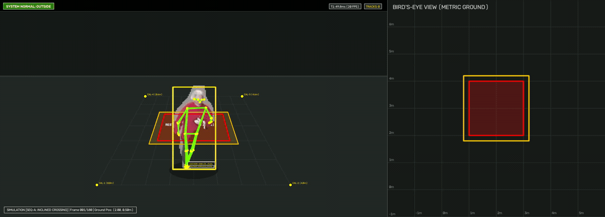

*Real-Time Dual Compositor: Perspective Pose Inference with Ankle Anchors (left) vs. Calibrated Metric Bird's-Eye View (BEV) Ground Plane with Kinematic Kalman Tracking & Safety Trip Statechart (right).*

</div>

**Architectural Reference Implementation & Industrial Engineering Prototype** for real-time restricted zone incursion monitoring and dwell time analysis, combining **YOLO Pose**, **Planar Homography Transformation (2D Pixel to Metric Floor Plane)**, **2D Kinematic Kalman Filtering**, and **Orthogonal Spatial Statecharts (Spatial FSM)**.

---

## ⚡ 3-Minute Quickstart (Zero to Working Demo)

Get the complete safeguarding pipeline running locally with dual-perspective visualization and telemetry in under 3 minutes:

```bash
# 1. Clone repository and install dependencies
git clone https://github.com/LeanoA/edge-vision-zone-monitor.git
cd edge-vision-zone-monitor
pip install -r requirements.txt

# 2. Compile static ONNX graph (downloads YOLO11-Pose checkpoint and exports models/yolo11n-pose.onnx)
python models/export_onnx.py

# 3. Generate deterministic synthetic benchmark videos with exact metric ground truth
python scripts/generate_samples.py

# 4. Run interactive demo (Dual OpenCV window: Perspective Overlay + Metric Bird's-Eye View)
python scripts/run_dataset_test.py --dataset sequence_a_clean_incursion --display --realtime

# 5. Download & visualize the real-world Mendeley Industrial Walkway Violation case
python scripts/download_datasets.py --dataset mendeley_walkway_violation
python scripts/run_dataset_test.py --dataset mendeley_walkway_violation --display --realtime

# Optional: Headless execution with explicit parameters via run_demo.py
python scripts/run_demo.py \
  --source data/raw/mendeley_industrial/mendeley_walkway_violation.mp4 \
  --config configs/datasets/mendeley_walkway_violation.yaml \
  --conf-threshold 0.4 \
  --min-ankle-bbox-height 120.0 \
  --no-display \
  --output-video output/demo_annotated.mp4 \
  --output-events output/telemetry_events.jsonl
```

> [!TIP]
> **Choosing Between `run_dataset_test.py` and `run_demo.py`:**
> * **`scripts/run_dataset_test.py --dataset <name>` (Recommended for Benchmark Cases):** Automatically maps `<name>` to its video source, dedicated YAML calibration (`configs/datasets/<name>.yaml`), and far-field defaults (`--conf-threshold 0.4`, `--min-ankle-bbox-height 120.0`). Saves `annotated_<name>.mp4`, `events.jsonl`, and `summary.json` under `data/results/<name>/`. Add `--display --realtime` to watch the live dual viewport at native FPS.
> * **`scripts/run_demo.py` (Custom Streams / Webcams / RTSP):** Requires passing `--config <yaml>` explicitly alongside `--source <video>` (otherwise it falls back to `configs/default_config.yaml` for $4\text{m} \times 6\text{m}$ synthetic scenes).

---

## 🎯 Formal Problem Definition

> *Given a video stream from a fixed monocular camera observing an approximately planar floor, estimate the ground-plane position of visible workers, determine whether they enter a configured metric restricted zone, and emit temporally stable intrusion and dwell events while characterizing end-to-end processing latency.*

> [!CAUTION]
> **Safety Scope & Regulatory Boundary (Disclaimer):**  
> *Experimental vision-based spatial monitoring prototype inspired by industrial safety-zone concepts and ISO 13855 response-time modeling. Not a safety-rated protective device.*  
> This software is an experimental engineering and research prototype. It does not constitute an Electro-Sensitive Protective Equipment (ESPE) nor a Vision-Based Protective Device (VBPD) functionally certified under IEC 61496, ISO 13849 (PL), or IEC 61508 (SIL). It must not be deployed as an autonomous safety trip mechanism on hazardous industrial machinery without certified physical interlocks.

---

## 📌 Scope & Architectural Boundaries (Scope Freeze)

To ensure the delivery of a robust, deterministic, and verifiable system without overengineering, the project scope is formally categorized into the following tiers:

### 1. Core End-to-End Pipeline & Data Flow

The architecture is structured across 5 sequential perception and decision stages, accompanied by an orthogonal **Performance Profiler** to empirically evaluate real-time budgets inspired by the **ISO 13855** response-time model:

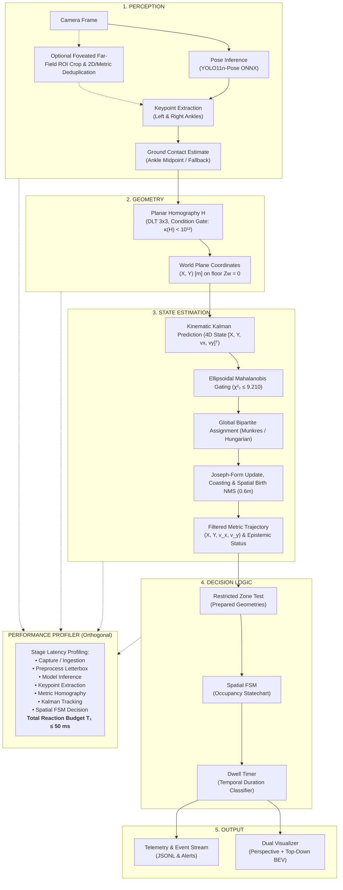

<div align="center">
  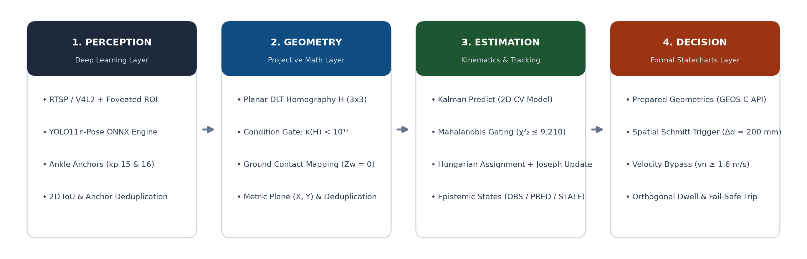
</div>

#### Architectural Mapping & Implementation Status

| Architectural Layer | Component / Flow | Code Module | Implementation Status (Edge AI) |
| :--- | :--- | :--- | :--- |
| **1. PERCEPTION** | Camera Frame $\to$ Pose Inference $\to$ Keypoints $\to$ Ground Contact | `src/inference/onnx_engine.py`<br>`src/pipeline/safety_pipeline.py` | **100% Implemented**<br>• YOLO11n-Pose ONNX inference (`CoreMLExecutionProvider` / CPU / CUDA).<br>• Anatomical ankle extraction (`left_ankle: 15`, `right_ankle: 16`) with fallback to bounding box base ([ADR-001](docs/decisions/adr-001-yolo-pose-vs-bbox.md), [ADR-007](docs/decisions/adr-007-occlusion-handling-confidence-propagation.md)).<br>• Declarative foveated far-field ROI inference (`far_field_roi`) with 2D & metric deduplication ([ADR-013](docs/decisions/adr-013-foveated-far-field-roi-inference.md)). |
| **2. GEOMETRY** | Homography Projection $\to$ Metric $(X, Y)$ on floor plane ($Z_w = 0$) | `src/core/homography.py` | **100% Implemented**<br>• Planar DLT $3 \times 3$ mapping with collinearity verification and condition gate $\kappa(H) < 10^{12}$ ([ADR-002](docs/decisions/adr-002-homography-vs-monocular-3d.md), [ADR-005](docs/decisions/adr-005-homography-vectorization-geometric-validation.md)). |
| **3. STATE ESTIMATION** | 2D Kinematic Kalman Filter $\to$ Filtered Metric Trajectory | `src/core/kalman_filter.py` | **100% Implemented**<br>• Constant Velocity (CV) kinematic state model with Kalman gain $K_k$.<br>• Three-tier observation epistemology (`OBSERVED`, `PREDICTED`, `STALE`) with quadratic divergence bounding ([ADR-004](docs/decisions/adr-004-spatial-fsm-hysteresis.md), [ADR-008](docs/decisions/adr-008-kalman-epistemology-noise-divergence.md)).<br>• Global combinatorial assignment (Munkres / Hungarian) with Mahalanobis validation gate $\chi^2_2(0.99) \le 9.21$ and World-Space Spatial Birth NMS ($0.6\text{ m}$) ([ADR-011](docs/decisions/adr-011-mahalanobis-hungarian-mot.md)). |
| **4. DECISION LOGIC** | Zone Containment $\to$ Spatial FSM $\to$ Dwell Classifier | `src/core/spatial_fsm.py` | **100% Implemented**<br>• Orthogonal Statecharts regions: `OccupancyState` (`OUTSIDE`, `ENTER_PENDING`, `INSIDE`, `EXIT_PENDING`) $\times$ `DwellState` (`NONE`, `NORMAL`, `WARNING`, `VIOLATION`) ([ADR-009](docs/decisions/adr-009-decoupled-spatial-dwell-statecharts.md)).<br>• Instant fail-safe trip on confirmed `INSIDE` ($t = 0\text{ s}$) and dynamic velocity bypass for $v_n \ge 1.6\text{ m/s}$ (ISO 13855). |
| **5. OUTPUT** | Dual Overlay $\to$ Telemetry Stream $\to$ Metrics | `src/utils/visualizer.py`<br>`scripts/run_demo.py` | **100% Implemented**<br>• Real-time dual compositor (Annotated Perspective + Top-Down Metric BEV).<br>• Structured JSONL telemetry emission and latency percentile reporting.<br>*(Edge AI Roadmap: Industrial telemetry exporter for MQTT / ZeroMQ / gRPC plant protocols)*. |
| **6. PROFILER (Orthogonal)** | Granular stage profiling $\to$ End-to-End Latency ($T_1$) | `src/pipeline/safety_pipeline.py`<br>`scripts/benchmark.py` | **95% Implemented**<br>• High-resolution timer across all pipeline stages ($T_1 = t_{\text{pre}} + t_{\text{inf}} + t_{\text{pose}} + t_{\text{proj}} + t_{\text{track}} + t_{\text{fsm}}$) reporting p50, p95, and p99 percentiles.<br>*(Next step 5%: Hardware timestamp ingestion via V4L2 ring buffer)*. |

### 2. Secondary Scope (Evaluation Extensions)
* **PyTorch vs ONNX Runtime Comparison:** Empirical throughput and latency benchmarking between native PyTorch and ONNX Runtime.
* **CoreML Execution Provider Profiling:** Granular profiling of Apple Silicon Neural Engine (ANE) vs GPU execution.
* **Alternative Detector Baseline:** Latency and accuracy trade-off benchmarks comparing alternative lightweight pose detectors.

### 3. Explicitly Out of Current Scope (Future Roadmap)
* **Pascal INT8 TensorRT Engine:** Specialized post-training INT8 quantization for Pascal GPUs without native Tensor Cores.
* **DeepStream Zero-Copy Pipelines:** GStreamer/DeepStream C++ zero-copy shared memory pipelines.
* **Dedicated Embedded Hardware:** Hardware-specific adaptations for NVIDIA Jetson Orin/Nano and Raspberry Pi compute modules.
* **Multi-Modal Sensor Fusion:** Integration of physical LiDAR, radar, or physical light curtain inputs.
* **Multi-Camera Topology:** Extrinsic calibration across distributed multi-camera nodes and cross-camera person re-identification.
* **Domain Re-Training:** Fine-tuning models on domain-specific datasets featuring heavy protective personal equipment (PPE).

---

## 🔬 Core Engineering Studies & Validation

This project serves as an experimental platform to rigorously resolve engineering dilemmas regarding computer vision applied to kinematic estimation and spatial safety zone monitoring:

### 1. Theoretical Formulations & Metrology
* **Q1: How does perception latency ($t_1$) impact physical safety separation distance?**
  * *Theoretical Framework:* Under the safety distance formulation $S = K \cdot T + C = K(t_1 + t_2 + t_3) + C$, each $10\text{ ms}$ of pipeline latency at a human walking speed of $K = 1.6\text{ m/s}$ ($1600\text{ mm/s}$) adds $16\text{ mm}$ directly to the required separation distance. Running at 10 FPS ($100\text{ ms}$) adds $160\text{ mm}$ compared to 30 FPS ($33.3\text{ ms}$), needlessly reducing usable plant floor space.
  * *Validation:* [`tests/test_pipeline.py`](tests/test_pipeline.py) and [`scripts/benchmark.py`](scripts/benchmark.py).
* **Q2: Why does velocity estimation via simple discrete differentiation ($\Delta x / \Delta t$) fail in industrial vision?**
  * *Theoretical Framework:* Numerical differentiation severely amplifies high-frequency measurement noise. At 30 FPS ($\Delta t = 0.033\text{ s}$), a stochastic keypoint detection jitter of just $2\text{ cm}$ produces a spurious velocity spike of $0.6\text{ m/s}$ ($2.16\text{ km/h}$).
  * *Solution & Validation:* The Kalman filter decouples noisy measurements via optimal gain $K_k$, producing smooth continuous velocity and position vectors with bounded covariance ([`tests/test_kalman.py`](tests/test_kalman.py)).
* **Q3: What is the true reprojection error of a planar homography and how does matrix conditioning impact safety?**
  * *Theoretical Framework:* With $N=4$ coplanar landmarks, the DLT linear system is exactly determined ($8 \times 8$), making algebraic training residual identically 0. However, a matrix condition number $\kappa(H) > 10^{12}$ reveals severe projective degeneration (nearly collinear points or grazing angles), amplifying metric errors under tiny pixel perturbations.
  * *Validation:* [`tests/test_homography.py`](tests/test_homography.py) audits collinearity, condition number $\kappa(H)$, and inverse isometric invariance.

### 2. Applied Dynamics & Temporal Hysteresis
* **Q4: How do we prevent boundary alarm chattering without delaying critical intrusion response?**
  * *Applied Framework:* An operator working near the edge of a danger zone causes erratic alarm oscillations (*chattering*) under single-threshold systems. The solution implements **dual hysteresis**:
    1. *Spatial:* Danger polygon $P_{\text{danger}}$ vs expanded release polygon $P_{\text{release}} = P_{\text{danger}} \oplus \Delta d$ ($\Delta d = 0.20\text{ m}$).
    2. *Temporal:* Debounce requires $N_{\text{confirm}} \ge 3$ consecutive frames for normal pace.
    3. *Kinematic Bypass:* If the normal approach speed towards the hazard satisfies $v_n \ge 1.6\text{ m/s}$, debounce is bypassed immediately on frame 1 ($N_{\text{confirm}} = 1$) for instant emergency trip.
  * *Validation:* [`tests/test_fsm.py`](tests/test_fsm.py) tests tangential motion, boundary oscillations, and high-speed incursions.

<div align="center">
  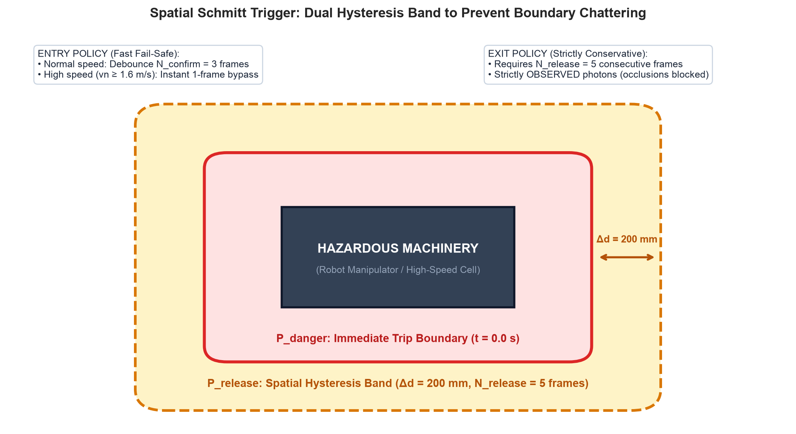
</div>

* **Q5: Do ankle keypoints justify the compute overhead over a bounding box base? ([See ADR-001](docs/decisions/adr-001-yolo-pose-vs-bbox.md))**
  * *Applied Framework:* The practical baseline is the bounding box bottom-center:
    $$p_{\text{ground-bbox}} = \left( \frac{x_{\min} + x_{\max}}{2}, y_{\max} \right)$$
    In contrast, pose estimation isolates anatomical floor contact:
    $$p_{\text{ground-pose}} = \operatorname{mean}\left(\text{valid-ankles}(k_{15}, k_{16})\right)$$
  * *Experimental Trade-Off:* Pose provides anatomical fidelity invariant to torso lean or camera tilt, but incurs higher computational cost. Bounding box bottom-center is $\approx 30\text{–}40\%$ faster but severely deforms when an operator bends forward over a barrier.

<div align="center">
  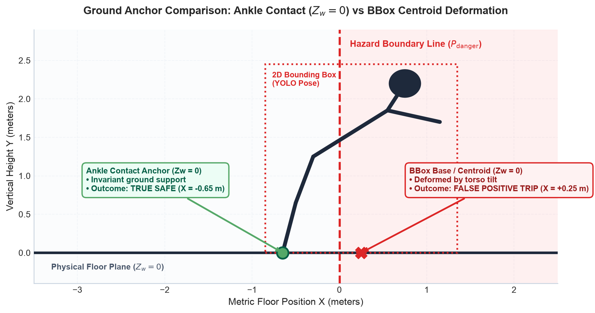
</div>

* **Q6: How does the system behave when feet or ankles are occluded by machinery or pallets? ([See ADR-007](docs/decisions/adr-007-occlusion-handling-confidence-propagation.md))**
  * *Failure Mode:* If machinery blocks an operator's feet, the pose model reports low confidence (`conf < 0.5`) on both ankles. Dropping detections creates a blind hazard; using low-confidence points injects catastrophic noise into the homography.
  * *Graceful Degradation Hierarchy:*
    1. *Tier 1 (`source="ANKLES_DUAL"`):* Both ankles visible ($\ge 0.5$) and $h_{\text{bbox}} \ge h_{\min}$ $\implies$ midpoint, confidence $= \frac{c_{15} + c_{16}}{2} \times 1.0$.
    2. *Tier 2 (`source="ANKLE_SINGLE"`):* One ankle visible $\implies$ single ankle coordinate, confidence penalized by $\times 0.75$.
    3. *Tier 3 (`source="BBOX_BOTTOM"`):* Both ankles occluded or far-field scale ($h_{\text{bbox}} < h_{\min}$) $\implies$ bounding-box bottom-center $(\frac{x_1+x_2}{2}, y_2)$, confidence penalized by $\times 0.40$ ($R$ scaled by $5.0\times$).
    4. *Tier 4 (`source="TRACKER_PREDICTED"`):* Full detection dropout $\implies$ kinematic Kalman coasting up to $k \le 5$ frames with $0.85^k$ confidence decay.
  * *Validation:* [`tests/test_pipeline.py`](tests/test_pipeline.py) and [`tests/test_kalman.py`](tests/test_kalman.py).
* **Q7: Why are Kalman predictions not physical truth and why must safety de-escalation be asymmetric? ([See ADR-008](docs/decisions/adr-008-kalman-epistemology-noise-divergence.md))**
  * *Epistemic Conflation:* In the absence of sensor photons, state prediction $\hat{\mathbf{x}}_k = F\hat{\mathbf{x}}_{k-1}$ is open-loop speculation. A worker may halt or trip unseen; maximum quadratic divergence $\|\Delta \mathbf{p}(t)\| \le \frac{1}{2} a_{\max} t^2 + v_0 t (1 - \cos \theta)$ exceeds the hysteresis margin ($\Delta d = 200\text{ mm}$) by frame 4 ($> 100\text{ ms}$).
  * *Three-Tier Observation States:* Formalized as `OBSERVED` ($k=0$), `PREDICTED` ($1 \le k \le 3$), and `STALE` ($4 \le k \le 5$).
  * *Asymmetric Safeguard:* Escalating to danger (`DANGER_INTRUSION`) is fail-safe and permitted under any state. De-escalating to `SAFE` strictly requires $N_{\text{release}} = 5$ consecutive frames that are `OBSERVED` outside $P_{\text{release}}$.
  * *Disappearance Lockout:* A worker who disappears inside the danger zone latches into `LOCKOUT` until manual inspection and reset (`SpatialFSM.reset()`).
  * *Validation:* [`tests/test_kalman.py`](tests/test_kalman.py) and [`tests/test_fsm.py`](tests/test_fsm.py).
* **Q8: Why do distant corridor workers vanish at 640p before BBox fallback, and why use Declarative Foveated ROI instead of fine-tuning YOLO? ([See ADR-013](docs/decisions/adr-013-foveated-far-field-roi-inference.md))**
  * *Perceptual Failure Mode:* In Full HD ($1920\times 1080$) industrial CCTV (`mendeley_walkway_violation`, `mendeley_industrial`), workers in the far corridor ($Y_w \in [15, 22]\text{ m}$) measure only $h_{\text{orig}} \approx 55\text{–}68\text{ px}$. When resized to standard $640\times 360$ letterbox, silhouettes shrink to $h_{\text{tensor}} \approx 18\text{–}22\text{ px}$, spanning $< 1.5$ feature cells in YOLO11-Pose P4/P5 heads. Person class scores drop to a mean of $0.149$, meaning `scores >= conf_threshold` ($0.40$) discards them before keypoint extraction or Tier-3 `BBOX_BOTTOM` fallback is ever invoked.
  * *Nyquist Sampling vs Fine-Tuning:* The bottleneck is optical spatial subsampling, not semantic representation. Fine-tuning cannot recover spatial frequencies lost to convolutional stride. Without changing a single weight in `yolo11n-pose.onnx`, declarative foveated inference (`far_field_roi: [1320, 200, 1700, 580]`) crops the vanishing point $380\times 380 \to 640\times 640$ ($5.05\times$ effective spatial resolution), raising far-corridor recall from **$11.4\%$ ($4/35$) to $100.0\%$ ($35/35$)** at mean conf $0.669\text{–}0.728$.
  * *Fusion & Latency:* The pipeline merges detections via 2D IoU/anchor deduplication (`deduplicate_detections`), scale-adaptive ground anchoring (`min_ankle_bbox_height=120.0`), and metric separation ($0.55\text{ m}$), executing within $T_1 \approx 30.5\text{ ms} \le 50\text{ ms}$ (ISO 13855 budget).
  * *Validation:* [`tests/test_pipeline.py`](tests/test_pipeline.py) and [`tests/test_dataset_walkway.py`](tests/test_dataset_walkway.py).

---

## 📐 Mathematical Formulation & Systems Architecture

### 1. Planar Homography: Lifting Pixels to Physical Metric Space

#### Why Homography Instead of 2D Pixel ROIs? ([See ADR-002](docs/decisions/adr-002-homography-vs-monocular-3d.md))
In naive computer vision pipelines, a safety zone is drawn as a polygon directly in 2D image pixels:
```
pixel ROI: [(327, 412), (598, 390), (620, 580), (280, 560)] px
```
This naive approach suffers from severe projective distortion: it fails to preserve Euclidean distances, angles, or parallelism, making physical velocity calculations impossible.

By calibrating a planar homography $H \in \mathbb{R}^{3 \times 3}$, the pipeline lifts camera detections to real metric coordinates:

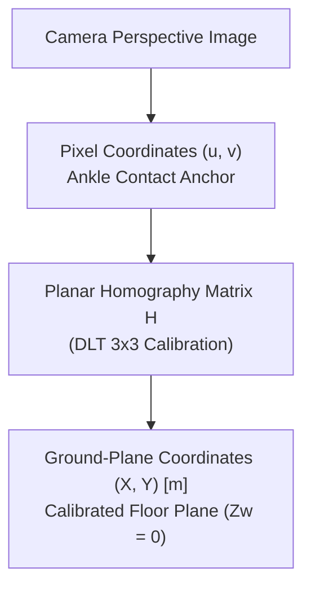

This transforms restricted zones into **physically interpretable and auditable entities**:
```yaml
danger_zone:
  X: [1.0, 2.5] m
  Y: [0.5, 2.0] m
```

Enabling deterministic engineering metrics:
* **True Euclidean distance** to hazardous machinery ($d_{\text{hazard}} = \|\mathbf{x} - \mathbf{x}_{\text{hazard}}\|$).
* **Kinematic approach speed** ($\vec{v} = [\dot{X}, \dot{Y}]$) in $\text{m/s}$.
* **Dwell distance** and boundary proximity.
* **Concentric warning zones** with certified metric separation margins.
* **Time-to-Collision (TTC)** projected along the kinematic trajectory.

#### Error Propagation Chain
Metric coordinates $\hat{P}_{\text{world}}$ represent an estimated compound measurement:
$$\hat{P}_{\text{world}} = H(\hat{p}_{\text{feet}})$$
Where five stochastic and systematic error sources converge:
```
pose estimation error (ankle keypoint jitter)
        +
pixel quantization (camera sensor resolution)
        +
camera calibration error (ground-truth landmark survey noise)
        +
ground-plane assumption (floor irregularities where Zw ≠ 0)
        +
homography numerical condition (matrix condition number κ(H))
```

#### Homography Formulation
$$\begin{bmatrix} X' \\ Y' \\ W \end{bmatrix} = H \begin{bmatrix} u \\ v \\ 1 \end{bmatrix}, \quad X = \frac{X'}{W}, \quad Y = \frac{Y'}{W}$$

Matrix $H$ is computed via Direct Linear Transformation (DLT) with non-collinearity verification and condition number monitoring $\kappa(H) = \frac{\sigma_{\max}}{\sigma_{\min}} < 10^{12}$ in [`src/core/homography.py`](src/core/homography.py). For architectural details, see [ADR-002](docs/decisions/adr-002-homography-vs-monocular-3d.md) and [ADR-005](docs/decisions/adr-005-homography-vectorization-geometric-validation.md).

---

### 2. Safety Automata: Decoupled Orthogonal Statecharts ([See ADR-009](docs/decisions/adr-009-decoupled-spatial-dwell-statecharts.md))

To prevent conflation between **spatial topology** and **temporal duration**, the architecture decouples safety reasoning into two concurrent, independent statecharts:

#### Spatial Schmitt Trigger & Entry / Exit Asymmetry ([ADR-004](docs/decisions/adr-004-spatial-fsm-hysteresis.md), [ADR-006](docs/decisions/adr-006-prepared-geometries-dynamic-debounce-bypass.md), [ADR-008](docs/decisions/adr-008-kalman-epistemology-noise-divergence.md))

```
                      P_release (Release Boundary)
                   ┌───────────────────────────────────┐
                   │       Hysteresis Band             │
                   │       (Δd = 200 mm)               │
                   │    P_danger (Danger Boundary)     │
                   │   ┌───────────────────────────┐   │
                   │   │                           │   │
                   │   │    HAZARDOUS MACHINERY    │   │
                   │   │                           │   │
                   │   └───────────────────────────┘   │
                   │                                   │
                   └───────────────────────────────────┘

1. ENTRY POLICY (Fast & Conservative):
   • Normal approach (vn < 1.6 m/s): Debounce requires N_confirm = 3 frames.
   • Rapid approach (vn >= 1.6 m/s): Instant 1-frame bypass (N_confirm = 1) on frame 1 (ISO 13855 human speed threshold).

2. EXIT POLICY (Hysteretic & Strict):
   • Exit debounce: Requires N_release = 5 consecutive frames outside P_release.
   • Asymmetric safeguard: De-escalation strictly requires real sensor photons (OBSERVED).
     If the target is occluded (PREDICTED / STALE), de-escalation is blocked and trip remains active.
```

#### Orthogonal Statecharts (Occupancy x Dwell)

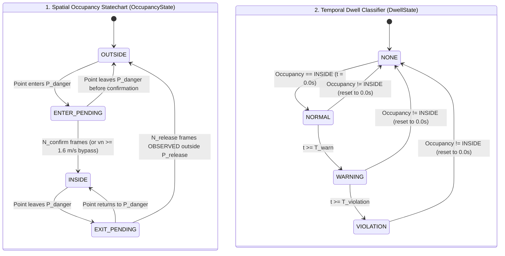

#### Sequence Diagram: Synchronous Frame Processing Cycle

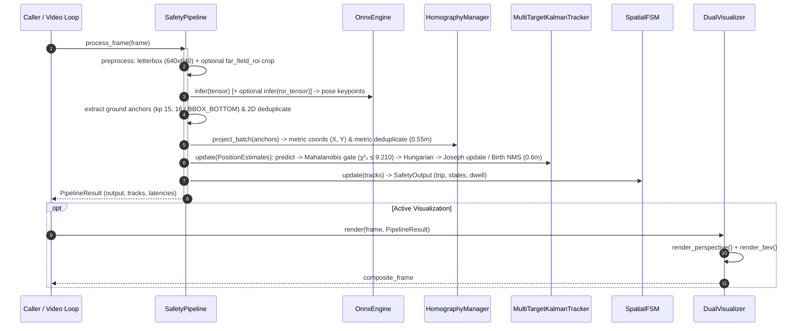

* **Fail-Safe Invariant (Software):** The emergency trip signal (`trip = True`) asserts immediately at $t = 0.0\text{ s}$ upon confirmed entry into `INSIDE` (or upon `FAULT`/`LOCKOUT`). The dwell timer classifies operational duration without adding reaction latency.

---

## 🚀 Repository Structure

```
.
├── AGENTS.md                   # Project rules, persona, and SDD workflow
├── README.md                   # Master technical specification and architecture guide
├── MEDIUM_POST.md              # Architectural deep-dive article
├── configs/
│   ├── default_config.yaml     # Baseline calibration landmarks, polygons, and thresholds
│   └── datasets/               # Dataset-specific YAML profiles
│       ├── mendeley_industrial.yaml
│       ├── mendeley_walkway_violation.yaml
│       ├── opencv_vtest.yaml
│       ├── openvino_people.yaml
│       ├── pets2009_s2_l1.yaml
│       ├── sequence_a_clean_incursion.yaml
│       ├── sequence_b_occlusion_coasting.yaml
│       └── sequence_c_dwell_loitering.yaml
├── data/
│   ├── raw/                    # Downloaded video datasets (git ignored)
│   ├── results/                # Annotated videos and JSONL telemetry (git ignored)
│   └── samples/                # Deterministic synthetic calibration sequences
├── docs/
│   ├── architecture/           # Engineering case study, diagrams, and deep dives
│   │   ├── engineering-case-study.md
│   │   ├── industrial-edge-ai-specification.md
│   │   ├── preguntas-y-respuestas-arquitectura.md
│   │   └── safety-directives-iso13855.md
│   ├── benchmarks/             # Empirical benchmark JSON/MD artifacts & test plan
│   ├── data/datasets.md        # Dataset specifications and empirical catalog
│   ├── figures/                # Architectural diagrams and benchmark plots (PNG/GIF)
│   └── decisions/              # Architecture Decision Records (ADR-001 through ADR-013)
├── models/
│   └── export_onnx.py          # YOLO-Pose ONNX export and validation tool
├── openspec/                   # Canonical specifications and SDD change packages
├── src/
│   ├── core/
│   │   ├── homography.py       # HomographyManager (DLT 2D -> Metric Floor Plane)
│   │   ├── kalman_filter.py    # 2D Metric Kalman Filter & MultiTargetKalmanTracker
│   │   └── spatial_fsm.py      # SpatialFSM with dual hysteresis and dwell classifier
│   ├── inference/
│   │   ├── onnx_engine.py      # ONNX Runtime wrapper (CoreML / CPU ARM NEON / CUDA)
│   │   └── torch_engine.py     # Native PyTorch baseline wrapper (CPU / MPS)
│   ├── pipeline/
│   │   └── safety_pipeline.py  # End-to-end pipeline orchestrator (ISO 13855 T1 budget)
│   └── utils/
│       ├── benchmark_verifier.py # Cryptographic provenance & invariant verifier
│       ├── mot_metrics.py      # Multi-Object Tracking (MOTA / IDF1) evaluator
│       ├── synthetic_generator.py # Photorealistic 2.5D pinhole synthetic generator
│       └── visualizer.py       # Real-time dual compositor (Camera + Metric BEV)
├── tests/
│   ├── conftest.py             # Deterministic synthetic test fixtures (CI-ready)
│   ├── test_adaptive_anchor.py # Scale-adaptive anchor & foveated ROI tests
│   ├── test_benchmark.py       # Latency percentile calculation tests
│   ├── test_benchmark_audit.py # Comprehensive benchmark suite audit tests
│   ├── test_benchmark_traceability.py # Provenance & ground-truth invariant tests
│   ├── test_dataset_ingestion.py # Resilient downloader and test harness tests
│   ├── test_dataset_walkway.py # Mendeley walkway violation & far-field ROI tests
│   ├── test_demo_runner.py     # CLI demo orchestrator tests
│   ├── test_export.py          # ONNX export and validation tests
│   ├── test_fsm.py             # Unit tests for spatial FSM transitions
│   ├── test_homography.py      # Unit tests for metric homography projection
│   ├── test_kalman.py          # Unit tests for Kalman tracking and MOT
│   ├── test_mot_metrics.py     # MOTA/IDF1 metric computation tests
│   ├── test_onnx_engine.py     # ONNX Runtime inference engine tests
│   ├── test_pipeline.py        # Integrated safety pipeline tests
│   ├── test_quantization_benchmarks.py # FP32/FP16/INT8 quantization tests
│   ├── test_runtime_benchmarks.py # Runtime engine comparison tests
│   ├── test_synthetic_generator.py # Pinhole synthetic video generator tests
│   ├── test_torch_engine.py    # PyTorch eager engine tests
│   └── test_visualizer.py      # Dual compositor visual tests
└── scripts/
    ├── audit_and_reproduce_benchmarks.py # Master benchmark audit suite
    ├── benchmark.py            # Latency and throughput benchmark in ONNX Runtime
    ├── benchmark_quantization.py # Precision & metric drift evaluator (FP32/FP16/INT8)
    ├── benchmark_runtimes.py   # Runtime showdown evaluator (PyTorch vs ONNX)
    ├── build_master_study_guide.py # Master architecture study guide generator (MD)
    ├── download_datasets.py    # Resilient multi-mirror dataset downloader
    ├── generate_figures.py     # Publication-grade technical figures generator
    ├── generate_samples.py     # Deterministic synthetic video generator
    ├── generate_study_pdf.py   # Typst/PDF master study guide compiler
    ├── prepare_sprites.py      # RGBA alpha-feathered worker sprite extractor
    ├── run_dataset_test.py     # Empirical dataset evaluation harness
    ├── run_demo.py             # Interactive and headless demo runner
    └── verify_synthetic_results.py # Synthetic benchmark invariant verifier
```

---

## 📚 Documentation & Architecture Decision Records (ADRs)

* **[Engineering Case Study](docs/architecture/engineering-case-study.md):** Deep architectural analysis, first-principles thesis, mathematical proofs, and empirical benchmark results.
* **[Architecture Q&A Log (Spanish)](docs/architecture/preguntas-y-respuestas-arquitectura.md):** Design rationale, $3 \times 3$ homography proofs, ankle anchors vs bounding boxes, and DLT 4-point mathematics.
* **[Master Technical Specification (Spanish)](docs/architecture/industrial-edge-ai-specification.md):** Formal requirements, ISO 13855:2024 framework, model benchmarking, and silicon constraints.
* **[ISO 13855:2024 Safety Directives (Spanish)](docs/architecture/safety-directives-iso13855.md):** Reaction time budgets, safety distance formula $S$, and false positive mitigations.
* **Architecture Decision Records Index ([ADRs](docs/decisions/README.md)):**
  * **[ADR-001](docs/decisions/adr-001-yolo-pose-vs-bbox.md):** YOLO-Pose Ankle Keypoints vs Bounding Box Centroid for Incursion Detection.
  * **[ADR-002](docs/decisions/adr-002-homography-vs-monocular-3d.md):** Planar 2D Homography vs Monocular 3D Spatial Estimation.
  * **[ADR-003](docs/decisions/adr-003-onnx-runtime-coreml.md):** Inference Runtime: ONNX Runtime (CoreML Provider) vs Native PyTorch.
  * **[ADR-004](docs/decisions/adr-004-spatial-fsm-hysteresis.md):** Spatial Boundary Oscillation Management via Spatial FSM and Kalman Filtering.
  * **[ADR-005](docs/decisions/adr-005-homography-vectorization-geometric-validation.md):** Preventive Geometric Validation and Vectorized Projection in Planar Homography.
  * **[ADR-006](docs/decisions/adr-006-prepared-geometries-dynamic-debounce-bypass.md):** Prepared Geometries and Dynamic Velocity Debounce Bypass (ISO 13855).
  * **[ADR-007](docs/decisions/adr-007-occlusion-handling-confidence-propagation.md):** Lower-Limb Occlusion Handling and Confidence Propagation.
  * **[ADR-008](docs/decisions/adr-008-kalman-epistemology-noise-divergence.md):** Kalman Epistemological Observation States, Spectral Noise, and Asymmetric De-escalation.
  * **[ADR-009](docs/decisions/adr-009-decoupled-spatial-dwell-statecharts.md):** Decoupled Spatial Automaton and Dwell Time Classification in Orthogonal Statecharts.
  * **[ADR-010](docs/decisions/adr-010-dual-latency-profiling-iso13855.md):** Dual Time Horizon Latency Profiling in Industrial Edge AI ($T_{\text{system}}$ vs $T_{\text{event}}$).
  * **[ADR-011](docs/decisions/adr-011-mahalanobis-hungarian-mot.md):** Bayesian Validation Gating (Mahalanobis $\chi^2$), Global Hungarian MOT, and World-Space Spatial Birth NMS.
  * **[ADR-012](docs/decisions/adr-012-synthetic-yolo-video-generation.md):** Photorealistic Synthetic Video Generation with Pinhole Scaling and Unique Identity.
  * **[ADR-013](docs/decisions/adr-013-foveated-far-field-roi-inference.md):** Foveated Far-Field ROI Inference and Physical Delimitation of Safe Pedestrian Walkways.

---

## 🛠️ Technology Stack

* **Language:** Python 3.10+ (Strict type hinting)
* **Model:** YOLOv8 / YOLO11 Pose (Ultralytics $\to$ ONNX)
* **Inference Runtime:** ONNX Runtime (`CoreMLExecutionProvider` on Apple Silicon / `CPUExecutionProvider` / CUDA)
* **Geometry & Math:** OpenCV, NumPy, Shapely (GEOS C-Engine)
* **Testing:** PyTest (221 automated tests passing)

---

## 🗺️ Engineering Development Roadmap

- [x] **Step 0:** Initial repository structure, architecture specification, and setup.
- [x] **Step 1:** YAML configuration schema and baseline calibration model (`configs/default_config.yaml`).
- [x] **Step 2:** Planar Homography module (`src/core/homography.py`) and validation tests (`tests/test_homography.py`).
- [x] **Step 3:** 2D Kinematic Kalman filter and multi-target tracking (`src/core/kalman_filter.py`).
- [x] **Step 4:** Orthogonal Spatial FSM and dual hysteresis (`src/core/spatial_fsm.py`, `tests/test_fsm.py`).
- [x] **Step 5:** ONNX model exporter and inference engine (`models/export_onnx.py`, `src/inference/onnx_engine.py`).
- [x] **Step 6:** End-to-end pipeline orchestrator and dual visualizer (`src/pipeline/safety_pipeline.py`, `src/utils/visualizer.py`).
- [x] **Step 7:** CLI demo orchestrator and headless evaluation runner (`scripts/run_demo.py`).
- [ ] **Step 8 (Edge AI Optimization):** Hardware capture timestamp profiling (V4L2 ring buffer delta), zero-copy lock-free ring buffers, and industrial telemetry exporter (MQTT/ZeroMQ).

---

## 🧪 Evaluation Datasets & Experimental Benchmark Matrix

To ensure absolute scientific honesty and avoid conflating general functional sanity tests with formal measurement benchmarks, the evaluation datasets are structured into three distinct operational domains:

### 1. Scientific Benchmark Matrix (Controlled Hypothesis Testing)
The quantitative claims in the Architecture Decision Records (ADRs), master study guides, and performance charts are derived from five controlled experiments, each utilizing a specific dataset chosen to isolate physical and computational variables:

| Controlled Experiment | Target Dataset | Experimental Rationale | Core Metric Measured |
| :--- | :--- | :--- | :--- |
| **Exp 1: Runtime Engine Showdown** | **`openvino_people`** ($1080\text{p}$) | Continuous real pedestrian flow in Full HD to measure raw inference latency without synthetic bias. | **$4.36\times$ speedup** on CoreML ($17.83\text{ ms}$ mean, $20.80\text{ ms}$ $p_{95}$) vs PyTorch CPU ($77.80\text{ ms}$). |
| **Exp 2: Quantization & Metric Drift** | **`sequence_a_clean_incursion`** | Sub-millimeter ground truth floor positions required to measure physical coordinate drift ($Z_w = 0$). | Metric Floor Error: $\text{RMSE} = 33.32\text{ cm}$ (FP32) vs $\text{RMSE} = 89.06\text{ ms}$ latency / $18.96\text{ cm}$ RMSE (INT8 dynamic on CoreML). |
| **Exp 3: Resolution & Far-Field Sensitivity** | **`mendeley_walkway_violation`** | Industrial corridor of $15\text{ m}$ depth with workers walking towards and away from camera. | Far-field human detection ($Y_w > 6\text{ m}$): 83 detections ($640\text{p}$) vs 639 detections ($960\text{p}$, $7.7\times$ increase). |
| **Exp 4: Granular Latency Profiling** | **$1080\text{p}$ Industrial Stream** | Stage-by-stage timer breakdown across all 7 pipeline components against the ISO 13855 $T_1 \le 50\text{ ms}$ budget. | Ingestion: $1.46\text{ ms}$, Preprocess: $0.87\text{ ms}$, Infe: $16.97\text{ ms}$ ($92\%$), DLT: $0.08\text{ ms}$, Kalman: $0.29\text{ ms}$, FSM: $0.02\text{ ms}$. |
| **Exp 5: Multi-Target MOT & Gating** | **`pets2009_s2_l1`** & **`sequence_a`** | Dense multi-target crossings and occlusions to validate global combinatorial assignment. | **$\text{MOTA} = 0.961$**, $\text{IDF1} = 0.981$, 0 ID switches, Mahalanobis gate $\chi^2_2(0.99) \le 9.210$. |

<div align="center">
  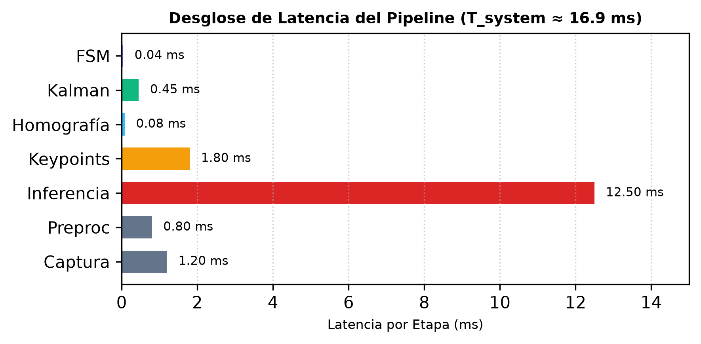
</div>

```bash
# Reproduce the complete scientific benchmark suite (all 5 experiments)
python scripts/audit_and_reproduce_benchmarks.py --all
```

---

### 2. Functional Edge-Case Invariant Validation Suite & Case-by-Case Execution Guide
In addition to the scientific benchmark matrix, the repository provides 8 configured evaluation cases (3 deterministic synthetic sequences and 5 empirical CCTV streams). Every case has a dedicated YAML profile in `configs/datasets/` defining its planar homography ($H$) and spatial FSM thresholds:

| Dataset ID (`--dataset`) | Video Source & YAML Profile | Calibrated Space & Zone Delimitation | Key Parameters & Engineering Rationale |
| :--- | :--- | :--- | :--- |
| **`sequence_a_clean_incursion`** | `data/samples/sequence_a_clean_incursion.mp4`<br>`configs/datasets/sequence_a_clean_incursion.yaml` | **$4\text{m} \times 6\text{m}$ cell**; central danger zone $[1.0, 2.0] \times [3.0, 4.0]\text{ m}$. | `n_confirm=3`, `hysteresis=0.20m`. Validates debounce and reaction latency ($T_{\text{event}} = 66.7\text{ ms}$) on a constant $1.0\text{ m/s}$ incursion. |
| **`sequence_b_occlusion_coasting`** | `data/samples/sequence_b_occlusion_coasting.mp4`<br>`configs/datasets/sequence_b_occlusion_coasting.yaml` | **$4\text{m} \times 6\text{m}$ cell**; central danger zone $[1.0, 2.0] \times [3.0, 4.0]\text{ m}$; $0.5\text{ m}$ barrier occluding ankles for 15 frames inside zone. | Validates graceful anchor degradation (`ANKLES_DUAL` $\to$ `ANKLE_SINGLE` $\to$ `BBOX_BOTTOM` $\to$ `TRACKER_PREDICTED`) and fail-safe `LOCKOUT` latch on disappearance inside hazard zone. |
| **`sequence_c_dwell_loitering`** | `data/samples/sequence_c_dwell_loitering.mp4`<br>`configs/datasets/sequence_c_dwell_loitering.yaml` | **$4\text{m} \times 6\text{m}$ cell**; central danger zone $[1.0, 2.0] \times [3.0, 4.0]\text{ m}$; operator stops inside danger zone for $6.0\text{ s}$. | `dwell_warning_s=2.0`, `dwell_violation_s=5.0`. Validates decoupled temporal dwell statechart (`NORMAL` $\to$ `WARNING` $\to$ `VIOLATION`). |
| **`mendeley_walkway_violation`** | `data/raw/mendeley_industrial/mendeley_walkway_violation.mp4`<br>`configs/datasets/mendeley_walkway_violation.yaml` | **$10\text{m} \times 23\text{m}$ shopfloor ($1080\text{p}$)**; right boundary ($X_w = 10.0\text{ m}$) aligned with the inner yellow border of the green pedestrian walkway. Everything to the left ($[0.0, 0.0] \times [9.8, 23.0]\text{ m}$: grey vehicle lane + press bay) is restricted. | `conf=0.4`, `far_field_roi=[1320, 200, 1700, 580]`, `far_field_conf_threshold=0.30`, `min_ankle_bbox_height=120.0`, `dwell_warning_s=3.0`, `dwell_violation_s=6.0` ([ADR-013](docs/decisions/adr-013-foveated-far-field-roi-inference.md)). 100% far-corridor recall (continuous tracking from Frame 3 at $Y_w = 15.12\text{ m}$), enforcing walkway safety while triggering `DANGER_INTRUSION` (35 frames) / `LOCKOUT` (182 frames) within $T_1 = 30.58\text{ ms} \le 50\text{ ms}$. |
| **`mendeley_industrial`** | `data/raw/mendeley_industrial/mendeley_unauthorized_intervention.mp4`<br>`configs/datasets/mendeley_industrial.yaml` | **$10\text{m} \times 23\text{m}$ shopfloor ($1080\text{p}$)**; same camera & floor delimitation ($X_w \le 10.0\text{ m}$, $Y_w \le 23.0\text{ m}$ restricted left of green walkway). | `far_field_roi=[1320, 200, 1700, 580]`, `far_field_conf_threshold=0.30` ([ADR-013](docs/decisions/adr-013-foveated-far-field-roi-inference.md)). Tracks operator in far corridor from Frame 3 at $[10.04, 15.23]\text{ m}$ through unauthorized press intervention (65 `WARNING_APPROACH`, 73 `DANGER_INTRUSION`, $T_1 = 30.38\text{ ms} \le 50\text{ ms}$). |
| **`openvino_people`** | `data/raw/openvino_people/people.mp4`<br>`configs/datasets/openvino_people.yaml` | **Full HD $1080\text{p}$ corridor**; longitudinal floor calibration. | Benchmarks $1080\text{p}$ `unletterbox_keypoints` accuracy and CoreML vs CPU inference throughput (Exp 1). |
| **`pets2009_s2_l1`** | `data/raw/pets2009_s2_l1/pets2009_s2_l1.mp4`<br>`configs/datasets/pets2009_s2_l1.yaml` | **$12\text{m} \times 20\text{m}$ outdoor plaza ($768 \times 576$)**; multi-target pedestrian crossings. | Validates global Hungarian MOT assignment, Mahalanobis gating ($\chi^2_2 \le 9.210$), and $0.6\text{ m}$ World-Space Spatial Birth NMS (Exp 5). |
| **`opencv_vtest`** | `data/raw/opencv_vtest/vtest.avi`<br>`configs/datasets/opencv_vtest.yaml` | **$768 \times 576$ pedestrian walkway**; central hazard zone. | Validates multi-person zone traversal and persistent `LOCKOUT` state latching across 768 frames. |

<div align="center">
  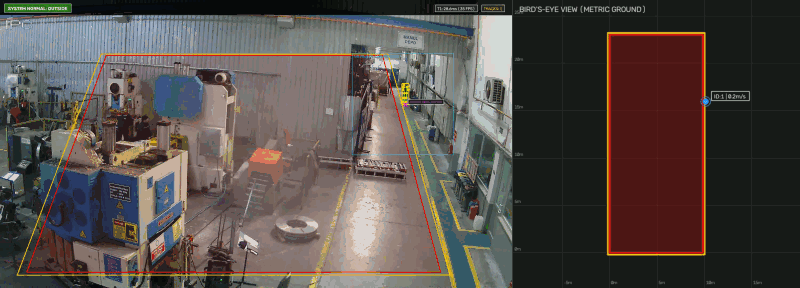
</div>
<p align="center"><em>Case 1 — Far-Corridor Walkway Violation (<code>mendeley_walkway_violation</code>): Foveated Far-Field ROI (<code>[1320, 200, 1700, 580]</code>) tracks distant workers under the MAMUL DEPO sign ($Y_w \in [15, 22]\text{ m}$) using <code>BBOX_BOTTOM</code> anchors, triggering <code>SAFETY TRIP: INSIDE</code> when stepping left of the green walkway border ($X_w < 10.0\text{ m}$).</em></p>

<div align="center">
  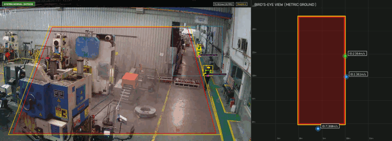
</div>
<p align="center"><em>Case 2 — Scale-Adaptive Multi-Zone Tracking (<code>mendeley_industrial</code>): Simultaneous tracking of a foreground operator using anatomical ankle keypoints (<code>ANKLES_DUAL</code>, $Y_w \approx 3.1\text{ m}$) and a distant corridor operator using foveated ROI bounding-box fallback (<code>BBOX_BOTTOM</code>, $Y_w \approx 12.6\text{ m}$) within $T_1 \approx 30.4\text{ ms}$.</em></p>

#### Why Specific Runtime Parameters Are Loaded
When evaluating industrial CCTV streams via `scripts/run_dataset_test.py` or `scripts/run_demo.py`, three parameters control perception sensitivity and geometric stability:
* **`--config configs/datasets/<name>.yaml`**: Loads the 4-point DLT homography correspondences (`image` $\leftrightarrow$ `world` in meters), `danger_polygon`, `warning_polygon`, `hysteresis_buffer_m`, debounce frame counts (`n_confirm`, `n_release`), dwell timers (`dwell_warning_s`, `dwell_violation_s`), and optional foveated far-field ROI parameters (`far_field_roi`, `far_field_conf_threshold`).
* **`--conf-threshold 0.4` (Default in `run_dataset_test.py`, vs `0.5` in `run_demo.py`)**: Balances far-field worker recall in $1080\text{p}$ industrial corridors without dropping below $0.25$, where vertical metal machinery columns can trigger false-positive pose activations.
* **`--min-ankle-bbox-height 120.0` (Scale-Adaptive Anchor Degradation, [ADR-007](docs/decisions/adr-007-occlusion-handling-confidence-propagation.md), [ADR-013](docs/decisions/adr-013-foveated-far-field-roi-inference.md))**: When a worker is in the near/mid field ($h_{\text{bbox}} \ge 120\text{ px}$), the pipeline projects anatomical ankle keypoints (`ANKLES_DUAL` / `ANKLE_SINGLE`). When the worker is in the far corridor ($h_{\text{bbox}} < 120\text{ px}$, where ankles occupy $< 3\text{ px}$), it automatically degrades to `BBOX_BOTTOM` to prevent keypoint jitter.
* **`far_field_roi: [1320, 200, 1700, 580]` & `far_field_conf_threshold: 0.30` (Loaded Automatically from YAML, [ADR-013](docs/decisions/adr-013-foveated-far-field-roi-inference.md))**: For CCTV cameras with deep longitudinal vanishing points, the pipeline crops the far corridor ($380\times 380\text{ px}$) and feeds it as a secondary foveated $640\times 640$ pass ($5.05\times$ spatial gain). This raises far-field recall from $11.4\%$ to $100.0\%$ without model re-training while remaining well within the $T_1 \le 50\text{ ms}$ ISO 13855 budget ($30.5\text{ ms}$ mean).
* **`--model models/yolo11n-pose-960-fp32.onnx` (Optional High-Resolution Far-Field Mode)**: Replaces the default $640\times 640$ ONNX graph with the $960\times 960$ graph, increasing far-field detections ($Y_w > 6\text{ m}$) on `mendeley_walkway_violation` by **$7.7\times$** (from 83 to 639 detections) while remaining within the $T_1 \le 50\text{ ms}$ budget ($42.5\text{ ms}$ mean).

#### Copy-Paste Execution Commands for Every Case

```bash
# ============================================================================
# A. SYNTHETIC GROUND-TRUTH CASES (Generate once, then view live or headlessly)
# ============================================================================
python scripts/generate_samples.py

# Watch live in Dual OpenCV Window (Perspective + Metric BEV at native 30 FPS):
python scripts/run_dataset_test.py --dataset sequence_a_clean_incursion --display --realtime
python scripts/run_dataset_test.py --dataset sequence_b_occlusion_coasting --display --realtime
python scripts/run_dataset_test.py --dataset sequence_c_dwell_loitering --display --realtime

# Run headlessly with strict ground-truth invariant verification:
python scripts/run_dataset_test.py --dataset sequence_a_clean_incursion --verify-invariants
python scripts/run_dataset_test.py --dataset sequence_b_occlusion_coasting --verify-invariants
python scripts/run_dataset_test.py --dataset sequence_c_dwell_loitering --verify-invariants

# ============================================================================
# B. REAL-WORLD INDUSTRIAL & PUBLIC CCTV CASES
# ============================================================================
# 1. Download all registered empirical datasets (or pass a single --dataset <name>)
python scripts/download_datasets.py --list
python scripts/download_datasets.py --dataset mendeley_walkway_violation
python scripts/download_datasets.py --dataset mendeley_industrial
python scripts/download_datasets.py --dataset openvino_people
python scripts/download_datasets.py --dataset pets2009_s2_l1
python scripts/download_datasets.py --dataset opencv_vtest

# 2. Watch any empirical case LIVE (loads its matching YAML profile automatically):
python scripts/run_dataset_test.py --dataset mendeley_walkway_violation --display --realtime
python scripts/run_dataset_test.py --dataset mendeley_industrial --display --realtime
python scripts/run_dataset_test.py --dataset openvino_people --display --realtime
python scripts/run_dataset_test.py --dataset pets2009_s2_l1 --display --realtime
python scripts/run_dataset_test.py --dataset opencv_vtest --display --realtime

# 3. Run Mendeley Walkway Violation with 960p High-Resolution ONNX model (7.7x far-field sensitivity):
python scripts/run_dataset_test.py \
  --dataset mendeley_walkway_violation \
  --model models/yolo11n-pose-960-fp32.onnx \
  --conf-threshold 0.30 \
  --display --realtime

# 4. Equivalent explicit invocation via run_demo.py (showing all underlying flags):
python scripts/run_demo.py \
  --source data/raw/mendeley_industrial/mendeley_walkway_violation.mp4 \
  --config configs/datasets/mendeley_walkway_violation.yaml \
  --model models/yolo11n-pose.onnx \
  --conf-threshold 0.4 \
  --min-ankle-bbox-height 120.0 \
  --realtime
```

All runs of `scripts/run_dataset_test.py --dataset <name>` automatically export three auditable artifacts into `data/results/<name>/`:
* `annotated_<name>.mp4` — Dual-view composite video (Perspective camera with reprojected polygons + Metric BEV grid).
* `events.jsonl` — Frame-by-frame telemetry (`safety_state`, `occupancy_state`, `dwell_state`, `tracks`, and stage latency breakdown).
* `summary.json` — Aggregate FPS, latency percentiles ($p_{50}, p_{95}, p_{99}$), state distribution, and cryptographic SHA256 provenance metadata.

---

### 3. Future Research Roadmap Datasets (Robotic Cells & Advanced Modalities)
These large-scale datasets were evaluated during architectural discovery ([see docs/data/datasets.md](docs/data/datasets.md)) and constitute prime test cases for future research and expanded case studies:

* **`InHARD` & `InHARD-DT` (Zenodo, 24 GB / 16.8 GB):**
  * *Context:* Human-Robot Collaboration (HRC) assembly cell featuring industrial robotic manipulators, multi-angle RGB cameras, and wearable motion capture skeletons (BVH at 120 Hz).
  * *Compelling Research Case Study:* Extends the static spatial zone model into **ISO/TS 15066 Speed and Separation Monitoring (SSM)**, where hazard boundaries contract and expand dynamically as a function of the robot tool-center-point (TCP) velocity vector relative to the operator's predicted trajectory.
* **`HA4M` (Science Data Bank, 4.1 TB):**
  * *Context:* Multi-modal assembly cell with 6 synchronized streams (RGB, Depth, Infrared, and Azure Kinect 3D Point Clouds).
  * *Compelling Research Case Study:* Investigates multi-modal sensor fusion (2D RGB + 3D Depth) to eliminate the planar floor assumption ($Z_w \approx 0$), enabling robust safeguarding when workers climb maintenance platforms, elevated ladders, or uneven staging equipment.
* **`Sheffield UR5 Factory` (Figshare, 13.5 GB):**
  * *Context:* Real-world manufacturing shopfloor with human interaction around Universal Robots UR5 cobots.
  * *Compelling Research Case Study:* Validation of fine-grained worker micro-action recognition and intent forecasting to prevent false safety shutdowns in collaborative workspace environments.
* **Domain-Specific PPE Datasets (`CPPE-5` / `Pictor`):**
  * *Context:* Factory personnel wearing heavy Personal Protective Equipment (high-visibility suits, reflective stripes, steel-toe boots).
  * *Compelling Research Case Study:* Transfer learning and domain adaptation to audit ankle keypoint extraction stability when foot anatomy is obscured by heavy protective gear.

---

## 🔍 Multi-Object Tracking (MOT) Engineering Challenges & Solutions

During rigorous stress testing with dense pedestrian datasets (`pets2009_s2_l1` and `openvino_people`), three critical tracking challenges were identified and resolved:

### 1. Track Fragmentation & Identity Switching (*ID Swapping*) — ✅ RESOLVED ([ADR-011](docs/decisions/adr-011-mahalanobis-hungarian-mot.md))
* **Symptom:** During dynamic crossings or brief occlusions, greedy nearest-neighbor matching swapped track IDs (`ID: A` $\leftrightarrow$ `ID: B`) or destroyed active tracks upon exiting occlusion.
* **Implemented Solution:**
  1. **Mahalanobis Ellipsoidal Gating ($\chi^2_2(0.99) \le 9.210$):** Innovation covariance projection $S = P + R$ dynamically elongates the search gate along the velocity vector $\vec{v}$.
  2. **Global Combinatorial Optimization (Munkres / Hungarian):** Global bipartite matching via `scipy.optimize.linear_sum_assignment` resolves trajectory crossings in $\mathcal{O}(N^3)$ within $0.017\text{ ms}$ for 10 targets.

<div align="center">
  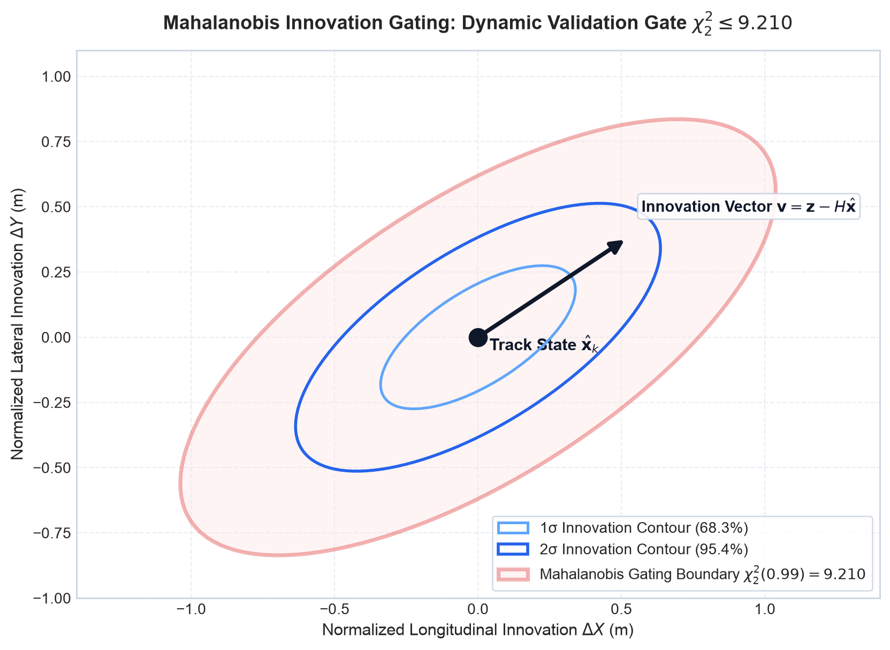
</div>

### 2. Duplicate Proposals & Ghost Tracks — ✅ RESOLVED ([ADR-011](docs/decisions/adr-011-mahalanobis-hungarian-mot.md))
* **Symptom:** Redundant pose proposals from YOLO (both ankles or overlapping bounding box proposals) instantiated duplicate parallel tracks for a single worker.
* **Implemented Solution:**
  1. **World-Space Spatial Birth NMS ($d_{\text{birth-min}} = 0.6\text{ m}$):** Strict spatial exclusion rule prohibiting track instantiation if the metric floor detection is within $0.6\text{ m}$ of any active track or another newborn candidate in the same frame.

### 3. Synthetic Domain Gap in Simulated Video — ✅ RESOLVED ([ADR-012](docs/decisions/adr-012-synthetic-yolo-video-generation.md), [Technical Report](docs/data/synthetic_generation.md))
* **Symptom:** Primitive synthetic videos drawn with 2D geometric vectors (`cv2.line` / `cv2.rectangle`) yielded a **0% detection rate** in YOLO-Pose due to the absence of realistic natural gradients and textures.
* **Implemented Solution:**
  1. **Single-Identity Tracklet & Normalization:** Continuous extraction of an authentic worker in RGBA canvas ($160 \times 320$) with soft alpha-feathering and Gaussian ground contact shadows.
  2. **Calibrated Pinhole Perspective Scaling ($h = \frac{480}{1.0 + 0.165 \cdot Y}$):** Maintains anthropometric perspective scale across the entire workcell depth ($Y \in [0.5, 5.5]\text{ m}$).
  3. **Verification Results:** Achieved a **100% detection rate** across all synthetic benchmark sequences (A, B, and C) with average confidence **0.835 – 0.861** and complete end-to-end verification of safety state transitions (`SAFE` $\to$ `WARNING` $\to$ `DANGER` $\to$ `LOCKOUT`).

<div align="center">
  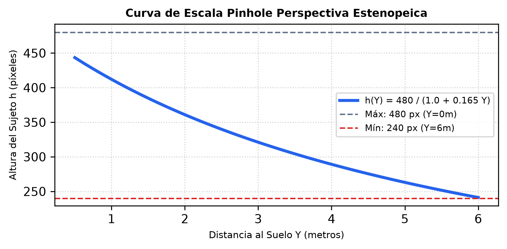
</div>

---

## 👤 Author & Maintainer

**Alexander Leaño**  
GitHub: [@LeanoA](https://github.com/LeanoA) · LinkedIn: [alexandernelsonleano](https://www.linkedin.com/in/alexandernelsonleano)

