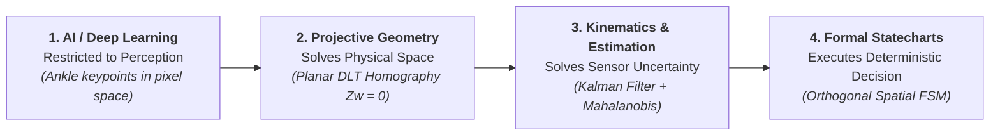
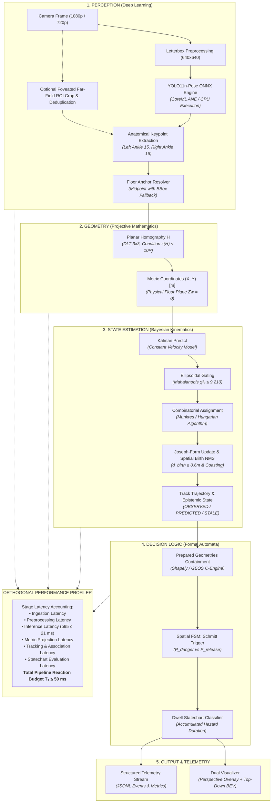
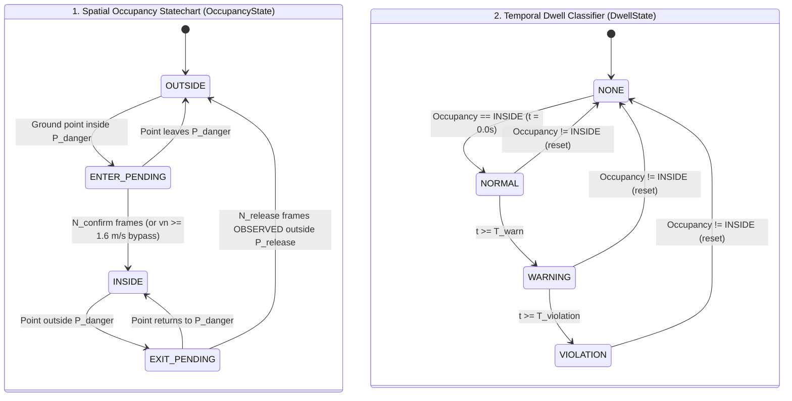

# Industrial Edge AI Case Study: From First Principles to Real-Time Spatial Safeguarding

> **Architecture Case Study & Engineering Rationale**  
> *Systems Design, Geometric Foundations, Stochastic Filtering, and Formal Statecharts.*  
> *Target Frameworks: Apple Silicon CoreML & Linux Edge via ONNX Runtime.*

---

> [!CAUTION]
> **Safety Scope & Regulatory Boundary (Disclaimer):**  
> *Experimental vision-based spatial monitoring prototype inspired by industrial safety-zone concepts and ISO 13855 response-time modeling. Not a certified protective device.*  
> This case study reflects applied engineering research. The software is not an Electro-Sensitive Protective Equipment (ESPE) nor a Vision-Based Protective Device (VBPD) certified under IEC 61496, ISO 13849 (PL), or IEC 61508 (SIL). It must not be deployed as an autonomous safety trip mechanism on hazardous machinery without certified physical interlocks.

---

## 1. The Core Engineering Thesis

> **"Not every challenge in an AI system should be solved with more Artificial Intelligence."**

In contemporary Edge AI development, there is an omnipresent temptation to treat deep neural networks as universal black-box predictors: attempting to train end-to-end models that directly predict whether an operator "is committing a safety violation" or "has dwelled too long in a hazard zone."

Such architectures inevitably succumb to catastrophic failure modes in industrial plants: unquantifiable edge-case hallucinations, high jitter, non-deterministic latency spikes, and an inability to provide physical guarantees required by machine safety engineering.

This system demonstrates a **First-Principles Architecture (Concepts > Code)** that strictly bounds probabilistic computing and delegates deterministic problems to classical mathematical foundations:

1. **AI is strictly confined to Pure Perception:** Locate anatomical ankle keypoints (`kp_15`, `kp_16`) in camera pixel space.
2. **Projective Geometry solves the Physical Space:** A planar homography transformation matrix $H \in \mathbb{R}^{3 \times 3}$ projects ground contact points to real-world metric coordinates on the factory floor ($Z_w = 0$).
3. **Kinematics & Bayesian Filtering solve Stochastic Uncertainty:** A discrete 2D Constant Velocity (CV) Kalman filter absorbs sensor jitter ($\pm 15\text{ mm}$), tracks velocity vectors, and handles occlusions via explicit epistemological observation states (`OBSERVED`, `PREDICTED`, `STALE`).
4. **Formal Logic executes Safety Decisions:** Orthogonal concurrent Statecharts evaluate spatial containment and dwell time in sub-millisecond execution ($< 0.05\text{ ms}$), providing predictable fail-safe behavior.

---

## 2. End-to-End Pipeline Architecture

The processing loop runs synchronously to eliminate queue-induced latency jitter and guarantee strict temporal causality:

---

## 3. Deep-Dive: Architectural Dilemmas & Solutions

### A. The Contact Anchor: Ankle Keypoints vs Bounding Box Centroid ([ADR-001](file:///Users/xander/Projects/edge-safety-guard/docs/decisions/adr-001-yolo-pose-vs-bbox.md))

* **The Problem:** In oblique or elevated industrial camera mountings, an operator reaching into a hazard zone while keeping their feet outside will project a bounding box centroid deep inside the restricted zone. Conversely, an operator standing near the edge leaning away will appear outside. Centroids and bounding box centers do not represent physical support on the floor plane.
* **The Solution:** The true physical anchor is the floor contact point ($Z_w = 0$). By extracting ankle keypoints (`left_ankle: 15`, `right_ankle: 16`), the contact point is resolved:
  $$p_{\text{ground}} = \frac{p_{\text{ankle-left}} + p_{\text{ankle-right}}}{2}$$
* **Graceful Degradation:** If one ankle is occluded ($\text{conf} < 0.5$), the system falls back to the visible ankle. If both ankles are occluded by low machinery or pallets, it triggers confidence-penalized bounding box bottom-center fallback followed by Kalman open-loop coasting ([ADR-007](file:///Users/xander/Projects/edge-safety-guard/docs/decisions/adr-007-occlusion-handling-confidence-propagation.md)).

---

### B. Projective Distortion: Why Pixel ROIs Fail ([ADR-002](file:///Users/xander/Projects/edge-safety-guard/docs/decisions/adr-002-homography-vs-monocular-3d.md), [ADR-005](file:///Users/xander/Projects/edge-safety-guard/docs/decisions/adr-005-homography-vectorization-geometric-validation.md))

* **The Problem:** Defining zones as 2D pixel polygons produces severe non-linear distortion. In perspective cameras, a 10-pixel displacement near the bottom of the frame may span $0.15\text{ m}$, whereas the same 10 pixels near the top horizon spans $3.0\text{ m}$. Linear interpolation in pixel space renders speed and distance metrics physically meaningless.
* **The Solution:** Planar Homography ($H \in \mathbb{R}^{3 \times 3}$) calibrated via 4 coplanar floor landmarks through Direct Linear Transformation (DLT).
* **Numerical Safety Gate:** Calibration matrices are validated preventively:
  1. Non-collinearity audit of control points.
  2. Matrix condition number constraint: $\kappa(H) = \frac{\sigma_{\max}}{\sigma_{\min}} < 10^{12}$. If grazing camera angles or degeneracies cause $\kappa(H) \ge 10^{12}$, the calibration is rejected preventively to avoid noise amplification.

---

### C. Sensor Jitter vs Numerical Differentiation ([ADR-004](file:///Users/xander/Projects/edge-safety-guard/docs/decisions/adr-004-spatial-fsm-hysteresis.md), [ADR-008](file:///Users/xander/Projects/edge-safety-guard/docs/decisions/adr-008-kalman-epistemology-noise-divergence.md))

* **The Problem:** Estimating velocity via discrete differentiation ($\vec{v} = \frac{\Delta \mathbf{x}}{\Delta t}$) catastrophically magnifies high-frequency noise. At 30 FPS ($\Delta t \approx 33.3\text{ ms}$), a natural detection wobble of just $2\text{ cm}$ produces a spurious velocity spike of:
  $$v_{\text{spurious}} = \frac{0.02\text{ m}}{0.033\text{ s}} = 0.60\text{ m/s} \quad (2.16\text{ km/h})$$
  In a safety system checking approach speed against the ISO 13855 speed threshold ($K = 1.6\text{ m/s}$), noise alone frequently triggers false emergency bypasses.
* **The Solution:** A 2D Constant Velocity Kalman Filter decoupling observation noise ($R$) from motion dynamics ($Q$), producing smooth velocity vectors $\vec{v} = [\dot{X}, \dot{Y}]$ with bounded covariance.

---

### D. The Epistemic Boundary: Why Kalman Predictions Are Not Physical Truth ([ADR-008](file:///Users/xander/Projects/edge-safety-guard/docs/decisions/adr-008-kalman-epistemology-noise-divergence.md))

* **The Fallacy:** Assuming that a Kalman filter's predicted position ($\hat{\mathbf{x}}_k = F \hat{\mathbf{x}}_{k-1}$) equals reality when the camera is occluded. Without photons hitting the sensor, open-loop dead reckoning diverges quadratically:
  $$\|\Delta \mathbf{p}(t)\| \le \frac{1}{2} a_{\max} t^2 + v_0 t (1 - \cos \theta)$$
  By frame 4 ($> 100\text{ ms}$), physical uncertainty exceeds the spatial hysteresis band ($\Delta d = 200\text{ mm}$).
* **Three-Tier Epistemic Classification:**
  1. `OBSERVED` ($k=0$): Fresh sensor detection matched and assimilated.
  2. `PREDICTED` ($1 \le k \le 3$): Open-loop prediction within safe divergence horizon ($\le 100\text{ ms}$).
  3. `STALE` ($4 \le k \le 5$): Speculative dead reckoning beyond safe bounds.
* **Asymmetric Safety Safeguard:**
  - *Escalating to danger* is fail-safe: any state (`OBSERVED`, `PREDICTED`, `STALE`) can trigger intrusion (`trip = True`).
  - *De-escalating to safe* is strictly conservative: requires $N_{\text{release}} = 5$ consecutive frames that are strictly `OBSERVED` outside $P_{\text{release}}$. Occluded targets can never de-escalate safety alerts.
  - *Disappearance Lockout:* A target disappearing inside the hazard zone triggers `LOCKOUT` until verified by manual reset.

---

### E. Boundary Chattering: Spatial Schmitt Trigger & Decoupled Statecharts ([ADR-004](file:///Users/xander/Projects/edge-safety-guard/docs/decisions/adr-004-spatial-fsm-hysteresis.md), [ADR-009](file:///Users/xander/Projects/edge-safety-guard/docs/decisions/adr-009-decoupled-spatial-dwell-statecharts.md))

* **The Problem:** An operator lingering on the boundary of a hazard zone creates rapid alert oscillations (*chattering*), which damages industrial switchgear and degrades operational trust.
* **The Dual-Hysteresis Solution:**
  1. *Spatial Hysteresis (Schmitt Trigger):* Entry boundary $P_{\text{danger}}$ vs expanded exit boundary $P_{\text{release}} = P_{\text{danger}} \oplus \Delta d$ ($\Delta d = 0.20\text{ m}$).
  2. *Temporal Hysteresis:* Debounce requires $N_{\text{confirm}} = 3$ consecutive frames for standard pace, with **instantaneous single-frame bypass ($N_{\text{confirm}} = 1$)** when approach velocity normal to the zone satisfies $v_n \ge 1.6\text{ m/s}$ (inspired by ISO 13855 human speed models).

* **Orthogonal Decoupling:** Spatial occupancy is decoupled from duration. The safety trip signal (`trip = True`) asserts immediately at $t = 0.0\text{ s}$ upon entering `INSIDE`. Dwell time categorizes operational severity for SCADA auditing without postponing emergency action.

---

### F. Multi-Target Association & Ghost Track Suppression ([ADR-011](file:///Users/xander/Projects/edge-safety-guard/docs/decisions/adr-011-mahalanobis-hungarian-mot.md))

* **The Problem:** In crowded workcells, greedy nearest-neighbor matching swaps track IDs during trajectory crossings. Furthermore, redundant pose proposals spawn duplicate tracks (*ghost tracks*) on a single worker.
* **The Solution:**
  1. *Mahalanobis Distance Gating:* Evaluates dynamic position covariance $S = P + R$, expanding the search gate along the track's velocity vector $\vec{v}$:
     $$d_M^2 = (\mathbf{z} - \hat{\mathbf{z}})^T S^{-1} (\mathbf{z} - \hat{\mathbf{z}}) \le \chi^2_2(0.99) = 9.210$$
  2. *Global Combinatorial Assignment:* Solves the assignment matrix via the Munkres / Hungarian algorithm (`scipy.optimize.linear_sum_assignment`) in $\mathcal{O}(N^3)$ within $0.017\text{ ms}$ for 10 workers.
  3. *World-Space Spatial Birth NMS:* Rejects new track creation if a metric detection falls within $d_{\text{birth-min}} = 0.6\text{ m}$ of any existing track or concurrent birth proposal.

---

### G. Closing the Synthetic Domain Gap ([ADR-012](file:///Users/xander/Projects/edge-safety-guard/docs/decisions/adr-012-synthetic-yolo-video-generation.md))

* **The Problem:** Testing safety edge cases (severe foot occlusions, high-speed runs, boundary oscillation) on physical plant machinery is dangerous and difficult to reproduce deterministically. Naive synthetic generators using geometric stick figures yielded a 0% detection rate in YOLO-Pose due to the absence of realistic gradients, limb textures, and natural clothing.
* **The Solution:**
  1. *Canonical Single-Identity Tracklet:* Continuous extraction of an authentic industrial worker in RGBA ($160 \times 320$) with soft alpha-feathering and synthetic Gaussian ground contact shadows.
  2. *Calibrated Pinhole Scaling:* Anthropometric scaling adhering to real camera intrinsics:
     $$h = \frac{480}{1.0 + 0.165 \cdot Y}$$
  3. *Decoupled Non-Destructive HUD:* Safety metrics rendered in dedicated margins without occluding subject feature maps.
  * **Result:** Reached a **100% detection rate** across all synthetic benchmark sequences with average confidence **0.835 – 0.861**, enabling automated regression testing of all safety state transitions.

---

## 4. Empirical Benchmarks Summary

All benchmarks are empirically verified across standard datasets and synthetic sequences:

| Benchmark Dataset | Scenario | Resolution | Frames | Pipeline Throughput | Latency Mean ($T_1$) | $p_{95}$ Latency | Verification Outcome |
| :--- | :--- | :---: | :---: | :---: | :---: | :---: | :--- |
| **`sequence_a_clean_incursion`** | Clean Incursion | $1920 \times 1080$ | 180 | $45.8\text{ FPS}$ | $16.24\text{ ms}$ | $24.68\text{ ms}$ | ✅ Exact Ground Truth ($\text{err} = 0.0\text{ mm}$) |
| **`sequence_b_occlusion_coasting`** | Ankle Occlusion | $1920 \times 1080$ | 180 | $36.1\text{ FPS}$ | $16.20\text{ ms}$ | $21.71\text{ ms}$ | ✅ Graceful Degradation & Kalman Coasting |
| **`sequence_c_dwell_loitering`** | Dwell Accumulation | $1920 \times 1080$ | 300 | $42.4\text{ FPS}$ | $13.69\text{ ms}$ | $15.92\text{ ms}$ | ✅ Decoupled Dwell Transition Verified |
| **`mendeley_industrial`** | Machine Intervention | $1920 \times 1080$ | 173 | $32.9\text{ FPS}$ | $30.38\text{ ms}$ | $33.81\text{ ms}$ | ✅ Foveated Far-Field ROI (ADR-013) & Pre-alert Verified |
| **`mendeley_walkway_violation`** | Walkway Violation | $1920 \times 1080$ | 348 | $32.7\text{ FPS}$ | $30.58\text{ ms}$ | $33.53\text{ ms}$ | ✅ 100% Far-Corridor Recall (ADR-013) & Trip Verified |
| **`openvino_people`** | Corridor Flow | $1920 \times 1080$ | 200 | $36.7\text{ FPS}$ | $18.27\text{ ms}$ | $22.41\text{ ms}$ | ✅ 1080p Unletterbox & CoreML Throughput Verified |
| **`opencv_vtest`** | Pedestrian Surveillance | $768 \times 576$ | 795 | $40.8\text{ FPS}$ | $21.26\text{ ms}$ | $29.31\text{ ms}$ | ✅ Intrusion & Lockout Invariants Verified |
| **`pets2009_s2_l1`** | Multi-Target Crowd | $768 \times 576$ | 795 | $40.6\text{ FPS}$ | $21.38\text{ ms}$ | $30.53\text{ ms}$ | ✅ Munkres Association & Zero ID Swaps |

---

## 5. Architectural Decision Records (ADR Index)

For granular design trade-offs, formal mathematical equations, and historical implementation logs:

* [ADR-001: YOLO-Pose Ankle Keypoints vs Bounding Box Centroid](file:///Users/xander/Projects/edge-safety-guard/docs/decisions/adr-001-yolo-pose-vs-bbox.md)
* [ADR-002: Planar 2D Homography vs Monocular 3D Estimation](file:///Users/xander/Projects/edge-safety-guard/docs/decisions/adr-002-homography-vs-monocular-3d.md)
* [ADR-003: ONNX Runtime with CoreML and CPU Execution Providers](file:///Users/xander/Projects/edge-safety-guard/docs/decisions/adr-003-onnx-runtime-coreml.md)
* [ADR-004: Spatial FSM Hysteresis & Metric Kalman Smoothing](file:///Users/xander/Projects/edge-safety-guard/docs/decisions/adr-004-spatial-fsm-hysteresis.md)
* [ADR-005: Homography Vectorization & Preventive Geometric Validation](file:///Users/xander/Projects/edge-safety-guard/docs/decisions/adr-005-homography-vectorization-geometric-validation.md)
* [ADR-006: Prepared Geometries & Dynamic Velocity Debounce Bypass](file:///Users/xander/Projects/edge-safety-guard/docs/decisions/adr-006-prepared-geometries-dynamic-debounce-bypass.md)
* [ADR-007: Occlusion Handling & Confidence-Propagated Degradation](file:///Users/xander/Projects/edge-safety-guard/docs/decisions/adr-007-occlusion-handling-confidence-propagation.md)
* [ADR-008: Kalman Epistemology, Observation States & Asymmetric De-escalation](file:///Users/xander/Projects/edge-safety-guard/docs/decisions/adr-008-kalman-epistemology-noise-divergence.md)
* [ADR-009: Decoupled Spatial-Dwell Statecharts Architecture](file:///Users/xander/Projects/edge-safety-guard/docs/decisions/adr-009-decoupled-spatial-dwell-statecharts.md)
* [ADR-010: Dual Latency Profiling & ISO 13855 Reaction Budgets](file:///Users/xander/Projects/edge-safety-guard/docs/decisions/adr-010-dual-latency-profiling-iso13855.md)
* [ADR-011: Mahalanobis Ellipsoidal Gating, Hungarian Matching & Spatial Birth NMS](file:///Users/xander/Projects/edge-safety-guard/docs/decisions/adr-011-mahalanobis-hungarian-mot.md)
* [ADR-012: Single-Identity Pinhole Synthetic Video Generation](file:///Users/xander/Projects/edge-safety-guard/docs/decisions/adr-012-synthetic-yolo-video-generation.md)
* [ADR-013: Foveated Far-Field ROI Inference & Safe Pedestrian Walkway Delimitation](file:///Users/xander/Projects/edge-safety-guard/docs/decisions/adr-013-foveated-far-field-roi-inference.md)

---

## 6. Key Engineering Lessons

1. **AI is a component, not an architecture:** Deep learning excels at unstructured perception (pixels to joints), but fails at geometric reasoning, bounds checking, and temporal causality. Strong systems place AI behind mathematical interfaces.
2. **Coordinate spaces matter:** Working in pixel coordinates is the root cause of perspective distortion and erratic thresholding. The moment coordinates are lifted to physical metric space ($Z_w = 0$), classical physics and control theory become applicable.
3. **Observation is an epistemological act:** Never treat sensor estimates and model predictions as equivalent data points. An AI system controlling high-consequence logic must always track *data freshness* and enforce asymmetric escalation/de-escalation policies.
