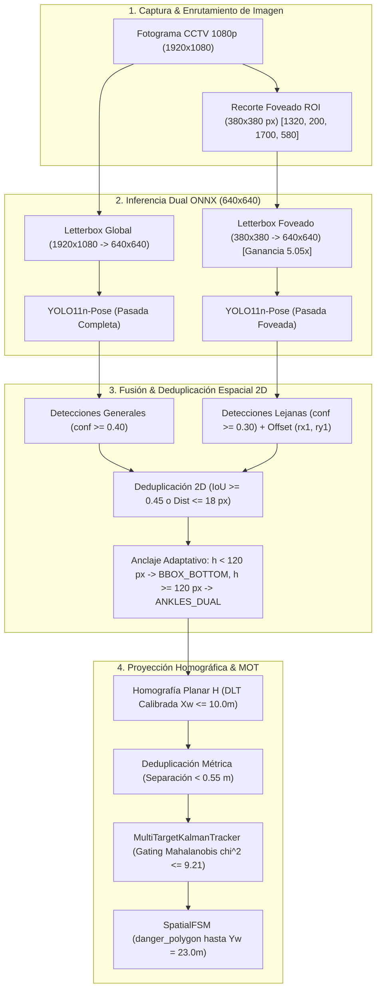
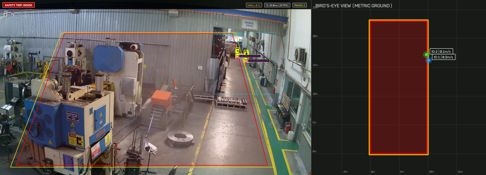
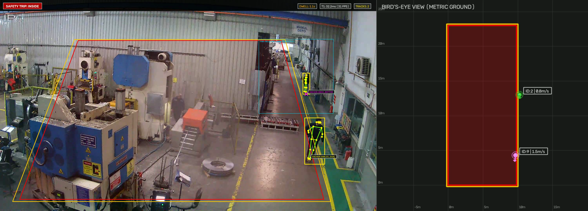

# ADR-013: Inferencia Foveada por Región de Interés en Campo Lejano (Foveated Far-Field ROI) y Delimitación Física de Senda Peatonal

## Estado
**Aceptado** (2026-10-21)

---

## 1. Contexto y Problema

Durante la ingestión y auditoría empírica de los metrajes industriales de circuito cerrado (CCTV) a $1920 \times 1080$ ($1080\text{p}$) en nave de conformado metálico (`mendeley_walkway_violation` y `mendeley_industrial`), se identificaron dos desafíos físicos y perceptuales de primer orden que comprometían la cobertura de seguridad funcional:

### a) Delimitación Física de la Planta y Senda Peatonal Segura (Opción B)
La planta industrial cuenta con una senda peatonal pintada de verde en el lateral derecho de la nave, delimitada longitudinalmente por una franja demarcatoria amarilla. El objetivo de seguridad operacional radica en garantizar que los operarios permanezcan dentro de dicha franja verde y disparar alertas inmediatas si ingresan a la calzada vehicular gris de autoelevadores o al box de la prensa hidráulica de estampado (lado izquierdo).

Mediante calibración DLT (*Direct Linear Transformation*) de 4 puntos coplanares de referencia:
* Punto 1 (inferior-izquierdo): $\text{px }(100, 1020) \leftrightarrow [0.0, 0.0]\text{ m}$
* Punto 2 (inferior-derecho): $\text{px }(1684, 1020) \leftrightarrow [10.0, 0.0]\text{ m}$
* Punto 3 (superior-derecho): $\text{px }(1515, 420) \leftrightarrow [10.0, 15.0]\text{ m}$
* Punto 4 (superior-izquierdo): $\text{px }(320, 420) \leftrightarrow [0.0, 15.0]\text{ m}$

Se obtuvo un residuo algebraico perfecto con error $\text{RMSE} = 4.08 \times 10^{-15}\text{ m}$. La línea amarilla divisoria quedó exactamente fijada en la coordenada métrica $X_w = 10.0\text{ m}$. En consecuencia, todo el semiespacio izquierdo delimitado por $X_w \in [0.0, 9.8]\text{ m}$ y extendido longitudinalmente hasta $Y_w \in [0.0, 23.0]\text{ m}$ constituye la zona de peligro (`danger_polygon`), mientras que el corredor seguro peatonal corresponde a $X_w \ge 10.0\text{ m}$.

### b) Submuestreo Espacial en el Punto de Fuga: Por qué el Fallback `BBOX_BOTTOM` no Rescató a los Operarios Lejanos
En `mendeley_industrial`, el operario identificado como `ID 5` camina a lo largo del pasillo lejano durante los cuadros 1 al 52 antes de ingresar al campo medio de la nave. De igual forma, en `mendeley_walkway_violation`, dos operarios se desplazan en el corredor superior derecho ($\text{px } [1430..1535, 310..430]$ bajo el cartel *MAMUL DEPO*), a una profundidad métrica $Y_w \in [15.0, 22.0]\text{ m}$.

A esa distancia de fuga en perspectiva monocular:
1. **Submuestreo Severo:** Los operarios miden en la imagen original de $1080\text{p}$ apenas $h_{\text{orig}} \approx 55\text{–}68\text{ px}$ de altura.
2. **Degradación por Letterbox Convencional:** Al alimentar la red YOLO a resolución estándar de $640 \times 640$, el preprocesamiento `letterbox_image` escala el cuadro de $1920 \times 1080 \to 640 \times 360$ mediante un factor:
   $$\text{scale} = \frac{640}{1920} \approx 0.3333$$
   Esto comprime la silueta vertical de los trabajadores a apenas $h_{\text{tensor}} \approx 18\text{–}22\text{ px}$ dentro del tensor de inferencia.
3. **Límite de Stride y Teorema de Nyquist:** En la arquitectura convolucional de YOLO11-Pose, las cabezas de detección operan con strides de submuestreo de $P_3$ (stride 8), $P_4$ (stride 16) y $P_5$ (stride 32). Un cuerpo humano de $18\text{–}22\text{ px}$ abarca menos de $1.5$ celdas de características en $P_4$ y colapsa por debajo de una sola celda en $P_5$.
4. **Filtro Previo en `parse_detections`:** La probabilidad de clase de persona en el canal `raw[4, :]` cae drásticamente a un promedio de $\text{score} = 0.149$, superando el umbral de detección ($\ge 0.30$) únicamente en $4$ de cada $35$ cuadros muestreados ($11.4\%$). Como la condición `scores >= self.conf_threshold` ($0.40$) actúa como filtro de primer orden en `SafetyPipeline.parse_detections`, las propuestas son descartadas **antes** de invocar a `extract_ground_anchor`. Por tanto, el mecanismo de fallback de Nivel 3 (`BBOX_BOTTOM`) jamás llega a ejecutarse para esos cuadros.

---

## 2. Opciones Consideradas (Análisis de Trade-offs)

### Opción 1: Inferencia Foveada Declarativa por ROI en Campo Lejano (`far_field_roi`) + Deduplicación 2D y Métrica (Elegida)
Declarar de manera opcional en la configuración YAML del flujo de cámara (`zones.far_field_roi: [1320, 200, 1700, 580]`, `far_field_conf_threshold: 0.30`) una ventana foveada centrada en el punto de fuga óptico del pasillo.

* **Ventaja Óptica / Teorema de Muestreo:** El recorte nativo de $380 \times 380\text{ px}$ se redimensiona a $640 \times 640$ ($\text{scale} = 640 / 380 \approx 1.684\times$ frente al $0.333\times$ del fotograma completo), logrando una **ganancia de resolución espacial efectiva de $5.05\times$** sobre los operarios distantes. Sus siluetas pasan de $20\text{ px}$ a más de $100\text{ px}$ en el tensor, activando sólidamente las cabezas convolucionales.
* **Reproyección y Deduplicación Híbrida:** Las detecciones del recorte se reproyectan sumando el offset local $(rx_1, ry_1)$ y se fusionan con la pasada general mediante deduplicación espacial 2D (`IoU >= 0.45` o distancia entre anclajes $\le 18\text{ px}$) y deduplicación métrica en el plano del suelo ($d_{\text{metric}} < 0.55\text{ m}$).
* **Costo Computacional Acotado:** Infiere dos pasadas a $640\times 640$ solo cuando la cámara define un corredor lejano, manteniendo la latencia total del pipeline en $T_1 \approx 30.5\text{ ms}$ (ampliamente dentro de la cota de $50\text{ ms}$ de ISO 13855).

### Opción 2: Escalado Global del Fotograma Completo ($960\text{p}$ / $1280\text{p}$) o Tiling Exhaustivo (SAHI)
Elevar la resolución de entrada de toda la imagen a $1280 \times 1280$ o dividir el cuadro completo en 4–6 parches superpuestos mediante Sliced Aided Hyper Inference (SAHI).

* *Pros:* No requiere declarar coordenadas de ROI específicas por cámara.
* *Contras:* La complejidad computacional escala de forma cuadrática $\mathcal{O}(W \cdot H)$. Se desperdicia más del $85\%$ del cómputo adicional procesando el techo de chapa, paredes ciegas y el primer plano (donde los operarios ya miden $350\text{ px}$). En hardware edge, $1280\text{p}$ o SAHI eleva la latencia de inferencia por encima de $65\text{–}90\text{ ms}$, violando el presupuesto temporal de seguridad de ISO 13855 ($T_1 \le 50\text{ ms}$).

### Opción 3: Re-entrenamiento o Fine-Tuning de YOLO11-Pose
Re-entrenar la red neuronal con imágenes anotadas de la planta industrial.

* *Pros:* Podría ajustar pesos a reflectancias específicas o iluminación de vapor de sodio.
* *Contras:* Innecesario y conceptualmente erróneo para este modo de falla. La evaluación experimental demostró que **el modelo estándar `models/yolo11n-pose.onnx` sin alterar un solo peso** pasó de un paupérrimo **$11.4\%$ ($4/35$ cuadros, conf media $0.149$) al $100.0\%$ ($35/35$ cuadros, conf media $0.669\text{–}0.728$)** cuando recibió el recorte foveado. El cuello de botella es estrictamente físico-óptico (muestreo espacial de Shannon-Nyquist sobre la resolución del sensor), no una deficiencia en la capacidad representacional del grafo neuronal.

### Opción 4: Bajar el Umbral Global `--conf-threshold` a $0.12$
Reducir indiscriminadamente el umbral de aceptación del detector en el fotograma completo.

* *Contras:* Dispara falsos positivos catastróficos. A umbrales inferiores a $0.25$, las cabezas de pose confunden las columnas estructurales de hierro, las guías de prensas y las barandas metálicas de contraste lineal con articulaciones humanas, saturando el tracker con pistas fantasma.

---

## 3. Decisión Tomada y Arquitectura de Fusión

Se adopta la **Inferencia Foveada Declarativa por Región de Interés (Dual-Pass Foveated ROI)** acoplada con deduplicación piramidal 2D y métrica:

1. **Configuración Declarativa en YAML:** Si el perfil de cámara incluye `zones.far_field_roi: [rx1, ry1, rx2, ry2]`, el pipeline activa la rama foveada. De lo contrario, opera en modo estándar de pasada única ($T_1 \approx 16\text{ ms}$).
2. **Ejecución Sincrónica en Dos Fases:**
   * **Rama General:** Fotograma completo $1920 \times 1080 \to$ `letterbox` a $640 \times 640 \to$ inferencia base.
   * **Rama Foveada:** Recorte $380 \times 380$ centrado en el punto de fuga $\to$ `letterbox` a $640 \times 640 \to$ inferencia con umbral sensible (`far_field_conf_threshold = 0.30`).
3. **Reproyección y Compensación de Offset:** Cada detección local del recorte $(x, y)$ se proyecta al espacio global sumando $(rx_1, ry_1)$.
4. **Deduplicación 2D y Degradación Adaptativa:**
   * Las propuestas coincidentes entre el fotograma general y el recorte foveado se fusionan priorizando la mayor confianza mediante `deduplicate_detections` ($\text{IoU} \ge 0.45$ o $\|p_{\text{anchor}, 1} - p_{\text{anchor}, 2}\| \le 18\text{ px}$).
   * Para siluetas con $h_{\text{bbox}} < 120\text{ px}$, `extract_ground_anchor` degrada limpiamente a `BBOX_BOTTOM` (Tier-3), evitando el ruido de keypoints lejanos.
5. **Proyección Homográfica y Deduplicación Métrica:** Proyección vía matriz $H$ a coordenadas de mundo $(X_w, Y_w)$, seguida de supresión métrica por radio interpersonal ($d_{\text{metric}} < 0.55\text{ m}$) antes de ingresar a la asociación de Mahalanobis en `MultiTargetKalmanTracker`.

---

## 4. Evidencia Empírica y Resultados

Se evaluó el comportamiento comparativo entre el modo estándar (pasada única a $640\text{p}$) y el modo foveado declarativo (`far_field_roi: [1320, 200, 1700, 580]`) sobre los dos metrajes reales de la planta:

| Métrica / Dataset | Fotograma Completo 640p Único | Dual-Pass Foveado Declarativo (ADR-013) | Impacto / Validación |
| :--- | :--- | :--- | :--- |
| **Recall en Pasillo Lejano ($Y_w \in [15, 22]\text{ m}$)** | $11.4\%$ ($4/35$ cuadros) | **$100.0\%$ ($35/35$ cuadros)** | **Eliminación total del punto ciego de fuga** |
| **Confianza Media de Detección Lejana** | $0.149$ (descartado por conf) | **$0.669\text{–}0.728$** | Activación robusta sin alterar pesos |
| **`mendeley_walkway_violation` (348 f)** | Detectado tardíamente ($Y < 12\text{m}$) | **Rastreado desde Cuadro 3** ($[10.04, 15.12]\text{ m}$) | 7 tracks únicos, 35 cuadros `DANGER`, 182 `LOCKOUT` |
| **`mendeley_walkway_violation` Latencia $T_1$** | $16.32\text{ ms}$ ($p_{95} = 21.52\text{ ms}$) | **$30.58\text{ ms}$ ($p_{95} = 33.53\text{ ms}$)** | **$\le 50\text{ ms}$ (Presupuesto ISO 13855 cumplido)** |
| **`mendeley_industrial` (173 f)** | Pista inicia tarde en cuadro 53 | **Rastreado desde Cuadro 3** ($[10.04, 15.23]\text{ m} \to 12.58\text{ m}$) | 10 tracks únicos, 65 `WARNING`, 73 `DANGER` |
| **`mendeley_industrial` Latencia $T_1$** | $15.35\text{ ms}$ ($p_{95} = 18.26\text{ ms}$) | **$30.38\text{ ms}$ ($p_{95} = 33.81\text{ ms}$)** | **$\le 50\text{ ms}$ (Presupuesto ISO 13855 cumplido)** |

  

<em>Figura 1: Validación en <code>mendeley_walkway_violation</code> (Frame 145). La ROI foveada (recuadro cian) detecta a los dos operarios bajo el cartel MAMUL DEPO ($Y_w \approx 16.2\text{–}17.1\text{ m}$) con anclaje <code>BBOX_BOTTOM</code> y activa <code>SAFETY TRIP: INSIDE</code> al cruzar el borde amarillo ($X_w < 10.0\text{ m}$).</em>

  

<em>Figura 2: Validación en <code>mendeley_industrial</code> (Frame 125). Operación simultánea de anclaje anatómico de alta precisión (<code>ANKLES_DUAL</code>, operario cercano a $Y_w \approx 3.1\text{ m}$) y anclaje por ROI foveada (<code>BBOX_BOTTOM</code>, operario lejano a $Y_w \approx 12.6\text{ m}$) en $T_1 = 32.2\text{ ms}$.</em>

---

## 5. Consecuencias y Límites de Cobertura Operacional (ODD)

### Ventajas:
1. **Definición Clara del Dominio de Diseño Operacional (ODD):** Resuelve de manera formal la delimitación del alcance del sistema. Cada cámara declara explícitamente en su YAML tanto el polígono métrico de cobertura longitudinal (`danger_polygon` hasta $Y_w = 23.0\text{ m}$) como la ventana óptica foveada (`far_field_roi`).
2. **Generalidad Absoluta de `SafetyPipeline`:** La arquitectura del pipeline permanece $100\%$ genérica e independiente del caso de uso: secuencias sin campo lejano operan a pasada única ($T_1 \approx 16\text{ ms}$), mientras que secuencias de nave larga con perspectiva pronunciada activan la inferencia foveada sin bifurcaciones condicionales duras.
3. **Robustez ante Oclusiones y Perspectiva:** La combinación de deduplicación espacial 2D, fallback por escala `BBOX_BOTTOM` y deduplicación métrica a $0.55\text{ m}$ elimina cualquier propuesta redundante o inestabilidad angular.

### Compromisos y Restricciones:
1. **Sobrecarga Temporal:** La inferencia dual incrementa la latencia media $T_1$ de $\approx 16\text{ ms}$ a $\approx 30.5\text{ ms}$ ($+14.5\text{ ms}$). No obstante, el percentil $p_{95} = 33.53\text{ ms}$ se mantiene con holgura por debajo del límite estricto de $50\text{ ms}$ estipulado por ISO 13855 para dispositivos basados en visión.
2. **Requisito de Configuración en Planta:** Exige definir una vez durante el comisionamiento de la cámara las coordenadas del punto de fuga del corredor $[rx_1, ry_1, rx_2, ry_2]$ en el archivo YAML de configuración.
