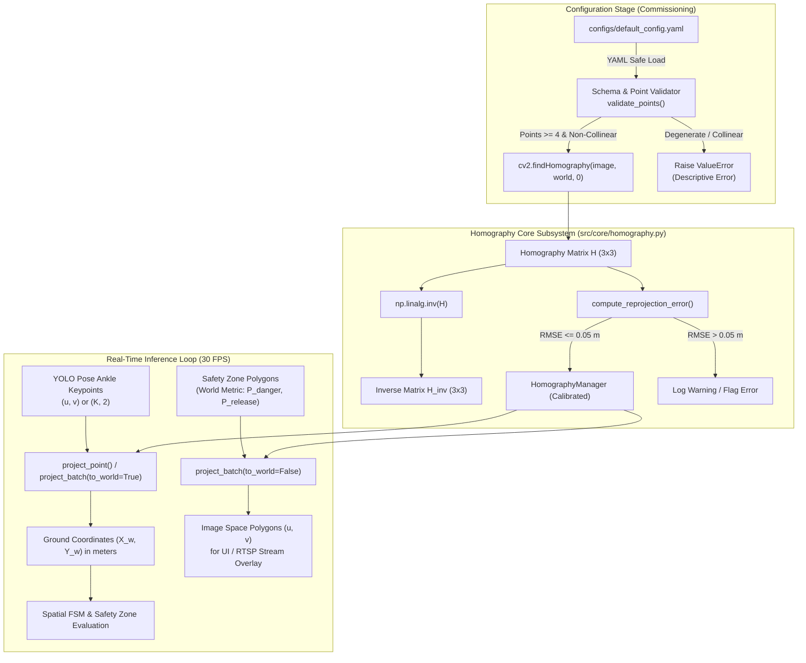
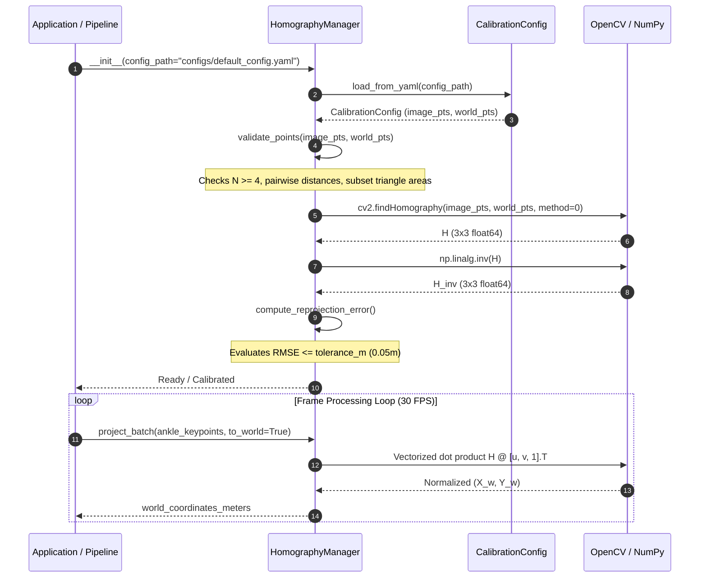

# Technical Design: Planar Homography Projection & Calibration Management

- **Change Name:** `calibration-homography`
- **Domain:** Spatial Mapping, Geometric Calibration & Metric Coordinate Transformation
- **Target Platform:** Apple Silicon (macOS arm64) / Linux Edge ARM & x86_64
- **Safety Standard:** ISO 13855:2024 (Safety of machinery — Positioning of safeguards with respect to the approach of the human body)
- **Status:** Draft

---

## 1. Technical Approach

### 1.1 Overview & Physical Context
In computer-vision-assisted industrial safeguarding, cameras are mounted overhead or angled towards machine workcells. Under perspective projection, distances measured directly in image pixels $(u, v)$ suffer from non-linear perspective foreshortening: a displacement of 50 pixels near the top of the frame may correspond to 3.0 meters, whereas the same displacement at the bottom may correspond to 0.4 meters.

According to **ISO 13855:2024**, safety zone perimeters and human approach clearance distances ($S = K \times T + C$) must be computed strictly in real-world metric space (meters/millimeters). Furthermore, spatial anchoring must be pinned to the worker's foot contact points (ankles) on the floor plane ($Z_w = 0$), eliminating false trips caused by tilted upper bodies or shadows.

This change establishes the geometric calibration subsystem:
1. **Calibration Specification (`configs/default_config.yaml`)**: Declarative schema specifying camera metadata, physical reference points on the floor plane, pixel correspondences, and tolerance limits.
2. **Homography Manager (`src/core/homography.py`)**: Core algorithmic module computing the planar homography matrix $H \in \mathbb{R}^{3 \times 3}$ via Direct Linear Transformation (DLT), performing forward and inverse metric projections, executing vectorized batch transforms for multi-person pose keypoints, and validating geometric stability.
3. **Rigorous Quality Assurance (`tests/test_homography.py`)**: Unit and property test suite validating synthetic projective transformations, bidirectional round-trip consistency, degeneracy rejection, and reprojection error accuracy.

### 1.2 Mathematical Formulation

#### 1.2.1 Planar Projective Transformation
Assuming the factory floor is a planar surface defined as $Z_w = 0$ in the world coordinate frame, the projective mapping between 2D pixel coordinates $(u, v)$ and ground-plane metric coordinates $(X_w, Y_w)$ is an invertible projective collineation (planar homography):

$$\begin{bmatrix} X_w' \\ Y_w' \\ W \end{bmatrix} = H \begin{bmatrix} u \\ v \\ 1 \end{bmatrix} = \begin{bmatrix} h_{11} & h_{12} & h_{13} \\ h_{21} & h_{22} & h_{23} \\ h_{31} & h_{32} & h_{33} \end{bmatrix} \begin{bmatrix} u \\ v \\ 1 \end{bmatrix}$$

Homogeneous coordinate normalization yields the Cartesian world coordinates:
$$X_w = \frac{X_w'}{W} = \frac{h_{11}u + h_{12}v + h_{13}}{h_{31}u + h_{32}v + h_{33}}$$
$$Y_w = \frac{Y_w'}{W} = \frac{h_{21}u + h_{22}v + h_{23}}{h_{31}u + h_{32}v + h_{33}}$$

Subject to the regularity condition:
$$|W| = |h_{31}u + h_{32}v + h_{33}| > \epsilon_{\text{horizon}} \quad (\epsilon_{\text{horizon}} = 10^{-7})$$
Points where $W \approx 0$ lie on the vanishing line (horizon) and cannot be projected to finite Euclidean world space.

#### 1.2.2 Inverse Projection (World to Image)
To reproject geometric danger zones, virtual safety fences, or metric trajectories back onto the camera video feed for visual verification and operator displays, the inverse homography $H^{-1} = \text{inv}(H)$ is utilized:

$$\begin{bmatrix} u' \\ v' \\ w \end{bmatrix} = H^{-1} \begin{bmatrix} X_w \\ Y_w \\ 1 \end{bmatrix}$$
$$u = \frac{u'}{w}, \quad v = \frac{v'}{w} \quad (|w| > 10^{-7})$$

#### 1.2.3 Direct Linear Transformation (DLT) & Least-Squares Estimation
Each point correspondence $(u_i, v_i) \leftrightarrow (X_i, Y_i)$ provides two independent linear constraints on the 8 degrees of freedom of $H$ (up to scale). For $N \ge 4$ correspondences, the system $A \mathbf{h} = \mathbf{0}$ is solved:
- When $N = 4$: Exact algebraic solution via Gaussian elimination / SVD.
- When $N > 4$: Overdetermined system solved via Singular Value Decomposition (SVD) least-squares minimizing algebraic error, or RANSAC for outlier rejection.

#### 1.2.4 Non-Collinearity & Degeneracy Validation
A planar homography cannot be uniquely determined if any 3 of the 4 points are collinear (or if the points are coplanar along a 1D line in 3D). To prevent singular or ill-conditioned matrices, the system validates the point set prior to computation:
1. **Point Count Verification**: $N \ge 4$ correspondences.
2. **Subset Triangle Area (Collinearity Check)**: For every triple of points $\{p_i, p_j, p_k\}$, the signed triangle area in 2D must exceed a safe threshold:
   $$\text{Area}(p_i, p_j, p_k) = \frac{1}{2} |u_i(v_j - v_k) + u_j(v_k - v_i) + u_k(v_i - v_j)| > \epsilon_{\text{area}}$$
3. **Affine Rank Check**: The homogeneous coordinate design matrix $P = [\mathbf{p}_1, \dots, \mathbf{p}_N]^T \in \mathbb{R}^{N \times 3}$ must have full column rank $\text{rank}(P) = 3$.
4. **Homography Invertibility & Condition Number**:
   $$|\det(H)| > 10^{-10} \quad \text{and} \quad \kappa(H) = \|H\|_2 \cdot \|H^{-1}\|_2 < 10^{8}$$

#### 1.2.5 Vectorized Batch Transformation
In real-time inference, multiple workers produce ankle keypoints simultaneously. A keypoint array of shape $(K, 2)$ is projected in a single vectorized NumPy operation:

$$\tilde{P}_{\text{in}} = \begin{bmatrix} P_{0,0} & P_{1,0} & \dots & P_{K-1,0} \\ P_{0,1} & P_{1,1} & \dots & P_{K-1,1} \\ 1 & 1 & \dots & 1 \end{bmatrix} \in \mathbb{R}^{3 \times K}$$

$$\tilde{P}_{\text{out}} = M \tilde{P}_{\text{in}} \in \mathbb{R}^{3 \times K} \quad (M \in \{H, H^{-1}\})$$

$$P_{\text{result}} = \begin{bmatrix} \tilde{P}_{\text{out}}[0, :] / \tilde{P}_{\text{out}}[2, :] \\ \tilde{P}_{\text{out}}[1, :] / \tilde{P}_{\text{out}}[2, :] \end{bmatrix}^T \in \mathbb{R}^{K \times 2}$$

This eliminates Python-level loops, executing in $< 0.05\text{ ms}$ for dozens of keypoints.

#### 1.2.6 Reprojection Error (RMSE) Metric
Calibration quality is evaluated against ground-truth pairs $(u_i, v_i) \leftrightarrow (X_i, Y_i)$ via Root-Mean-Square Error in world metric space (meters):

$$\text{RMSE}_{\text{world}} = \sqrt{\frac{1}{N} \sum_{i=1}^N \left( (X_i - \hat{X}_i)^2 + (Y_i - \hat{Y}_i)^2 \right)}$$
where $(\hat{X}_i, \hat{Y}_i) = \text{project-point}(u_i, v_i)$.

Under safety directives, $\text{RMSE}_{\text{world}} \le 0.05\text{ m}$ ($50\text{ mm}$). If the error exceeds this threshold, a warning or validation error is triggered during system initialization.

---

## 2. Architecture Decisions & Trade-Offs

### Decision 1: OpenCV `cv2.findHomography` vs Custom SVD DLT
- **Context:** Computing $H$ requires solving a homogeneous linear system $A\mathbf{h} = \mathbf{0}$.
- **Alternatives Considered:**
  1. *Custom Pure-Python/NumPy SVD DLT*: Implements Hartley coordinate normalization, constructs matrix $A_{2N \times 9}$, and computes SVD via `np.linalg.svd`.
  2. *OpenCV `cv2.findHomography` with `method=0` (least squares) or `cv2.RANSAC`*: Native C++ implementation with SIMD acceleration and automatic isotropic normalization.
- **Decision:** Utilize **OpenCV `cv2.findHomography`** as the core solver.
- **Rationale:**
  - `cv2.findHomography` is already an existing core dependency of the project (`opencv-python`).
  - Native OpenCV implementation incorporates Hartley isotropic normalization internally, avoiding numerical instability without additional lines of maintenance.
  - Supports standard DLT least squares (`method=0`) when calibration markers are precise, and robust estimators (`cv2.RANSAC`) if redundant points ($N > 4$) contain manual labeling noise.
  - Execution time is sub-millisecond ($< 0.2\text{ ms}$), executed once at initialization.

### Decision 2: Structured Dataclass & Schema Validation vs Raw Dicts
- **Context:** Calibration data is read from YAML files (`configs/default_config.yaml`) created during commissioning.
- **Alternatives Considered:**
  1. *Unstructured Raw Dictionaries*: Directly passing `yaml.safe_load()` dicts into functions.
  2. *Pydantic Models*: Full validation library with schemas.
  3. *Type-Safe Python Dataclasses with Explicit Validator Methods*: Built-in standard library dataclasses (`dataclasses.dataclass`) with rigorous assertion logic.
- **Decision:** Employ **Type-Safe Python Dataclasses (`CalibrationConfig`, `CalibrationPoints`)** with custom validation methods.
- **Rationale:**
  - Eliminates external heavyweight dependencies while enforcing strict PEP 484/526 typing.
  - Fails fast on malformed YAML (missing keys, mismatched point counts, non-float types) before any camera or inference pipeline starts.
  - Keeps configuration cleanly serializable and testable with mock data.

### Decision 3: In-Memory Precomputed $H$ and $H^{-1}$ Caching vs Dynamic Computation
- **Context:** During real-time processing (30 FPS), points are projected continuously.
- **Alternatives Considered:**
  1. *Compute on Demand*: Recomputing or inverting $H$ dynamically when needed.
  2. *In-Memory Precomputed & Cached $H$ and $H^{-1}$*: Compute $H$ and $H^{-1} = \text{inv}(H)$ once during configuration loading; maintain immutable references.
- **Decision:** Enforce **In-Memory Caching of $H$ and $H^{-1}$**.
- **Rationale:**
  - Industrial camera rigs and machine perimeters are physically bolted and rigid. The calibration does not change per frame.
  - Inverting a $3 \times 3$ matrix per frame adds unnecessary CPU instructions. Caching $H^{-1}$ reduces projection to a single NumPy matrix multiplication: $\mathcal{O}(1)$ complexity taking $< 0.01\text{ ms}$.

### Decision 4: Geometric Pre-Validation (Non-Collinearity & Horizon Checks)
- **Context:** Singular matrices cause silent `NaN` propagation, zero-division, or crashes during real-time tracking.
- **Alternatives Considered:**
  1. *Catch `np.linalg.LinAlgError` after the fact*: Only detect singular matrices when `inv()` fails.
  2. *Proactive Pre-Flight Geometric Validation*: Inspect points for collinearity, minimum area, and rank before solving, plus post-solve determinant/condition number check.
- **Decision:** Implement **Proactive Pre-Flight Geometric Validation**.
- **Rationale:**
  - A nearly singular matrix might still invert mathematically with enormous condition number ($\kappa > 10^{15}$), producing catastrophic coordinate drift ($X_w > 10^5\text{ m}$) that corrupts safety evaluation.
  - Explicit collinearity checks provide actionable error messages to plant operators (e.g., "Points 0, 1, and 2 are collinear with area < 1e-4 px^2").

---

## 3. Component Architecture & Data Flow

### 3.1 Architectural Flow



### 3.2 Sequence Diagram: Initialization and Transformation



---

## 4. File Changes & Signatures

### 4.1 `configs/default_config.yaml`
Central declarative configuration specification for edge deployment.

```yaml
camera:
  id: "industrial_cam_01"
  resolution:
    width: 1920
    height: 1080
  fps: 30

calibration:
  method: "DLT"  # DLT (least-squares) or RANSAC
  reprojection_tolerance_m: 0.05  # Maximum allowable RMSE in meters (ISO 13855 compliance)
  points:
    image:
      - [480.0, 920.0]    # Point 1: bottom-left
      - [1440.0, 920.0]   # Point 2: bottom-right
      - [1200.0, 480.0]   # Point 3: top-right
      - [720.0, 480.0]    # Point 4: top-left
    world:
      - [0.0, 0.0]        # (X, Y) in meters on ground plane (Z=0)
      - [4.0, 0.0]
      - [4.0, 6.0]
      - [0.0, 6.0]
```

### 4.2 `src/core/homography.py`
Core module implementing homography estimation, projection, and validation.

```python
"""
src/core/homography.py
Planar Homography and Metric Calibration Management for Edge Safety Guard.
Compliant with ISO 13855:2024 metric safety positioning.
"""

from dataclasses import dataclass
from pathlib import Path
from typing import Optional, Tuple, Union
import logging
import numpy as np
import cv2
import yaml

@dataclass(frozen=True)
class CalibrationConfig:
    """Immutable representation of calibration configuration."""
    image_points: np.ndarray          # Shape: (N, 2), dtype: float64
    world_points: np.ndarray          # Shape: (N, 2), dtype: float64
    reprojection_tolerance_m: float   # Max allowable RMSE in meters (default: 0.05)
    method: str = "DLT"               # "DLT" or "RANSAC"

    @classmethod
    def from_yaml(cls, config_path: Union[str, Path]) -> "CalibrationConfig":
        """
        Load and validate calibration configuration from a YAML file.
        
        Args:
            config_path: Path to the YAML configuration file.
            
        Returns:
            Validated CalibrationConfig instance.
            
        Raises:
            FileNotFoundError: If configuration file does not exist.
            ValueError: If YAML schema is missing required keys or points are malformed.
        """
        ...


class HomographyManager:
    """
    Manages planar homography estimation, bidirectional metric-pixel projections,
    vectorized batch coordinate mapping, and geometric validation.
    """

    def __init__(
        self,
        config_path: Optional[Union[str, Path]] = None,
        image_points: Optional[Union[np.ndarray, list]] = None,
        world_points: Optional[Union[np.ndarray, list]] = None,
        reprojection_tolerance_m: float = 0.05,
    ) -> None:
        """
        Initialize the HomographyManager from a configuration file or direct point arrays.

        Args:
            config_path: Optional path to a YAML configuration file.
            image_points: Optional array-like of shape (N, 2) in pixel space.
            world_points: Optional array-like of shape (N, 2) in metric world space.
            reprojection_tolerance_m: Permissible reprojection RMSE in meters.

        Raises:
            ValueError: If neither config_path nor (image_points, world_points) are provided,
                        or if points fail geometric non-collinearity validation.
        """
        ...

    @property
    def H(self) -> np.ndarray:
        """Return the 3x3 planar homography matrix (image to world)."""
        ...

    @property
    def H_inv(self) -> np.ndarray:
        """Return the 3x3 inverse planar homography matrix (world to image)."""
        ...

    @property
    def is_calibrated(self) -> bool:
        """Return True if homography matrices are computed and valid."""
        ...

    @property
    def reprojection_error(self) -> float:
        """Return the computed Root-Mean-Square Error (RMSE) in meters."""
        ...

    def compute_homography(self, method: Optional[int] = None) -> np.ndarray:
        """
        Compute the 3x3 planar homography matrix H and its inverse H_inv.

        Args:
            method: OpenCV method flag (0 for standard DLT, cv2.RANSAC for robust fit).
                    If None, defaults to 0 (or RANSAC if N > 4).

        Returns:
            The calculated 3x3 homography matrix H.

        Raises:
            ValueError: If points fail non-collinearity validation or solve fails.
            RuntimeError: If matrix inversion fails or condition number is degenerate.
        """
        ...

    def project_point(self, u: float, v: float) -> Tuple[float, float]:
        """
        Project a single pixel coordinate (u, v) to ground-plane world coordinates (X_w, Y_w) in meters.

        Args:
            u: Horizontal pixel coordinate.
            v: Vertical pixel coordinate.

        Returns:
            Tuple (X_w, Y_w) in metric coordinates.

        Raises:
            RuntimeError: If HomographyManager is not calibrated.
            ValueError: If point is on the horizon (homogeneous divisor W close to 0).
        """
        ...

    def project_to_image(self, X: float, Y: float) -> Tuple[float, float]:
        """
        Project a single world coordinate (X_w, Y_w) in meters to pixel coordinate (u, v).

        Args:
            X: Real-world ground X coordinate in meters.
            Y: Real-world ground Y coordinate in meters.

        Returns:
            Tuple (u, v) in pixel coordinates.

        Raises:
            RuntimeError: If HomographyManager is not calibrated.
            ValueError: If point homogeneous divisor w is close to 0.
        """
        ...

    def project_batch(self, points: np.ndarray, to_world: bool = True) -> np.ndarray:
        """
        Project an array of 2D coordinates in a vectorized NumPy operation.

        Args:
            points: Array of shape (N, 2) containing coordinates to project.
            to_world: If True, projects from image (u, v) to world (X_w, Y_w).
                      If False, projects from world (X_w, Y_w) to image (u, v).

        Returns:
            Array of shape (N, 2) with transformed coordinates.

        Raises:
            ValueError: If input array does not have shape (N, 2) or contains horizon points.
            RuntimeError: If HomographyManager is not calibrated.
        """
        ...

    def compute_reprojection_error(self) -> float:
        """
        Compute the Root-Mean-Square Error (RMSE) in meters across calibration points.

        Returns:
            Float RMSE in meters: sqrt(mean(||P_world - project(P_image)||^2)).
        """
        ...

    @staticmethod
    def validate_points(
        image_points: np.ndarray,
        world_points: Optional[np.ndarray] = None,
        min_triangle_area: float = 1e-4,
    ) -> bool:
        """
        Validate that points meet geometric requirements:
        1. At least 4 points.
        2. Equal count between image and world points.
        3. No 3 points are collinear (checked via pairwise triangle areas).
        4. Coordinate matrix has full rank.

        Args:
            image_points: Array of shape (N, 2).
            world_points: Optional array of shape (N, 2).
            min_triangle_area: Minimum area below which 3 points are deemed collinear.

        Returns:
            True if points are valid.

        Raises:
            ValueError: With explicit details if any validation criterion fails.
        """
        ...
```

---

## 5. Testing Strategy & Quality Assurance

### 5.1 Test Organization (`tests/test_homography.py`)
To ensure compliance with the repository's strict TDD contract (`strict_tdd: true`), the test suite covers mathematical edge cases, known synthetic transforms, roundtrip identities, and schema error handling without external hardware dependencies:

```
tests/
├── conftest.py              # Synthetic models & fixtures
├── test_homography.py       # Full unit and property tests for homography subsystem
```

### 5.2 Test Matrix

| Category | Test Case | Target / Specification | Verification Type |
| :--- | :--- | :--- | :--- |
| **Synthetic Transforms** | `test_identity_homography` | Identical source and destination yields $H = I_3$ | Unit (Exact) |
| **Synthetic Transforms** | `test_pure_translation` | Shift by $(t_x, t_y)$ matches analytical formula | Unit (Analytical) |
| **Synthetic Transforms** | `test_uniform_scale` | Scale by factor $s$ maps $(u, v) \to (s \cdot u, s \cdot v)$ | Unit (Analytical) |
| **Synthetic Transforms** | `test_perspective_trapezoid` | Trapezoid in image space maps to metric rectangle | Unit (Geometric) |
| **Roundtrip Consistency** | `test_single_point_roundtrip` | `project_to_image(project_point(u, v)) == (u, v)` ($< 1\text{e-4}$) | Property Test |
| **Roundtrip Consistency** | `test_batch_roundtrip` | Bidirectional `project_batch` identity on $K=100$ points | Property Test |
| **Degeneracy Handling** | `test_insufficient_points` | Points count $< 4$ raises `ValueError` | Exception Handling |
| **Degeneracy Handling** | `test_mismatched_point_counts` | $N_{\text{image}} \ne N_{\text{world}}$ raises `ValueError` | Exception Handling |
| **Degeneracy Handling** | `test_collinear_points_all` | 4 points on a single straight line raise `ValueError` | Exception Handling |
| **Degeneracy Handling** | `test_collinear_points_three` | 3 of 4 points on a line raise `ValueError` | Exception Handling |
| **Degeneracy Handling** | `test_duplicate_points` | Duplicate identical points raise `ValueError` | Exception Handling |
| **Degeneracy Handling** | `test_horizon_point_projection` | Point with $W \approx 0$ raises `ValueError` | Exception Handling |
| **Reprojection Accuracy** | `test_reprojection_error_exact` | Exact correspondences yield $\text{RMSE} < 1\text{e-6}\text{ m}$ | Unit (Tolerance) |
| **Reprojection Accuracy** | `test_reprojection_error_noisy` | Noisy points compute correct RMSE; flags $\text{RMSE} > 0.05\text{ m}$ | Unit (Tolerance) |
| **Config Serialization** | `test_load_from_valid_yaml` | Correctly parses `configs/default_config.yaml` | Integration |
| **Config Serialization** | `test_load_missing_file` | Missing YAML file raises `FileNotFoundError` | Exception Handling |
| **Config Serialization** | `test_load_malformed_yaml` | Missing keys in YAML raise `ValueError` | Exception Handling |
| **Batch Interface** | `test_batch_empty_and_shapes` | Handles empty array $(0, 2)$, rejects $(N, 3)$ or $(N,)$ | Unit / Interface |

---

## 6. Safety & Performance Budgets (ISO 13855:2024)

### 6.1 Latency Budget Allocation ($t_{\text{homo}}$)
Within the total vision pipeline budget ($t_1 \le 50.0\text{ ms}$):
- ONNX Pose Inference ($t_{\text{infer}}$): $\le 30.0\text{ ms}$ ($p95$)
- Preprocessing & Letterbox ($t_{\text{pre}}$): $\le 3.0\text{ ms}$
- Postprocessing / Keypoint NMS ($t_{\text{post}}$): $\le 4.0\text{ ms}$
- **Planar Homography Batch Projection ($t_{\text{homo}}$): $\le 0.5\text{ ms}$ (Target: $< 0.05\text{ ms}$)**
- Spatial FSM & Zone Polygons ($t_{\text{fsm}}$): $\le 1.0\text{ ms}$

By using precomputed in-memory matrices and NumPy matrix multiplication, projection of all detected workers' ankles takes $< 50\,\mu\text{s}$, well within the sub-millisecond safety allocation.

### 6.2 Spatial Accuracy Budget
- **Permissible Reprojection Error:** $\text{RMSE} \le 0.05\text{ m}$ ($50\text{ mm}$).
- Under ISO 13855:2024, the distance uncertainty factor $Z_{\text{extra}}$ incorporates camera calibration error. Restricting calibration error to $\le 50\text{ mm}$ ensures that the machine stop distance $S$ does not require excessive conservative margins that impede operator workflow.

---

## 7. Migration & Rollback Strategy
- **Additive Implementation**: The change introduces:
  - `configs/default_config.yaml`
  - `src/core/homography.py`
  - `tests/test_homography.py`
- **Zero Breaking Changes**: Existing inference engine and export modules are uncoupled and unaffected.
- **Rollback Procedure**: Revert newly added files if any failure occurs:
  ```bash
  rm configs/default_config.yaml src/core/homography.py tests/test_homography.py
  ```
