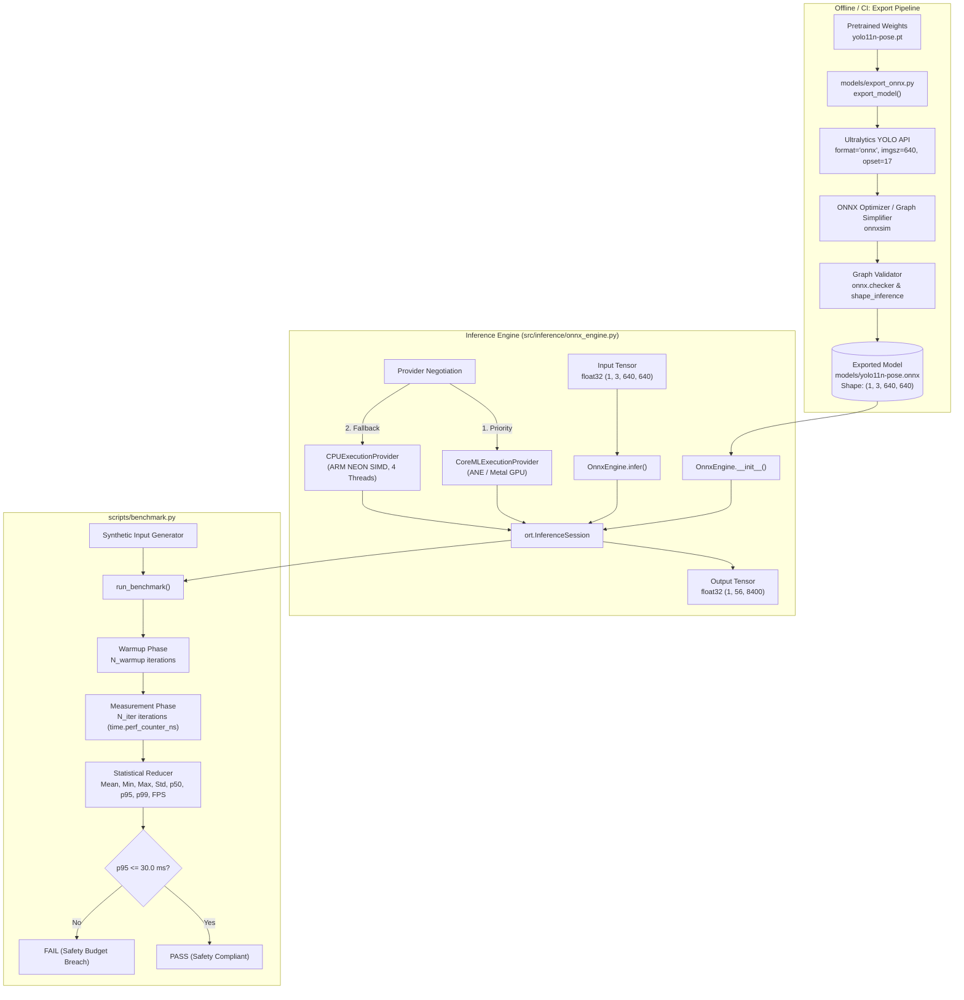

# Technical Design: Model Export & Latency Benchmark

- **Change Name:** `model-export-benchmark`
- **Domain:** Model Ingestion, Runtime Acceleration & Performance Profiling
- **Target Platform:** Apple Silicon (M1 arm64) / Edge ARM devices
- **Safety Standard:** ISO 13855:2024 (Safety of machinery — Positioning of safeguards with respect to the approach of the human body)
- **Status:** Draft

---

## 1. Technical Approach

### 1.1 Overview & Motivation
Edge Safety Guard requires continuous human pose estimation to accurately locate worker foot contact points (ankles) on the ground floor plane for geometric homography and danger zone intrusion detection. In accordance with ISO 13855:2024, the end-to-end response time of safeguarding equipment directly determines the minimum safety clearance distance ($S = K \times T + C$). 

To ensure minimal physical safety distance requirements and guarantee real-time reactivity at $\ge 30\text{ FPS}$, the vision pipeline enforces an inference latency budget:
$$t_{\text{infer}} \le 30.0\text{ ms} \quad (\text{at } p95)$$

This change establishes the foundational inference subsystem comprising:
1. **Model Exporter (`models/export_onnx.py`)**: Automates retrieval and conversion of Ultralytics YOLO Pose models (`yolo11n-pose.pt` / `yolov8n-pose.pt`) into optimized, static-dimension ONNX graphs (`opset=17`, `simplify=True`).
2. **Inference Engine (`src/inference/onnx_engine.py`)**: A decoupled, production-grade abstraction over ONNX Runtime (`InferenceSession`) providing automated execution provider negotiation (`CoreMLExecutionProvider` with graceful fallback to `CPUExecutionProvider` leveraging ARM NEON vector extensions).
3. **Statistical Profiler (`scripts/benchmark.py`)**: A high-resolution profiling harness utilizing monotonic nanosecond timers to record runtime distributions, compute percentile metrics ($p50, p95, p99$), and validate conformance against edge safety latency budgets.

---

## 2. Architecture Decisions & Trade-Offs

### Decision 1: Static Input Shape `(1, 3, 640, 640)` vs Dynamic Axes
- **Context:** ONNX allows graphs to be exported with dynamic dimensions (e.g. variable batch size or variable height/width). 
- **Alternatives Considered:**
  1. *Dynamic Axes (`dynamic=True`)*: Enables arbitrary batch sizes and varying image resolutions.
  2. *Static Tensor Shape (`dynamic=False`, `(1, 3, 640, 640)`)*: Locks the input shape at export time to batch size 1 and fixed $640 \times 640$ spatial resolution.
- **Decision:** Enforce **static input shape `(1, 3, 640, 640)`**.
- **Rationale:**
  - Edge hardware accelerators (Apple Neural Engine via CoreML, edge NPUs, TensorRT) perform ahead-of-time (AOT) graph compilation, memory allocation, and kernel fusion.
  - Dynamic dimensions prevent optimal AOT memory planning, leading to runtime memory reallocations, CPU fallback, and execution latency jitter that breach real-time safety thresholds.
  - The edge safety pipeline processes streaming video frame-by-frame (batch size = 1) at a calibrated $640 \times 640$ aspect-preserved letterbox format.

### Decision 2: Hierarchical Execution Provider Negotiation
- **Context:** The system targets Apple Silicon (macOS arm64) during primary edge development and deployment, but must also support standard CPU environments (Linux ARM/x86_64, Docker containers, and CI runners).
- **Alternatives Considered:**
  1. *Hardcoded `CoreMLExecutionProvider`*: Fails immediately on non-macOS platforms or environments lacking Apple Neural Engine drivers.
  2. *Generic `CPUExecutionProvider` only*: Incurs unnecessary CPU overhead and fails to exploit Apple Silicon ANE/GPU hardware acceleration.
  3. *Hierarchical Provider Negotiation (`CoreML` -> `CPU`)*: Dynamically probes available runtime execution providers and configures session thread affinity.
- **Decision:** Implement **hierarchical negotiation: `["CoreMLExecutionProvider", "CPUExecutionProvider"]`**.
- **Rationale:**
  - When running on macOS arm64, ONNX Runtime offloads compatible layers to CoreML (delegating to Apple Neural Engine / Apple Silicon GPU), achieving sub-20ms inference with minimal thermal load.
  - If CoreML is unavailable, fails compilation, or runs on generic ARM/x86 hardware, the engine falls back gracefully to `CPUExecutionProvider`.
  - For `CPUExecutionProvider`, `SessionOptions` sets `intra_op_num_threads=4` to maximize multi-core throughput and ARM NEON SIMD vector instruction utilization.

### Decision 3: Decoupled Single-Responsibility Engine (`OnnxEngine`)
- **Context:** Downstream modules require model inference, but must not be coupled to Ultralytics dependencies or ONNX Runtime configuration details.
- **Alternatives Considered:**
  1. *Monolithic Pipeline Class*: Combining video capture, letterboxing, ONNX inference, NMS post-processing, and homography within a single class.
  2. *Ultralytics High-Level API (`YOLO('model.onnx')`)*: Wraps ONNX models inside the Ultralytics framework.
  3. *Decoupled Low-Level Engine (`OnnxEngine`)*: Adheres strictly to the Single Responsibility Principle (SRP).
- **Decision:** Implement a **dedicated, standalone `OnnxEngine` class**.
- **Rationale:**
  - Isolates ONNX Runtime session management, tensor validation, and execution provider negotiation from data preprocessing and business logic.
  - Ultralytics wrapper adds unnecessary framework overhead, hides provider negotiation, and complicates custom memory/tensor management.
  - Decoupling allows unit testing with synthetic numpy tensors without requiring mock video streams or synthetic bounding boxes.

### Decision 4: Monotonic High-Resolution Timing & Percentile Metrics
- **Context:** Industrial safety systems require statistical latency guarantees under operational jitter. Mean latency masks worst-case outliers.
- **Alternatives Considered:**
  1. *Mean Latency via `time.time()`*: Inaccurate; susceptible to NTP adjustments and system clock drift; hides tail latencies.
  2. *Statistical Percentiles ($p50, p95, p99$) via `time.perf_counter_ns()`*: Monotonic, nanosecond-precision profiling capturing true tail latency.
- **Decision:** Employ **`time.perf_counter_ns()` with separate warmup cycles and empirical percentile computation ($p50, p95, p99$)**.
- **Rationale:**
  - CoreML and CPU caches exhibit cold-start latency on initial iterations due to graph compilation and memory page faults. Warmup iterations (default: 10 to 50) ensure steady-state profiling.
  - ISO 13855 compliance mandates verifying worst-case bounded reaction times. The $p95$ metric provides statistical confidence that $95\%$ of frames finish within the $30\text{ ms}$ budget.

---

## 3. Component Architecture & Data Flow

### 3.1 Architectural Diagram



### 3.2 YOLO-Pose Tensor Contract

For YOLO Pose (`yolo11n-pose` / `yolov8n-pose`) with static input $(1, 3, 640, 640)$:
- **Input Tensor:**
  - Name: `images`
  - Shape: `(1, 3, 640, 640)`
  - Dtype: `float32` (normalized to $[0.0, 1.0]$ in RGB order)
- **Output Tensor:**
  - Name: `output0`
  - Shape: `(1, 56, 8400)`
  - Dtype: `float32`
  - Decomposition across the 56 features per anchor:
    - Indices `0..3`: Bounding box coordinates $[x_{\text{center}}, y_{\text{center}}, w, h]$ in pixels.
    - Index `4`: Bounding box confidence score ($c \in [0.0, 1.0]$).
    - Indices `5..55`: 17 human keypoints $\times 3$ values $[x_k, y_k, \text{conf}_k]$.
    - Ankle keypoints specifically:
      - Left Ankle (Keypoint 15): Features $[5 + 15 \times 3, \dots] = [50, 51, 52]$
      - Right Ankle (Keypoint 16): Features $[5 + 16 \times 3, \dots] = [53, 54, 55]$

---

## 4. File Changes & Signatures

### 4.1 `models/export_onnx.py`
Script and utility library responsible for model acquisition, ONNX graph export, and topological validation.

```python
"""
models/export_onnx.py
YOLO Pose ONNX model export and validation utility.
"""

from pathlib import Path
from typing import Optional, Union
import argparse
import logging
import onnx

def validate_onnx_model(
    model_path: Union[str, Path],
    expected_input_shape: tuple[int, ...] = (1, 3, 640, 640),
) -> bool:
    """
    Validate the structural and dimensional integrity of an ONNX model graph.

    Args:
        model_path: Path to the exported ONNX model file.
        expected_input_shape: Expected dimensions for the primary input tensor.

    Returns:
        True if the model passes validation; raises ValueError or returns False otherwise.

    Raises:
        FileNotFoundError: If model_path does not exist.
        onnx.checker.ValidationError: If graph topology violates the ONNX standard.
        ValueError: If input tensor dimensions or data types do not match expectations.
    """
    ...

def export_model(
    model_name: str = "yolo11n-pose.pt",
    output_path: Optional[Union[str, Path]] = None,
    imgsz: int = 640,
    opset: int = 17,
    simplify: bool = True,
) -> Path:
    """
    Download (if necessary) and export a YOLO-Pose PyTorch checkpoint to static ONNX.

    Args:
        model_name: Ultralytics model identifier or local .pt checkpoint path.
        output_path: Optional custom destination path for the exported .onnx file.
                     Defaults to models/{model_stem}.onnx.
        imgsz: Input image dimension (square height and width). Default: 640.
        opset: Target ONNX operator set version. Default: 17.
        simplify: Whether to run onnxsim graph simplification. Default: True.

    Returns:
        Path to the verified exported ONNX model file.

    Raises:
        RuntimeError: If Ultralytics export or validation fails.
    """
    ...

def parse_args() -> argparse.Namespace:
    """Parse CLI arguments for model export."""
    ...

def main() -> None:
    """CLI entry point for export_onnx."""
    ...
```

### 4.2 `src/inference/onnx_engine.py`
High-performance inference session wrapper adhering to Single Responsibility Principle.

```python
"""
src/inference/onnx_engine.py
Hardware-accelerated ONNX Runtime inference wrapper.
"""

from pathlib import Path
from typing import Any, Optional, Union
import logging
import numpy as np
import onnxruntime as ort

class OnnxEngine:
    """
    Encapsulates an ONNX Runtime InferenceSession with automated provider negotiation,
    thread configuration, and tensor verification.
    """

    def __init__(
        self,
        model_path: Union[str, Path],
        providers: Optional[list[str]] = None,
        num_threads: int = 4,
    ) -> None:
        """
        Initialize the ONNX runtime session.

        Args:
            model_path: Path to the ONNX model file.
            providers: Ordered list of preferred execution providers. Defaults to
                       ['CoreMLExecutionProvider', 'CPUExecutionProvider'].
            num_threads: Intra-op thread pool size for CPU execution. Default: 4.

        Raises:
            FileNotFoundError: If model_path does not exist.
            RuntimeError: If ONNX Runtime fails to initialize session with specified providers.
        """
        ...

    def infer(self, input_tensor: np.ndarray) -> np.ndarray:
        """
        Execute forward inference pass on input tensor.

        Args:
            input_tensor: Preprocessed numpy ndarray with shape (1, 3, 640, 640) and dtype float32.

        Returns:
            Raw model output numpy ndarray with shape (1, 56, 8400) and dtype float32.

        Raises:
            ValueError: If input tensor dimensions, shape, or dtype do not match model input contract.
            RuntimeError: If execution fails during session.run.
        """
        ...

    def get_providers(self) -> list[str]:
        """Return the list of execution providers actively bound to this session."""
        ...

    def get_input_details(self) -> dict[str, Any]:
        """Return input node metadata (name, shape, type)."""
        ...

    def get_output_details(self) -> dict[str, Any]:
        """Return output node metadata (name, shape, type)."""
        ...
```

### 4.3 `scripts/benchmark.py`
Statistical latency profiler computing distribution percentiles against edge safety limits.

```python
"""
scripts/benchmark.py
Latency and throughput statistical benchmarking suite.
"""

from dataclasses import dataclass, asdict
from pathlib import Path
from typing import Optional
import argparse
import json
import logging
import time
import numpy as np

from src.inference.onnx_engine import OnnxEngine

LATENCY_BUDGET_P95_MS: float = 30.0

@dataclass(frozen=True)
class BenchmarkMetrics:
    """Immutable container for statistical benchmark results."""
    model_path: str
    active_providers: list[str]
    warmup_iterations: int
    iterations: int
    mean_ms: float
    min_ms: float
    max_ms: float
    std_ms: float
    p50_ms: float
    p95_ms: float
    p99_ms: float
    fps: float
    passed_budget: bool

def run_benchmark(
    engine: OnnxEngine,
    iterations: int = 100,
    warmup: int = 10,
    input_shape: tuple[int, ...] = (1, 3, 640, 640),
) -> BenchmarkMetrics:
    """
    Execute statistical latency profiling over synthetic inputs.

    Args:
        engine: Initialized OnnxEngine instance.
        iterations: Number of timed measurement iterations. Default: 100.
        warmup: Number of untimed warmup iterations. Default: 10.
        input_shape: Dimensions of the synthetic input tensor. Default: (1, 3, 640, 640).

    Returns:
        BenchmarkMetrics containing computed percentiles and safety budget status.
    """
    ...

def format_benchmark_table(metrics: BenchmarkMetrics) -> str:
    """Format benchmark metrics into an ANSI/text table."""
    ...

def parse_args() -> argparse.Namespace:
    """Parse CLI arguments for benchmarking."""
    ...

def main() -> None:
    """CLI entry point for benchmark."""
    ...
```

---

## 5. Testing Strategy & Quality Assurance

### 5.1 Test Isolation & Synthetic Models
To guarantee fast, deterministic unit test execution and avoid external network downloads of weights in CI/CD, testing adopts a layered isolation strategy:

```
tests/
├── conftest.py              # Synthetic ONNX model generator fixture (zero-download)
├── test_export.py           # Unit tests for export argument handling, CLI, and validation
├── test_onnx_engine.py      # Unit tests for OnnxEngine (session, providers, errors, shapes)
└── test_benchmark.py       # Unit tests for statistical calculations, CLI, and metrics
```

### 5.2 Synthetic Model Generator (`tests/conftest.py`)
A lightweight, programmatic ONNX model fixture built with `onnx.helper` that takes shape `(1, 3, 640, 640)` and produces output `(1, 56, 8400)` using basic linear operations (Conv / Identity / Reshape).
- Generates in $< 50\text{ ms}$.
- Requires 0 network requests.
- Validates the entire ONNX Runtime execution pipeline, session options, provider negotiation, and benchmark profiler in CI.

### 5.3 Test Matrix

| Test Module | Test Case | Description | Verification Type |
| :--- | :--- | :--- | :--- |
| `test_export.py` | `test_validate_onnx_model_success` | Valid synthetic model passes graph validation | Unit |
| `test_export.py` | `test_validate_onnx_model_nonexistent` | Raises `FileNotFoundError` for missing path | Unit |
| `test_export.py` | `test_validate_onnx_model_corrupt` | Raises `ValidationError` on corrupted graph | Unit |
| `test_export.py` | `test_validate_onnx_model_shape_mismatch` | Rejects unexpected tensor dimensions | Unit |
| `test_export.py` | `test_export_model_invokes_ultralytics` | Mocks `ultralytics.YOLO.export` with expected arguments | Unit (Mocked) |
| `test_onnx_engine.py` | `test_engine_initialization` | Successfully initializes session with synthetic model | Unit |
| `test_onnx_engine.py` | `test_engine_provider_negotiation` | Correctly handles provider precedence and fallbacks | Unit |
| `test_onnx_engine.py` | `test_engine_inference_shape` | Verifies forward pass returns `(1, 56, 8400)` | Unit |
| `test_onnx_engine.py` | `test_engine_invalid_input_dtype` | Rejects `float64` or `uint8` with informative `ValueError` | Unit |
| `test_onnx_engine.py` | `test_engine_invalid_input_shape` | Rejects non-`(1, 3, 640, 640)` shape with `ValueError` | Unit |
| `test_benchmark.py` | `test_run_benchmark_metrics_integrity` | Confirms $p50 \le p95 \le p99$ and valid FPS | Unit |
| `test_benchmark.py` | `test_run_benchmark_warmup` | Ensures warmup executions do not pollute recorded times | Unit |
| `test_benchmark.py` | `test_benchmark_budget_evaluation` | Verifies `passed_budget` evaluates against 30ms limit | Unit |

---

## 6. Edge Safety Latency Budget & Evaluation Criteria

### 6.1 Latency Budget Allocation
Under the full edge safety pipeline:
- Ingestion & Letterboxing: $t_{\text{pre}} \le 3.0\text{ ms}$
- **ONNX Pose Inference: $t_{\text{infer}} \le 30.0\text{ ms}$ (Target: $15\text{--}22\text{ ms}$ on M1 ANE/GPU)**
- Tensor Extraction & NMS: $t_{\text{post}} \le 4.0\text{ ms}$
- Planar Homography Projection: $t_{\text{homo}} \le 1.5\text{ ms}$
- Zone FSM & Alarm Evaluation: $t_{\text{fsm}} \le 0.5\text{ ms}$
- **Total Pipeline Latency: $T \le 39.0\text{ ms} \approx 25.6\text{ FPS}$**

At $p95 \le 30.0\text{ ms}$ for model inference, the safety perimeter distance $S = K \times T + C$ calculated under ISO 13855 remains well within industrial reach thresholds without requiring excessive worker buffer zones.

---

## 7. Migration & Rollback Strategy
- **Additive Implementation**: The change introduces new files in `models/`, `src/inference/`, `scripts/`, and `tests/`.
- **Zero Breaking Changes**: No existing modules or configuration files are modified.
- **Rollback Procedure**: Remove the created files:
  - `models/export_onnx.py`
  - `src/inference/onnx_engine.py`
  - `scripts/benchmark.py`
  - `tests/conftest.py`, `tests/test_export.py`, `tests/test_onnx_engine.py`, `tests/test_benchmark.py`
