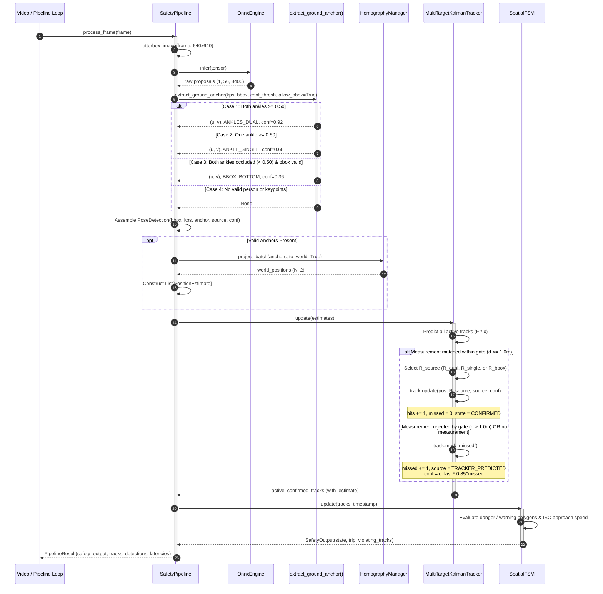

# Design: Lower-Limb Occlusion Degradation & Confidence Propagation

**Change ID:** `confidence-propagation`  
**Status:** Approved  
**Related Documents:**
- Proposal: [`openspec/changes/confidence-propagation/proposal.md`](file:///Users/xander/Projects/edge-safety-guard/openspec/changes/confidence-propagation/proposal.md)
- Exploration: [`openspec/changes/confidence-propagation/exploration.md`](file:///Users/xander/Projects/edge-safety-guard/openspec/changes/confidence-propagation/exploration.md)
- Architecture Decision Record: [`docs/decisions/adr-007-occlusion-handling-confidence-propagation.md`](file:///Users/xander/Projects/edge-safety-guard/docs/decisions/adr-007-occlusion-handling-confidence-propagation.md)

---

## 1. Architecture Overview

### 1.1 Context & Objectives
In vision-based industrial safety guarding (governed by ISO 13855:2024 and ISO 13849-1), optical occlusion of lower extremities is the primary operational failure mode. Low-lying obstacles (machinery skirts, pallets, conveyor side-guards, mobile AGVs/forklifts, or the bottom edge of the camera frame) regularly occlude human feet and ankles while the head, shoulders, and torso remain visible.

The `confidence-propagation` architectural change introduces:
1. A **4-Tier Graceful Degradation Anchor Hierarchy** spanning high-fidelity dual ankles down to constant-velocity dead reckoning.
2. A unified, immutable, and typed contract (`PositionEstimate`) carrying metric coordinates, source provenance, uncertainty confidence, and error covariance across the perception $\to$ extraction $\to$ projection $\to$ tracking $\to$ safeguarding pipeline.
3. **Adaptive Kalman Filtering** dynamically adjusting the measurement noise covariance matrix $R_{\text{source}}$ based on anchor source fidelity.
4. **Kinematic Confidence Decay** modeling information loss during sensor blackout/coasting ($c_k = c_{\text{last}} \cdot 0.85^k$).
5. Strict **100% Backward Compatibility** across all public properties, datatypes, and existing test suites.

### 1.2 End-to-End Pipeline Dataflow

```
Input Frame (H, W, 3)
         │
         ▼
[Stage 1: Preprocessing]
  Letterbox resize (640x640) with aspect ratio preservation
         │
         ▼
[Stage 2: Inference]
  YOLO Pose ONNX Model (1, 56, 8400 proposals)
         │
         ▼
[Stage 3: Ground Anchor Extraction & Hierarchy]
  extract_ground_anchor() evaluates keypoints & bounding boxes:
    ├── Tier 1: ANKLES_DUAL    (both ankles visible >= tau_conf)
    ├── Tier 2: ANKLE_SINGLE   (one ankle visible >= tau_conf)
    └── Tier 3: BBOX_BOTTOM    (ankles occluded; bbox bottom-center)
  Enriches PoseDetection with anchor_source & anchor_confidence
         │
         ▼
[Stage 4: Planar Homography Projection]
  H: P^2 -> R^2 projects original frame pixels to ground plane (Z_w = 0)
  Constructs metric PositionEstimate (xy_m, confidence, source)
         │
         ▼
[Stage 5: Multi-Target Kalman Tracking]
  MultiTargetKalmanTracker associates via Euclidean Gating (<= 1.0m)
    ├── Matched: MetricKalmanFilter.update(pos, R_source) with adaptive R
    └── Coasting: Tier 4 TRACKER_PREDICTED with exponential confidence decay
         │
         ▼
[Stage 6: Spatial Safeguarding FSM]
  SpatialFSM evaluates zone containment (danger / warning / release)
  and ISO 13855 approach speeds using enriched Track.estimate
         │
         ▼
PipelineResult(frame_id, timestamp, safety_output, tracks, detections, latencies)
```

---

## 2. Data Structures & Typed Contracts

The typed contracts are defined in [`src/core/kalman_filter.py`](file:///Users/xander/Projects/edge-safety-guard/src/core/kalman_filter.py) to prevent architectural dependency inversion (`core` must not depend on `pipeline`), and are re-exported by [`src/pipeline/safety_pipeline.py`](file:///Users/xander/Projects/edge-safety-guard/src/pipeline/safety_pipeline.py) and [`src/pipeline/__init__.py`](file:///Users/xander/Projects/edge-safety-guard/src/pipeline/__init__.py).

### 2.1 AnchorSource Enum

```python
class AnchorSource(str, Enum):
    """Origin provenance and fidelity classification of a ground position estimate."""
    ANKLES_DUAL = "ANKLES_DUAL"          # Tier 1: Midpoint of left and right ankles
    ANKLE_SINGLE = "ANKLE_SINGLE"        # Tier 2: Single detected ankle keypoint
    BBOX_BOTTOM = "BBOX_BOTTOM"          # Tier 3: Bounding box bottom-center proxy
    TRACKER_PREDICTED = "TRACKER_PREDICTED"  # Tier 4: Dead reckoning via Kalman prediction
```

### 2.2 PositionEstimate Dataclass

```python
@dataclass(frozen=True)
class PositionEstimate:
    """
    Immutable metric ground position estimate with provenance and uncertainty.
    
    Attributes:
        xy_m: Metric (X, Y) coordinates on the factory floor plane (meters).
        confidence: Normalized reliability metric in [0.0, 1.0].
        source: AnchorSource identifying the data tier.
        covariance: Optional 2x2 spatial position error covariance matrix (m^2).
    """
    xy_m: Tuple[float, float]
    confidence: float
    source: AnchorSource
    covariance: Optional[np.ndarray] = None

    def __post_init__(self) -> None:
        if len(self.xy_m) != 2:
            raise ValueError(f"xy_m must be a 2-tuple, got {self.xy_m}")
        if not (0.0 <= self.confidence <= 1.0):
            raise ValueError(f"confidence must be in [0.0, 1.0], got {self.confidence}")
        if self.covariance is not None:
            if not isinstance(self.covariance, np.ndarray) or self.covariance.shape != (2, 2):
                raise ValueError("covariance must be a 2x2 numpy array if provided.")
```

### 2.3 PoseDetection Extension

[`PoseDetection`](file:///Users/xander/Projects/edge-safety-guard/src/pipeline/safety_pipeline.py#L37-L42) is extended with backward-compatible default attributes:

```python
@dataclass
class PoseDetection:
    """Extracted pose detection containing bounding box, keypoints, and ground anchor."""
    bbox: Tuple[float, float, float, float]       # (x1, y1, x2, y2) original frame coords
    keypoints: np.ndarray                         # (17, 3) [x, y, conf]
    anchor: Optional[Tuple[float, float]] = None  # (u, v) original frame coords (retained for 100% backward compat)
    anchor_source: Optional[AnchorSource] = None  # Provenance tier
    anchor_confidence: float = 0.0                # Derived confidence score [0.0, 1.0]
```

### 2.4 Track Class Extension

[`Track`](file:///Users/xander/Projects/edge-safety-guard/src/core/kalman_filter.py#L288-L436) maintains backward compatibility for all existing properties (`track_id`, `state`, `position`, `velocity`, `speed`, `heading`, `missed_count`, `hits`, `age`, `filter`) while exposing new typed uncertainty properties:

```python
class Track:
    # Existing properties retained:
    # .track_id -> int
    # .state -> TrackState
    # .position -> Tuple[float, float]
    # .velocity -> Tuple[float, float]
    # .speed -> float
    # .heading -> float
    
    @property
    def source(self) -> AnchorSource:
        """Current origin source of the track's position estimate."""
        return self._source

    @property
    def confidence(self) -> float:
        """Current normalized confidence score [0.0, 1.0]."""
        return self._confidence

    @property
    def estimate(self) -> PositionEstimate:
        """
        Unified immutable PositionEstimate encapsulating position, confidence,
        provenance source, and 2x2 ground position error covariance.
        """
        cov_2x2 = self._filter.P[:2, :2].copy()
        return PositionEstimate(
            xy_m=self.position,
            confidence=self._confidence,
            source=self._source,
            covariance=cov_2x2,
        )
```

---

## 3. Mathematical Formulation

### 3.1 4-Tier Anchor Hierarchy & Confidence Scoring

The anchor extraction logic in `extract_ground_anchor` maps keypoint geometry and detection confidences to image anchor coordinates, initial source classification, and scalar confidence:

$$\tau_{\text{conf}} = 0.50 \quad (\text{default detection confidence threshold})$$

#### Tier 1: Dual Ankles (`ANKLES_DUAL`)
- **Criterion**: Left ankle $c_{15} \ge \tau_{\text{conf}}$ AND right ankle $c_{16} \ge \tau_{\text{conf}}$
- **Pixel Position**:
  $$\mathbf{u}_{\text{anchor}} = \frac{\mathbf{u}_{15} + \mathbf{u}_{16}}{2}$$
- **Confidence**:
  $$c_{\text{det}} = \frac{c_{15} + c_{16}}{2} \in [0.50, 1.00]$$

#### Tier 2: Single Ankle Fallback (`ANKLE_SINGLE`)
- **Criterion**: Exactly one ankle keypoint $v \in \{15, 16\}$ has $c_v \ge \tau_{\text{conf}}$
- **Pixel Position**:
  $$\mathbf{u}_{\text{anchor}} = \mathbf{u}_v$$
- **Confidence**:
  $$c_{\text{det}} = c_v \times 0.75 \in [0.375, 0.75]$$
  *(The $0.75$ scaling factor accounts for lateral stance uncertainty of $\pm 0.25\text{ m}$ away from the human sagittal center of mass).*

#### Tier 3: Bounding Box Bottom-Center (`BBOX_BOTTOM`)
- **Criterion**: Both ankles $c_{15} < \tau_{\text{conf}}$ and $c_{16} < \tau_{\text{conf}}$, valid person bounding box $(x_1, y_1, x_2, y_2)$ with person detection score $s_{\text{person}} \ge \tau_{\text{conf}}$, and `allow_bbox_fallback=True`
- **Pixel Position**:
  $$\mathbf{u}_{\text{anchor}} = \left( \frac{x_1 + x_2}{2}, \; y_2 \right)$$
- **Confidence**:
  $$c_{\text{det}} = s_{\text{person}} \times 0.40 \in [0.20, 0.40]$$
  *(The $0.40$ scaling factor penalizes the severe vertical parallax error when obstacles cut off legs above the floor level).*

#### Tier 4: Tracker Prediction (`TRACKER_PREDICTED`)
- **Criterion**: Active confirmed track unmatched during association in frame $t$
- **State Extrapolation**: Constant velocity kinematic prediction $\hat{\mathbf{x}}_{k|k-1} = \mathbf{F} \hat{\mathbf{x}}_{k-1|k-1}$
- **Confidence**: Exponential kinematic decay (see Section 3.3).

---

### 3.2 Adaptive Measurement Noise Scaling Matrix ($R_{\text{source}}$)

The discrete 2D Constant Velocity Kalman Filter models the observation vector $\mathbf{z}_k \in \mathbb{R}^2$ as:
$$\mathbf{z}_k = \mathbf{H} \mathbf{x}_k + \mathbf{v}_k, \quad \mathbf{v}_k \sim \mathcal{N}(\mathbf{0}, \mathbf{R}_{\text{source}})$$
where $\mathbf{H} = \begin{bmatrix} 1 & 0 & 0 & 0 \\ 0 & 1 & 0 & 0 \end{bmatrix}$.

Let nominal position measurement noise variance be $r_{\text{pos}} = 0.05\text{ m}^2$, giving base covariance:
$$\mathbf{R}_0 = \begin{bmatrix} r_{\text{pos}} & 0 \\ 0 & r_{\text{pos}} \end{bmatrix} = \begin{bmatrix} 0.05 & 0 \\ 0 & 0.05 \end{bmatrix}\text{ m}^2$$

The source-specific measurement noise covariance $\mathbf{R}_{\text{source}}$ scales $\mathbf{R}_0$ by a tier weighting factor $\alpha_{\text{source}}$:

$$\mathbf{R}_{\text{source}} = \alpha_{\text{source}} \cdot \mathbf{R}_0$$

$$\alpha_{\text{source}} = \begin{cases}
1.0 & \text{for } \text{ANKLES\_DUAL} \implies \mathbf{R}_{\text{dual}} = \begin{bmatrix} 0.05 & 0 \\ 0 & 0.05 \end{bmatrix}\text{ m}^2 \\
2.0 & \text{for } \text{ANKLE\_SINGLE} \implies \mathbf{R}_{\text{single}} = \begin{bmatrix} 0.10 & 0 \\ 0 & 0.10 \end{bmatrix}\text{ m}^2 \\
5.0 & \text{for } \text{BBOX\_BOTTOM} \implies \mathbf{R}_{\text{bbox}} = \begin{bmatrix} 0.25 & 0 \\ 0 & 0.25 \end{bmatrix}\text{ m}^2
\end{cases}$$

#### Impact on Kalman Gain and Innovation Shock
The optimal Kalman Gain $\mathbf{K}_k \in \mathbb{R}^{4 \times 2}$ is computed as:
$$\mathbf{K}_k = \mathbf{P}_{k|k-1} \mathbf{H}^T \left( \mathbf{H} \mathbf{P}_{k|k-1} \mathbf{H}^T + \mathbf{R}_{\text{source}} \right)^{-1}$$

When updating with a degraded Tier 3 measurement (`BBOX_BOTTOM`), the $5\times$ inflated measurement covariance $\mathbf{R}_{\text{bbox}}$ suppresses the magnitude of $\mathbf{K}_k$. Consequently, in the state update:
$$\hat{\mathbf{x}}_{k|k} = \hat{\mathbf{x}}_{k|k-1} + \mathbf{K}_k \left( \mathbf{z}_k - \mathbf{H}\hat{\mathbf{x}}_{k|k-1} \right)$$
the filter places dominant weight on the prior kinematic trajectory $\hat{\mathbf{x}}_{k|k-1}$ rather than overreacting to bounding box boundary fluctuations.

---

### 3.3 Exponential Kinematic Confidence Decay

When an active track experiences an occlusion and receives no matching measurement in frame $t$, it transitions to or remains in `TrackState.COASTING`.

While the Kalman error covariance $\mathbf{P}_{k|k-1}$ expands via the discrete process noise:
$$\mathbf{P}_{k|k-1} = \mathbf{F} \mathbf{P}_{k-1|k-1} \mathbf{F}^T + \mathbf{Q}$$
the scalar confidence score decays exponentially as a function of consecutive unobserved frames $k$:

$$c_k = c_{\text{last}} \cdot \left( \lambda_{\text{decay}} \right)^k$$

where:
- $c_{\text{last}} \in [0.0, 1.0]$ is the confidence score recorded at the most recent physical measurement update.
- $k = \text{missed\_count} \in [1, \text{max\_missed}]$.
- $\lambda_{\text{decay}} = 0.85$ is the per-frame kinematic persistence factor.

#### Decay Trajectory over Coasting Horizon ($N_{\text{max}} = 5$ frames at 30 FPS, $\Delta t = 166.7\text{ ms}$):

| Missed Frame ($k$) | $\lambda^k = 0.85^k$ | Nominal Dual ($c_{\text{last}} = 1.0$) | Degraded Bbox ($c_{\text{last}} = 0.40$) |
| :---: | :---: | :---: | :---: |
| **0 (Observed)** | $1.000$ | $1.000$ | $0.400$ |
| **1** | $0.850$ | $0.850$ | $0.340$ |
| **2** | $0.723$ | $0.723$ | $0.289$ |
| **3** | $0.614$ | $0.614$ | $0.246$ |
| **4** | $0.522$ | $0.522$ | $0.209$ |
| **5 (Max Coast)** | $0.444$ | $0.444$ | $0.177$ |
| **6 (Deleted)** | $0.377$ | *Track Pruned* | *Track Pruned* |

Upon receiving a valid measurement update, $c_k$ instantly restores to the newly measured source confidence ($c_{\text{meas}}$) and $\text{missed\_count}$ resets to 0.

---

### 3.4 Euclidean Spatial Gating Formulation

To prevent association jumps caused by severe vertical parallax (e.g. an operator walking behind a 1-meter high table where the bounding box bottom projects 2 to 4 meters away on the ground plane), Euclidean distance gating is enforced prior to association.

Let the predicted ground position of track $i$ be $\hat{\mathbf{p}}_i = [\hat{X}_i, \hat{Y}_i]^T = \mathbf{H} \hat{\mathbf{x}}_{i, k|k-1}$.  
Let the reprojected ground coordinate of detection candidate $j$ be $\mathbf{p}_j = [X_j, Y_j]^T$.

The Euclidean innovation distance is:
$$d(i, j) = \|\mathbf{p}_j - \hat{\mathbf{p}}_i\|_2 = \sqrt{(X_j - \hat{X}_i)^2 + (Y_j - \hat{Y}_i)^2}$$

The association gate constraint is defined by the spatial threshold $d_{\text{gate}} = 1.0\text{ m}$:

$$C_{i, j} = \begin{cases}
d(i, j) & \text{if } d(i, j) \le d_{\text{gate}} \\
\infty & \text{if } d(i, j) > d_{\text{gate}}
\end{cases}$$

#### Parallax Mitigation Proof:
1. When an operator walks behind an obstacle of height $h_{\text{obs}} = 1.0\text{ m}$, the camera ray through the bbox bottom $(u, v_{\text{bottom}})$ intersects the tabletop rather than the floor.
2. Homography projection $H$ assumes $Z_w = 0$, projecting this ray onto the floor plane behind the table at an offset $\Delta d_{\text{parallax}} \ge 2.0\text{ m}$.
3. Because $\Delta d_{\text{parallax}} > d_{\text{gate}} = 1.0\text{ m}$, the gate rejects the association ($C_{i, j} = \infty$).
4. The track does **not** jump to the false obstacle coordinate; instead, it safely enters `COASTING` mode (`TRACKER_PREDICTED`), preserving smooth kinematic continuity and true zone dwell timers.

---

## 4. Sequence Diagram: Frame Processing with Occlusion Fallback

The following Mermaid sequence diagram illustrates the lifecycle of a frame undergoing perception, degraded anchor extraction, homography, adaptive tracking, and FSM evaluation:



---

## 5. Migration & Backwards Compatibility Plan

### 5.1 Backward Compatibility Contract

All existing public APIs, attributes, and behavior contracts are guaranteed to remain 100% functional without requiring modifications to existing client code:

| Component | Existing Contract | Extended Contract | Compatibility Guarantee |
| :--- | :--- | :--- | :--- |
| `extract_ankle_anchor` | `(kps, conf_thresh, scale, pad_x, pad_y) -> Optional[Tuple[float, float]]` | Retained verbatim with identical signature and logic | **100% Unchanged**. Existing tests in `tests/test_pipeline.py` pass without diff. |
| `extract_ground_anchor` | *None (New)* | `(kps, bbox, conf_thresh, scale, pad_x, pad_y, allow_bbox_fallback=True) -> Optional[Tuple[Tuple[float, float], AnchorSource, float]]` | **New Function**. Returns coordinates, `AnchorSource`, and confidence. |
| `PoseDetection` | Dataclass `(bbox, keypoints, anchor)` | Adds optional `anchor_source: Optional[AnchorSource] = None` and `anchor_confidence: float = 0.0` | **100% Compatible**. Unpacking by name or position continues to function. |
| `MetricKalmanFilter.update` | `update(measurement)` where `measurement` is 2-element position | Adds optional `R: Optional[np.ndarray] = None` parameter | **100% Compatible**. If `R is None`, falls back to internal `self._R`. |
| `Track.position` | Property returning `Tuple[float, float]` | Retained verbatim; returns `Tuple[float, float]` | **100% Compatible**. All spatial distance & zone checks continue without change. |
| `Track.estimate` | *None (New)* | New property returning frozen `PositionEstimate` | **Additive Only**. Exposes typed uncertainty without breaking existing code. |
| `MultiTargetKalmanTracker.update` | Accepts `Union[np.ndarray, List[Tuple[float, float]], Sequence[Sequence[float]]]` | Extended to also accept `Sequence[PositionEstimate]` | **100% Compatible**. Plain 2D coordinates are automatically wrapped into `ANKLES_DUAL` with `confidence=1.0`. |
| `PipelineResult` | Fields `frame_id, timestamp, safety_output, tracks, detections, latencies` | Field structure completely identical | **100% Compatible**. |

### 5.2 Step-by-Step Implementation & Rollout Plan

1. **Step 1: Core Types & Contracts (`src/core/kalman_filter.py`)**
   - Implement `AnchorSource` enum and `@dataclass(frozen=True) PositionEstimate`.
   - Update `MetricKalmanFilter.update(measurement, R=None)` to accept optional measurement noise override.
   - Update `Track`:
     - Initialize `_source: AnchorSource = AnchorSource.ANKLES_DUAL` and `_confidence: float = 1.0`.
     - In `Track.update()`, accept optional `source: AnchorSource`, `confidence: float`, and `R: Optional[np.ndarray]`.
     - In `Track.mark_missed()`, set `_source = AnchorSource.TRACKER_PREDICTED` and decay `_confidence = _last_observed_confidence * (0.85 ** self._missed_count)`.
     - Add properties `.source`, `.confidence`, and `.estimate`.

2. **Step 2: Multi-Target Tracker Adaptive Updates (`src/core/kalman_filter.py`)**
   - In `MultiTargetKalmanTracker.update()`, detect if inputs are `PositionEstimate` instances or raw coordinates.
   - For `PositionEstimate` inputs:
     - Map source to measurement noise matrix:
       - `ANKLES_DUAL` $\implies R_0$
       - `ANKLE_SINGLE` $\implies 2.0 R_0$
       - `BBOX_BOTTOM` $\implies 5.0 R_0$
     - Apply Euclidean gating ($1.0\text{ m}$).
     - Pass source, confidence, and scaled $R$ to matched track updates.

3. **Step 3: Ground Anchor Extraction & Pipeline Propagation (`src/pipeline/safety_pipeline.py`)**
   - Re-export `AnchorSource` and `PositionEstimate`.
   - Retain `extract_ankle_anchor()` for backward compatibility.
   - Implement `extract_ground_anchor()`.
   - Update `PoseDetection` dataclass with `anchor_source` and `anchor_confidence`.
   - In `SafetyPipeline.parse_detections()`, invoke `extract_ground_anchor()` and populate `PoseDetection`.
   - In `SafetyPipeline.process_frame()`, construct `PositionEstimate` objects from projected world coordinates and detection metadata, and pass them to `self.tracker.update()`.

4. **Step 4: Unit & Regression Testing**
   - Add unit tests in `tests/test_kalman.py`:
     - Verify adaptive $R$ scaling dampens state updates.
     - Verify exponential confidence decay: $c_k = c_0 \cdot 0.85^k$ over missed frames.
     - Verify confidence restoration upon re-detection.
     - Verify Euclidean gating ($1.0\text{ m}$) rejects large jumps.
     - Verify `PositionEstimate` immutability and covariance slicing.
   - Add unit tests in `tests/test_pipeline.py`:
     - Verify `extract_ground_anchor` 4-tier fallback: dual ankles, single ankle, bbox bottom, and drop.
     - Verify `PoseDetection` contains `anchor_source` and `anchor_confidence`.
     - Verify pipeline end-to-end execution latency remains $\le 50\text{ ms}$.
   - Run complete test suite (`pytest tests/`) to confirm 100% pass rate.

5. **Step 5: Documentation & Memory Persistence**
   - Update OpenSpec capability specifications:
     - `openspec/specs/safety-pipeline/spec.md`
     - `openspec/specs/kalman-tracking/spec.md`
   - Persist architecture decision and design artifacts.
