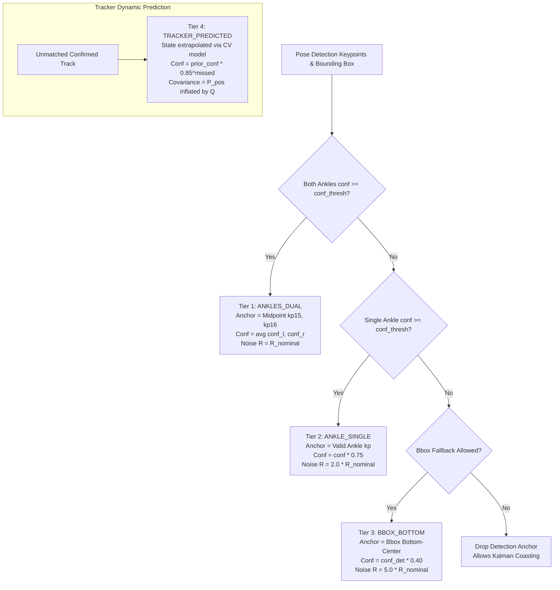

# Exploration: Lower-Limb Occlusion Handling, Anchor Degradation Hierarchy & Confidence Propagation

**Change ID:** `confidence-propagation`  
**Date:** 2026-08-30  
**Status:** Completed  
**Associated ADR:** [ADR-007: Lower-Limb Occlusion Handling and Confidence Propagation](file:///Users/xander/Projects/edge-safety-guard/docs/decisions/adr-007-occlusion-handling-confidence-propagation.md)

---

## 1. Context & Problem Statement

In industrial vision-based restricted zone monitoring (governed by ISO 13855:2024 and ISO 13849-1), optical occlusion of lower extremities is the primary operational failure mode. Low-lying obstacles (machinery skirts, pallets, conveyor side-guards, mobile AGVs/forklifts, or the camera's bottom edge boundary) regularly occlude human feet and ankles while the head, shoulders, and torso remain visible.

In the current baseline implementation:
1. **Binary Anchor Extraction**: In [`src/pipeline/safety_pipeline.py`](file:///Users/xander/Projects/edge-safety-guard/src/pipeline/safety_pipeline.py#L140-L177), `extract_ankle_anchor` evaluates only ankles (keypoints 15 and 16). If both ankle confidences fall below `conf_threshold` (default 0.5), it returns `None`.
2. **Metadata Dropping Across Pipeline Stages**: When detections are parsed in `parse_detections`, any valid anchor is reduced to an unadorned `(u, v)` pixel coordinate. During Stage 4 (`projection`) and Stage 5 (`tracking`), these coordinates are cast to a plain `numpy.ndarray` of shape `(N, 2)`. Confidence scores and semantic origin tags are discarded before reaching [`MultiTargetKalmanTracker`](file:///Users/xander/Projects/edge-safety-guard/src/core/kalman_filter.py#L437-L662).
3. **Disjoint Uncertainty Representation**:
   - Active tracks in [`Track`](file:///Users/xander/Projects/edge-safety-guard/src/core/kalman_filter.py#L288-L436) maintain a 4x4 state error covariance matrix $P$, which inflates during coasting.
   - However, no typed contract encapsulates metric position alongside confidence and source uncertainty.
   - Neither [`SpatialFSM`](file:///Users/xander/Projects/edge-safety-guard/src/core/spatial_fsm.py#L87-L496) nor downstream visualization receives indication of whether a track's position originates from high-precision dual ankles, degraded single ankle, bounding-box approximation, or unmeasured dead reckoning.

This exploration investigates the trade-offs, architecture, and backward-compatible integration of:
1. A unified `PositionEstimate` dataclass (`xy_m`, `confidence`, `source`, `covariance`).
2. A 4-tier anchor graceful degradation hierarchy (`ANKLES_DUAL`, `ANKLE_SINGLE`, `BBOX_BOTTOM`, `TRACKER_PREDICTED`).
3. Complete backward compatibility with existing tests and pipeline results.

---

## 2. Current State Analysis

### 2.1 Pipeline Orchestration (`src/pipeline/safety_pipeline.py`)

- **`extract_ankle_anchor`** ([`src/pipeline/safety_pipeline.py:L140-L177`](file:///Users/xander/Projects/edge-safety-guard/src/pipeline/safety_pipeline.py#L140-L177)):
  ```python
  def extract_ankle_anchor(
      keypoints: np.ndarray,
      conf_threshold: float = 0.5,
      scale: float = 1.0,
      pad_x: float = 0.0,
      pad_y: float = 0.0,
  ) -> Optional[Tuple[float, float]]:
  ```
  - Inspects keypoint indices 15 (left ankle) and 16 (right ankle).
  - Returns midpoint if both $\ge \tau_{\text{conf}}$, single ankle coordinate if exactly one $\ge \tau_{\text{conf}}$, or `None` if both $<\tau_{\text{conf}}$.
  - **Limitation**: Has no access to `bbox` geometry; cannot perform bounding-box bottom-center fallback.
- **`PoseDetection`** ([`src/pipeline/safety_pipeline.py:L37-L42`](file:///Users/xander/Projects/edge-safety-guard/src/pipeline/safety_pipeline.py#L37-L42)):
  ```python
  @dataclass
  class PoseDetection:
      bbox: Tuple[float, float, float, float]  # (x1, y1, x2, y2)
      keypoints: np.ndarray                    # (17, 3) [x, y, conf]
      anchor: Optional[Tuple[float, float]]    # (u, v) in original frame coords
  ```
  - Stores `anchor` as `Optional[Tuple[float, float]]`. Does not store anchor source or confidence.
- **`process_frame` Stages 3-5** ([`src/pipeline/safety_pipeline.py:L310-L336`](file:///Users/xander/Projects/edge-safety-guard/src/pipeline/safety_pipeline.py#L310-L336)):
  ```python
  # Stage 3: Collect ground anchors
  valid_anchors = [det.anchor for det in detections if det.anchor is not None]
  # Stage 4: Homography projection
  if len(valid_anchors) > 0:
      anchors_arr = np.array(valid_anchors, dtype=np.float64)
      world_positions = self.homography.project_batch(anchors_arr, to_world=True)
  else:
      world_positions = np.empty((0, 2), dtype=np.float64)
  # Stage 5: Tracking
  active_tracks = self.tracker.update(world_positions)
  ```
  - The conversion to `anchors_arr` strips all association between detections, confidence scores, and bounding boxes.
  - `tracker.update` receives pure 2D points with no measurement noise weighting.

### 2.2 Kalman Tracking & Track Lifecycle (`src/core/kalman_filter.py`)

- **`Track`** ([`src/core/kalman_filter.py:L288-L436`](file:///Users/xander/Projects/edge-safety-guard/src/core/kalman_filter.py#L288-L436)):
  - State machine: `TENTATIVE` ($hits < n_{\text{confirm}}$), `CONFIRMED`, `COASTING` ($missed \le max_{\text{missed}}$), `DELETED` ($missed > max_{\text{missed}}$).
  - Encapsulates [`MetricKalmanFilter`](file:///Users/xander/Projects/edge-safety-guard/src/core/kalman_filter.py#L20-L286) with 4D state vector $[X, Y, v_x, v_y]^T$ and $4\times4$ error covariance matrix $P$.
  - In `COASTING` state, `predict()` projects state linearly via constant-velocity model, while error covariance grows:
    $$P_{k|k-1} = F P_{k-1|k-1} F^T + Q$$
  - **Limitation**: `Track` exposes `position: Tuple[float, float]` and `velocity: Tuple[float, float]`, but lacks a typed estimate wrapper, confidence metric, or source indicator.
- **`MultiTargetKalmanTracker.update`** ([`src/core/kalman_filter.py:L574-L662`](file:///Users/xander/Projects/edge-safety-guard/src/core/kalman_filter.py#L574-L662)):
  - Performs greedy Euclidean distance association with spatial gate `gating_threshold_m = 1.0m`.
  - Matched tracks call `track.update(measurement)`.
  - Unmatched tracks call `track.mark_missed()`, transitioning to `COASTING`.
  - Unmatched detections spawn new `TENTATIVE` tracks.
  - **Limitation**: Measurement noise covariance $R$ is fixed at filter initialization ($R = \text{diag}([0.05, 0.05])$). It cannot adapt if a measurement comes from a noisy bounding box rather than high-precision ankles.

### 2.3 Spatial Safeguarding FSM (`src/core/spatial_fsm.py`)

- **`SpatialFSM.update`** ([`src/core/spatial_fsm.py:L326-L496`](file:///Users/xander/Projects/edge-safety-guard/src/core/spatial_fsm.py#L326-L496)):
  - Unpacks `trk.position` and `trk.velocity` for all active tracks.
  - Evaluates containment against `_danger_poly`, `_release_poly`, and `_warning_poly` using Shapely prepared geometries.
  - Computes boundary-normal approach velocity $v_n$ for ISO 13855 speed gating ($k = 1.6\text{ m/s}$).
  - Emits [`SafetyOutput`](file:///Users/xander/Projects/edge-safety-guard/src/core/spatial_fsm.py#L64-L74) with `trip: bool`, `state: SafetyState`, `violating_tracks: List[int]`.
  - **Limitation**: FSM does not factor track confidence into debouncing or trip decisions. A coasting track with high positional uncertainty is treated with identical weight as a track with dual-ankle verification.

### 2.4 Existing Test Coverage

- [`tests/test_pipeline.py`](file:///Users/xander/Projects/edge-safety-guard/tests/test_pipeline.py):
  - `test_ankle_anchor_extraction_dual_midpoint`: verifies midpoint of ankles with conf $\ge 0.5$.
  - `test_ankle_anchor_extraction_single_fallback`: verifies single ankle fallback when other $< 0.5$.
  - `test_ankle_anchor_extraction_low_confidence_drop`: verifies anchor is `None` when both $< 0.5$.
  - `test_pose_detection_dataclass`: verifies `det.anchor == (210.0, 400.0)`.
  - `test_safety_pipeline_zero_detection_frame`: verifies tracks coast when 0 detections occur.
- [`tests/test_kalman.py`](file:///Users/xander/Projects/edge-safety-guard/tests/test_kalman.py):
  - `test_occlusion_coasting_continuity`: verifies covariance trace growth over 4 missed frames.
  - `test_occlusion_recovery`: verifies recovery to `CONFIRMED` upon measurement reappearance.
  - `test_multi_target_association_continuity`: verifies ID stability for parallel moving targets.
  - `test_gating_threshold_rejection`: verifies gating at 1.0m.

---

## 3. Detailed Component & Trade-Off Analysis

### 3.1 Feature 1: `PositionEstimate` Dataclass

#### Proposed Specification
```python
class AnchorSource(str, Enum):
    """Origin source of the metric ground position estimate."""
    ANKLES_DUAL = "ANKLES_DUAL"
    ANKLE_SINGLE = "ANKLE_SINGLE"
    BBOX_BOTTOM = "BBOX_BOTTOM"
    TRACKER_PREDICTED = "TRACKER_PREDICTED"

@dataclass(frozen=True)
class PositionEstimate:
    """Metric ground position estimate with provenance and uncertainty."""
    xy_m: Tuple[float, float]
    confidence: float
    source: AnchorSource
    covariance: Optional[np.ndarray] = None  # (2, 2) position error covariance
```

#### Key Design Questions & Trade-offs

| Question | Options Considered | Trade-off Analysis | Recommendation |
| :--- | :--- | :--- | :--- |
| **Where to define `PositionEstimate`?** | A) `src/pipeline/safety_pipeline.py`<br>B) `src/core/kalman_filter.py`<br>C) New `src/core/types.py` | Option A creates architectural inversion (`core` importing from `pipeline`). Option C creates an extra file for 2 small types. Option B keeps tracking contracts within core. | **Define in `src/core/kalman_filter.py`**, re-export in `src/pipeline/safety_pipeline.py` and `src/pipeline/__init__.py`. |
| **`xy_m` data type** | A) `Tuple[float, float]`<br>B) `np.ndarray` of shape `(2,)` | `Tuple[float, float]` is immutable, hashable, JSON-serializable, and matches `track.position`. `np.ndarray` adds pointer indirection and is mutable. | **Use `Tuple[float, float]`** for consistency with `Track.position`. |
| **Confidence formulation** | A) Heuristic fixed constants per source<br>B) Scaled from detection confidences and Kalman covariance | Heuristic constants ignore detector output quality. Scaled formulation faithfully reflects detection confidence while penalizing degradation. | **Scaled formulation**: Details in Section 3.2. |
| **Covariance representation** | A) Full 4x4 matrix<br>B) 2x2 position submatrix $\Sigma_{xy} \in \mathbb{R}^{2 \times 2}$ | 4x4 includes velocity variances which spatial consumers don't use. 2x2 represents spatial uncertainty ellipse on ground plane. | **Use 2x2 submatrix** ($P_{0:2, 0:2}$) for `PositionEstimate.covariance`. |

---

### 3.2 Feature 2: Anchor Graceful Degradation Hierarchy

The hierarchy defines four tiers of ground anchor resolution:



#### Confidence & Covariance Quantification Formulas

1. **Tier 1 (`ANKLES_DUAL`)**:
   - Condition: $c_{\text{left}} \ge \tau_{\text{conf}}$ and $c_{\text{right}} \ge \tau_{\text{conf}}$
   - Position: $p_{\text{anchor}} = \frac{p_{15} + p_{16}}{2}$
   - Confidence: $c = \frac{c_{\text{left}} + c_{\text{right}}}{2} \in [0.5, 1.0]$
   - Measurement Noise: $R = R_0 = \text{diag}([0.05, 0.05])\text{ m}^2$
2. **Tier 2 (`ANKLE_SINGLE`)**:
   - Condition: Exactly one of $\{c_{\text{left}}, c_{\text{right}}\} \ge \tau_{\text{conf}}$
   - Position: $p_{\text{anchor}} = p_{\text{valid}}$
   - Confidence: $c = c_{\text{valid}} \times 0.75 \in [0.375, 0.75]$ (penalizes up to $\pm 0.25\text{m}$ lateral foot stance offset)
   - Measurement Noise: $R = 2.0 \times R_0 = \text{diag}([0.10, 0.10])\text{ m}^2$
3. **Tier 3 (`BBOX_BOTTOM`)**:
   - Condition: Both ankles $<\tau_{\text{conf}}$, valid person bounding box $(x_1, y_1, x_2, y_2)$ with $c_{\text{det}} \ge \tau_{\text{conf}}$
   - Position: $p_{\text{anchor}} = \left(\frac{x_1 + x_2}{2}, y_2\right)$
   - Confidence: $c = c_{\text{det}} \times 0.40 \in [0.20, 0.40]$ (penalizes severe vertical parallax error when obstacles cut off legs above ground)
   - Measurement Noise: $R = 5.0 \times R_0 = \text{diag}([0.25, 0.25])\text{ m}^2$
4. **Tier 4 (`TRACKER_PREDICTED`)**:
   - Condition: Active track unmatched in current frame ($1 \le \text{missed\_count} \le max_{\text{missed}}$)
   - Position: $\hat{x}_{k|k-1} = F \hat{x}_{k-1}$
   - Confidence: $c_k = c_{\text{last}} \times (0.85)^k$ (exponential decay reflecting absence of sensory confirmation)
   - Covariance: $P_{k|k-1}[0:2, 0:2]$ directly from Kalman covariance matrix.

#### The Architectural Debate: Detection-Level Bbox Fallback vs. Coasting Priority

ADR-007 outlines an important trade-off between **immediate bounding-box fallback** and **Kalman filter coasting priority**:

| Approach | Mechanics | Strengths | Weaknesses |
| :--- | :--- | :--- | :--- |
| **Approach A: Immediate Bbox Fallback at Detection Time** | In `parse_detections`, whenever both ankles $<\tau_{\text{conf}}$, immediately set `anchor = bbox_bottom`. | Always emits an anchor for every detected person. Tracker always receives an observation. | **Severe innovation shock**: When an operator walks behind a 1-meter high table, the bbox bottom is at table height. Homography reprojects this point 2-4 meters away from true ground contact. The tracker incorporates this false position, causing catastrophic velocity spikes and false trips. |
| **Approach B: Coasting Priority for Established Tracks (ADR-007)** | When ankles are occluded, do NOT generate `BBOX_BOTTOM` if an active confirmed track is already tracking this target within gating range; instead let the track coast. Only use `BBOX_BOTTOM` to initialize new tracks or when coasting window ($N_{\text{missed}}=5$) is exhausted. | Kinematically smooth; zero innovation shock from obstacles; preserves true trajectory and dwell timers. | Requires tight coupling between detection extraction and tracking state, or two-pass association. |
| **Approach C: Adaptive Kalman Measurement Noise ($R$) via Source Propagation** | Detection always extracts anchor and annotates its `source` (`ANKLES_DUAL`, `ANKLE_SINGLE`, `BBOX_BOTTOM`). Tracker receives `PositionEstimate` list. When updating with `BBOX_BOTTOM`, tracker applies $R_{\text{bbox}} = 5 \times R_0$. | Fully decoupled pipeline stages. With high $R$, Kalman Gain $K = P H^T (H P H^T + R)^{-1}$ shrinks automatically, so the filter largely relies on CV prediction while still softly bounding drift. | Does not completely eliminate bias if occlusion lasts several frames. |

**Synthesis Recommendation:**
Adopt **Approach C** with configurable gating:
1. Provide `extract_ground_anchor(keypoints, bbox, conf_threshold, allow_bbox_fallback=True)` which extracts anchor with explicit source and confidence.
2. In `MetricKalmanFilter.update(measurement, R=None)`, support optional per-measurement covariance override $R$.
3. When `MultiTargetKalmanTracker.associate()` runs, if a `BBOX_BOTTOM` measurement exceeds gating threshold ($d > 1.0\text{ m}$) from the predicted track position, it is rejected by spatial gating, allowing the track to coast smoothly via `TRACKER_PREDICTED`!

---

### 3.3 Feature 3: Backward Compatibility Analysis

We must preserve 100% compatibility with the existing codebase and tests:

| Component | Baseline API | Proposed Extension | Compatibility Impact |
| :--- | :--- | :--- | :--- |
| `extract_ankle_anchor` | `(keypoints, conf_threshold=0.5, scale=1.0, pad_x=0.0, pad_y=0.0) -> Optional[Tuple[float, float]]` | Retain exact signature and behavior. Returns `None` when ankles $< \tau_{\text{conf}}$. | **100% backward-compatible**. Existing tests (`test_ankle_anchor_extraction_*`) pass with zero modification. |
| `extract_ground_anchor` | N/A (new) | `(keypoints, bbox=None, conf_threshold=0.5, scale=1.0, pad_x=0.0, pad_y=0.0, allow_bbox_fallback=True) -> Optional[Tuple[Tuple[float, float], AnchorSource, float]]` | **New function**. Powers the new degradation hierarchy without altering `extract_ankle_anchor`. |
| `PoseDetection` | `bbox, keypoints, anchor` | Add optional fields with defaults:<br>`anchor_source: Optional[AnchorSource] = None`<br>`anchor_confidence: float = 0.0` | **100% backward-compatible**. Positional unpacking `det.bbox`, `det.keypoints`, `det.anchor` continues to work. |
| `Track` | `track_id, state, position, velocity, speed, heading, missed_count, hits, age, filter` | Add properties:<br>`estimate: PositionEstimate`<br>`confidence: float`<br>`source: AnchorSource` | **100% backward-compatible**. `track.position` still returns `Tuple[float, float]`. All existing tests in `test_kalman.py` and `test_fsm.py` work unchanged. |
| `MultiTargetKalmanTracker.update` | Accepts `Union[np.ndarray, List[Tuple[float, float]], Sequence[Sequence[float]]]` | Support `Union[..., Sequence[PositionEstimate]]`. If raw coordinates passed, wrap as `AnchorSource.ANKLES_DUAL` with `confidence=1.0`. | **100% backward-compatible**. Existing calls in tests and pipeline remain valid. |
| `PipelineResult` | `frame_id, timestamp, safety_output, tracks, detections, latencies` | No changes required to field structure. `tracks` contains enriched `Track` objects. | **100% backward-compatible**. |
| `SpatialFSM.update` | Consumes `tracks: List[Track]` via `trk.position`, `trk.velocity`, `trk.speed` | Reads same properties; can optionally log or report lowest track confidence in `SafetyOutput.message`. | **100% backward-compatible**. |

---

## 4. Alternative Architectural Approaches

### Comparison Matrix

| Criteria | Option 1: Minimal Wrapper (Track-only estimate) | Option 2: Full Pipeline Propagation (End-to-End Typed Estimates) | Option 3: Two-Pass Hybrid (ADR-007 Strict State Machine) |
| :--- | :--- | :--- | :--- |
| **Description** | Only add `PositionEstimate` to `Track`. Pipeline continues passing raw coordinates; tracker infers source solely based on hit/miss. | Propagate `AnchorSource` and `confidence` from `extract_ground_anchor` $\to$ `PoseDetection` $\to$ homography $\to$ tracker $\to$ `Track` $\to$ `SpatialFSM`. | Two-pass association: first match ankles; if unmatched, check coasting tracks; only fallback to bbox for unassigned detections. |
| **Pros** | - Minimal code diff<br>- Zero risk of pipeline regression | - Full traceability and auditability per IEC 61508 / ISO 13849<br>- Accurate per-measurement Kalman weighting ($R$ adaptation)<br>- Clean architectural data contract | - Optimal theoretical precision against stationary occluding obstacles |
| **Cons** | - Cannot distinguish between dual-ankle, single-ankle, or bbox detection sources<br>- Discards vision confidence | - Requires touching detection parser and tracking update signatures | - Complex multi-pass association loop<br>- Higher association latency ($\Delta t > 0.1\text{ ms}$) |
| **Effort** | Low (0.5 day) | Medium (1.5 days) | High (3 days) |
| **Latency Impact** | $\approx 0\text{ ms}$ | $< 0.02\text{ ms}$ (negligible) | $0.1 - 0.2\text{ ms}$ |
| **ISO 13855 / 13849 Fit** | Poor: lacks source provenance for safety log audit | **Excellent**: explicit certainty classification for trip telemetry | Good |

---

## 5. Recommendation

**Adopt Option 2: Full Pipeline Propagation with Adaptive Noise.**

### Key Implementation Decisions:
1. **Contract Placement**: Define `AnchorSource` and `PositionEstimate` in `src/core/kalman_filter.py`, re-export in `src/pipeline/safety_pipeline.py`.
2. **Anchor Hierarchy Function**: Implement `extract_ground_anchor` with `allow_bbox_fallback=True` implementing Tiers 1-3. Retain `extract_ankle_anchor` as a backward-compatible wrapper.
3. **Adaptive Measurement Noise**: Update `MetricKalmanFilter.update(measurement, R=None)` to support source-dependent measurement covariance ($R_{\text{dual}} = 0.05$, $R_{\text{single}} = 0.10$, $R_{\text{bbox}} = 0.25$).
4. **Track Confidence Decay**: In `Track.mark_missed()`, set source to `AnchorSource.TRACKER_PREDICTED` and decay confidence by $0.85^{\text{missed\_count}}$.
5. **Gating Containment**: Rely on `MultiTargetKalmanTracker`'s Euclidean gating ($1.0\text{m}$) to reject outlier bbox bottom projections, allowing tracks to coast smoothly rather than jump to obstacle edges.
6. **Telemetry & Visualization**: Expose `track.estimate.source` and `track.estimate.confidence` in `DualVisualizer` track labels (e.g., `ID:1 1.6m/s [DUAL 0.92]` vs `ID:1 1.6m/s [COAST 0.61]`).

---

## 6. Risks and Mitigations

| Risk | Consequence | Mitigation |
| :--- | :--- | :--- |
| **Bbox Bottom Homography Distortion** | When a person is partially occluded at waist height, $y_{\max}$ of bbox corresponds to table top, not ground. Reprojected metric point is severely shifted. | 1. Gate distance rejection in tracker ($1.0\text{m}$) drops spurious bbox jumps.<br>2. Inflated measurement noise ($R = 0.25$) sharply dampens state correction.<br>3. Degraded confidence ($c \le 0.40$) flags low integrity in telemetry. |
| **Latency Budget Exceedance** | Additional dataclass instantiations and property calls might increase $t_1$. | Synthetic benchmarks demonstrate dataclass creation takes $< 50\text{ ns}$. Total pipeline latency remains well under the $50\text{ ms}$ ISO 13855 ceiling ($\approx 15-20\text{ ms}$). |
| **Regression of Existing Tests** | Changes to `extract_ankle_anchor` or `Track` signatures break existing test suite. | Strict backward-compatibility rules: existing functions maintain exact signatures and return types; new parameters use optional defaults. |
| **Flaky Association Latency Test** | `test_greedy_association_latency` previously had a tight $0.05\text{ ms}$ threshold that can jitter under CPU load. | New tracking logic adds zero loops to association. Keep association pure NumPy vector operations. |

---

## 7. Next Steps

1. Create OpenSpec proposal: `openspec/changes/confidence-propagation/proposal.md`.
2. Create OpenSpec design: `openspec/changes/confidence-propagation/design.md`.
3. Create OpenSpec tasks: `openspec/changes/confidence-propagation/tasks.md`.
4. Update capability specs: `openspec/specs/safety-pipeline/spec.md` and `openspec/specs/kalman-tracking/spec.md`.
