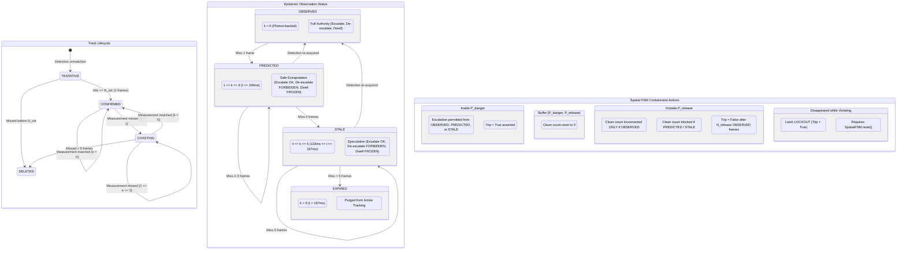

# Technical Design: Epistemological Observation States & Asymmetric Safety De-escalation

- **Change Name:** `kalman-observation-states`
- **Domain:** Kinematic Estimation, Epistemic Modeling & Industrial Safeguarding Automata
- **Target Platform:** Edge Linux (x86_64 / ARM64) / Apple Silicon (macOS arm64)
- **Applicable Standards:** ISO 13855:2024, ISO 13849-1 (PL d/e), IEC 61508 (SIL 2/3)
- **Status:** Draft
- **Related Documents:**
  - Proposal: [`openspec/changes/kalman-observation-states/proposal.md`](file:///Users/xander/Projects/edge-safety-guard/openspec/changes/kalman-observation-states/proposal.md)
  - Exploration: [`openspec/changes/kalman-observation-states/exploration.md`](file:///Users/xander/Projects/edge-safety-guard/openspec/changes/kalman-observation-states/exploration.md)
  - Preceding Design: [`openspec/changes/archive/2026-08-30-kalman-spatial-fsm/design.md`](file:///Users/xander/Projects/edge-safety-guard/openspec/changes/archive/2026-08-30-kalman-spatial-fsm/design.md)
  - Preceding Design: [`openspec/changes/archive/2026-08-30-confidence-propagation/design.md`](file:///Users/xander/Projects/edge-safety-guard/openspec/changes/archive/2026-08-30-confidence-propagation/design.md)

---

## 1. Architecture Overview: The Epistemological Problem in Safety Monitoring

### 1.1 "Prediction is Not Truth"
In computer-vision-based safety monitoring (Vision-Based Protective Devices - VBPD pursuant to ISO 13855:2024 and ISO 13849-1), an autonomous safeguarding system must make life-critical decisions: whether to assert or release emergency stop contactors controlling hazardous industrial machinery.

The perception pipeline continuously projects 2D keypoints into world metric coordinates $(X_w, Y_w)$ on the factory floor plane ($Z_w = 0$). To smooth keypoint jitter, estimate velocity vectors, and bridge brief sensor occlusions (e.g. feet passing behind conveyor supports, pallets, or machine guards), a 2D Metric Kalman Filter operates over incoming detections.

However, a fundamental epistemological problem arises when the filter operates **open-loop** during sensor dropouts (*coasting*):
$$\text{\bf "Kalman prediction is an unverified hypothesis; optical measurement is empirical truth."}$$

When visual measurements cease ($z_k = \emptyset$), a Kalman filter extrapolates position strictly via its internal kinematic prior $\hat{\mathbf{x}}_k = F \hat{\mathbf{x}}_{k-1}$. This extrapolation assumes that the human subject continues moving at constant velocity. In reality, an unobserved worker is free to accelerate, reverse direction, stumble, or kneel. As time elapses, the uncertainty volume of the worker's true physical position expands quadratically and cubically.

### 1.2 The Epistemic Conflation Defect
In the preceding architecture:
1. `Track` maintained a lifecycle status (`TrackState`: `TENTATIVE`, `CONFIRMED`, `COASTING`, `DELETED`).
2. Position coordinates were packaged into `PositionEstimate(xy_m, confidence, source, covariance)`.
3. Downstream, `SpatialFSM.update` accepted `tracks: List[Track]` and evaluated containment purely against `trk.position`.

This created a severe safety vulnerability: **the FSM treated open-loop kinematic predictions with identical authority as fresh optical photons.**

```
[Camera Sensor] ──(Photons)──► [Pose Ingestion] ──► [Homography H] ──► [OBSERVED Measurement] (Empirical Fact)
                                       │
                              (Sensor Dropout / Occlusion)
                                       │
                                       ▼
                       [Kalman Dead Reckoning: F^k · x] ─────────────► [PREDICTED Extrapolation] (Mathematical Fiction)
```

### 1.3 The Safety Asymmetry Principle
Under IEC 61508 and ISO 13849-1 fail-safe guidelines, hazardous failure modes and safe actions are fundamentally asymmetric:
- **Hazard Escalation (Fail-Safe)**: If an open-loop predicted track enters the hazard zone $P_{\text{danger}}$, asserting an emergency stop is **conservative and fail-safe**. Erring on the side of caution prevents harm even if the prediction was an overshoot.
- **Hazard De-escalation (Hazardous)**: If a track currently violating $P_{\text{danger}}$ coasts outward into the safe zone $P_{\text{safe}}$, de-escalating the safety relay based on prediction is **potentially fatal**. If the worker actually stopped or slipped inside the hazard area while the open-loop filter predicted they exited, releasing the machine will crush or injure the worker.

Therefore, this design enforces the **Asymmetric Safety Invariant**:
> **Invariant I:** Danger escalation may trigger on `OBSERVED`, `PREDICTED`, or `STALE` states.  
> **Invariant II:** Danger de-escalation strictly requires positive optical proof: $N_{\text{release}}$ consecutive frames with status `OBSERVED` outside the release perimeter $P_{\text{release}}$.  
> **Invariant III:** Hazard zone disappearance cannot self-clear: a violating track that expires without verified exit transitions the FSM into a latched `LOCKOUT` state.  
> **Invariant IV:** Warning zone dwell time represents cumulative exposure to risk and must freeze during dead reckoning.

---

## 2. Mathematical Formulations & Physical Bounds

### 2.1 Spectral Decomposition of Measurement Noise

Raw ground coordinates $(X_w, Y_w)$ generated by neural pose estimation coupled with planar homography projection are corrupted by three additive noise processes:

$$\tilde{\mathbf{z}}_k = \mathbf{z}_k + \boldsymbol{\eta}_{\text{jitter}} + \boldsymbol{\eta}_{\text{quant}} + \boldsymbol{\eta}_{\text{parallax}}$$

```
                       MEASUREMENT NOISE SPECTRUM
 ┌─────────────────────────────────────────────────────────────────────────┐
 │ High Frequency (10 - 30 Hz): Keypoint Jitter (±15 to 25 mm)            │
 │ ----------------------------------------------------------------------- │
 │ High Frequency (Spatial):    Pixel Quantization (±10 to 40 mm)          │
 │ ----------------------------------------------------------------------- │
 │ Mid Frequency (2 - 5 Hz):    Bounding Box Parallax (±50 to 250 mm)      │
 │ ----------------------------------------------------------------------- │
 │ Low Frequency (0 - 2 Hz):    Physical Human Motion (v <= 2.5 m/s)       │
 └─────────────────────────────────────────────────────────────────────────┘
```

1. **Keypoint Jitter ($\boldsymbol{\eta}_{\text{jitter}}$)**: High-frequency spatial fluctuations ($\sigma \approx 0.015\text{ m}$, magnitude $\pm 15\text{ to } 25\text{ mm}$) caused by sub-pixel heatmap regression noise in convolutional layers, garment flutter, and edge interpolation.
2. **Pixel Quantization ($\boldsymbol{\eta}_{\text{quant}}$)**: Uniform spatial discretization noise introduced by finite sensor resolution ($640 \times 640$ letterbox grid). Under homography transformation $H$, pixel step size $\Delta_{\text{pix}}$ maps to metric uncertainty $\sigma_{\text{quant}} \approx \frac{\|J_H\| \Delta_{\text{pix}}}{\sqrt{12}} \approx \pm 10\text{ to } 40\text{ mm}$.
3. **Bounding Box Parallax ($\boldsymbol{\eta}_{\text{parallax}}$)**: Mid-frequency structural displacement ($\pm 50\text{ to } 250\text{ mm}$, mean $\pm 100\text{ mm}$) occurring when falling back to bounding box bottom-center (`BBOX_BOTTOM`). Torso pitch, arm movement, or perspective foreshortening shift the box base away from the actual stance contact point.

#### Why Numerical Differentiation ($\Delta x / \Delta t$) Fails
Attempting to calculate velocity via backward finite differences $\hat{v}_k = \frac{\tilde{z}_k - \tilde{z}_{k-1}}{\Delta t}$ at $30\text{ FPS}$ ($\Delta t = 0.0333\text{ s}$) causes severe noise explosion:

$$\sigma_v = \frac{\sqrt{2} \sigma_{\text{pos}}}{\Delta t} = \frac{\sqrt{2} \times 0.015\text{ m}}{0.0333\text{ s}} \approx 0.637\text{ m/s} \quad (2.29\text{ km/h})$$

A standard $3\sigma_v$ bound produces fictitious velocity spikes of:
$$3 \sigma_v \approx 1.91\text{ m/s}$$

Because ISO 13855 defines human industrial approach speed as $K = 1.6\text{ m/s}$, **raw numerical differentiation falsely triggers the emergency dynamic bypass continuously on stationary or gently swaying workers.** A Kalman filter is mathematically mandatory.

---

### 2.2 Justification of Constant Velocity (CV) over Constant Acceleration (CA) at 30 FPS

A critical architectural question is whether to model human motion as Constant Velocity ($4\text{D state}: [X, Y, v_x, v_y]^T$) or Constant Acceleration ($6\text{D state}: [X, Y, v_x, v_y, a_x, a_y]^T$).

#### Kinematic Discrepancy under Maximum Human Acceleration
Maximum human walking acceleration during emergency stopping or sprint onset is biomechanically bounded by floor friction ($\mu \approx 0.7$):
$$a_{\max} \approx 2.5\text{ to } 3.5\text{ m/s}^2$$

Over a single video frame interval at $30\text{ FPS}$ ($\Delta t = 0.0333\text{ s}$):
1. **Velocity change per frame**:
   $$\Delta v = a_{\max} \Delta t \le 3.5\text{ m/s}^2 \times 0.0333\text{ s} \approx 0.117\text{ m/s}$$
2. **Positional displacement attributable to acceleration**:
   $$\Delta x_{\text{acc}} = \frac{1}{2} a_{\max} (\Delta t)^2 \le \frac{1}{2} (3.5) (0.0333)^2 \approx 0.00194\text{ m} = \mathbf{1.94\text{ mm}}$$

#### Comparison with Sensor Noise Floor
- Acceleration displacement per frame: $\mathbf{1.94\text{ mm}}$
- Measurement jitter noise floor: $\mathbf{15.00\text{ mm}}$
- Noise-to-Signal Ratio:
  $$\frac{\sigma_{\text{jitter}}}{\Delta x_{\text{acc}}} = \frac{15.0\text{ mm}}{1.94\text{ mm}} \approx \mathbf{7.73}$$

The physical displacement caused by human acceleration is almost an order of magnitude smaller than the sensor noise floor. It is mathematically unobservable within a single frame interval.

#### Second Derivative Noise Explosion in Constant Acceleration (CA) Models
If a CA filter is constructed, acceleration must be inferred from the second difference of position measurements:
$$\hat{a}_k \approx \frac{\tilde{z}_k - 2\tilde{z}_{k-1} + \tilde{z}_{k-2}}{\Delta t^2}$$

Assuming independent identically distributed positional noise with variance $\sigma_{\text{pos}}^2$:
$$\text{Var}(\hat{a}) = \frac{1^2 + (-2)^2 + 1^2}{\Delta t^4} \sigma_{\text{pos}}^2 = \frac{6}{\Delta t^4} \sigma_{\text{pos}}^2$$

For $\Delta t = 0.0333\text{ s}$ ($\Delta t^4 \approx 1.23 \times 10^{-6}\text{ s}^4$) and $\sigma_{\text{pos}} = 0.015\text{ m}$:
$$\text{Var}(\hat{a}) = \frac{6 \times 2.25 \times 10^{-4}\text{ m}^2}{1.23 \times 10^{-6}\text{ s}^4} \approx 1097\text{ m}^2/\text{s}^4 \implies \sigma_a \approx \mathbf{33.1\text{ m/s}^2 \ (> 3.3\text{ g})}$$

An acceleration estimation error standard deviation of $3.3\text{ g}$ causes violent oscillations in estimated velocity and position, induces severe filter lag, and corrupts boundary containment decisions. Therefore, **Constant Velocity (CV) with process noise absorbing human maneuvers is the provably optimal kinematic formulation**.

---

### 2.3 Process Noise $Q$ vs Measurement Noise $R$

The Kalman filter balances fidelity in physical dynamics against sensor veracity via the noise covariance ratio $Q / R$.

#### 2.3.1 Measurement Noise Covariance Matrix $R$
$R = \text{diag}([r_{\text{pos}}, r_{\text{pos}}])$ dynamically scales based on the anchor provenance tier established in ADR-007:
- **`ANKLES_DUAL`** ($\alpha = 1.0\times$): $r_{\text{pos}} = 0.05\text{ m}^2$ ($\sigma_{\text{eff}} \approx 0.22\text{ m}$, incorporating camera calibration uncertainty and homography condition number $\kappa(H)$).
- **`ANKLE_SINGLE`** ($\alpha = 2.0\times$): $r_{\text{pos}} = 0.10\text{ m}^2$ (absorbs lateral stance-phase offset up to $0.30\text{ m}$).
- **`BBOX_BOTTOM`** ($\alpha = 5.0\times$): $r_{\text{pos}} = 0.25\text{ m}^2$ (dampens filter gain against body-sway parallax).

#### 2.3.2 Process Noise Covariance Matrix $Q$
Human deviations from constant velocity are modeled as zero-mean discrete white noise accelerations $w_a \sim \mathcal{N}(0, \sigma_a^2)$ where $\sigma_a \approx 2.0\text{ m/s}^2$:

$$Q = \begin{bmatrix} 
\frac{\Delta t^3}{3} \sigma_a^2 & 0 & \frac{\Delta t^2}{2} \sigma_a^2 & 0 \\
0 & \frac{\Delta t^3}{3} \sigma_a^2 & 0 & \frac{\Delta t^2}{2} \sigma_a^2 \\
\frac{\Delta t^2}{2} \sigma_a^2 & 0 & \Delta t \sigma_a^2 & 0 \\
0 & \frac{\Delta t^2}{2} \sigma_a^2 & 0 & \Delta t \sigma_a^2
\end{bmatrix}$$

Evaluating with $\Delta t = 0.0333\text{ s}$ and $\sigma_a = 2.0\text{ m/s}^2$:
- Positional process variance: $Q_{\text{pos}} = \frac{(0.0333)^3}{3} (4.0) \approx 4.93 \times 10^{-5}\text{ m}^2$
- Velocity process variance: $Q_{\text{vel}} = (0.0333) (4.0) \approx 0.133\text{ (m/s)}^2$

The implementation adopts the robust diagonal parameterization $Q = \text{diag}([0.01, 0.01, 0.10, 0.10])$, guaranteeing fast responsiveness during sharp cornering while effectively attenuating high-frequency measurement noise.

---

### 2.4 Horizon of Safe Dead Reckoning: Quadratic Divergence Envelope

During sensor dropouts, the filter runs open-loop. The state and covariance evolve according to:
$$\hat{\mathbf{x}}_k = F^k \hat{\mathbf{x}}_0, \quad P_k = F^k P_0 (F^k)^T + \sum_{j=0}^{k-1} F^j Q (F^j)^T$$

If an unobserved operator maneuvers with maximum acceleration $a_{\max} = 3.0\text{ m/s}^2$ and pivots by angle $\theta$, the upper bound on physical positional divergence from the predicted trajectory is:

$$\|\Delta \mathbf{p}(t)\| \le \frac{1}{2} a_{\max} t^2 + v_0 t (1 - \cos \theta)$$

Evaluating across consecutive missed frames at $30\text{ FPS}$ ($v_0 = 1.6\text{ m/s}$, $a_{\max} = 3.0\text{ m/s}^2$):

| Missed Frames ($k$) | Time ($t$) | Trajectory Overshoot ($v_0 t$) | Maneuver Divergence ($\frac{1}{2} a t^2$) | Total Max Divergence | Ratio to Buffer $\Delta d = 200\text{ mm}$ | Epistemic Classification |
| :---: | :---: | :---: | :---: | :---: | :---: | :---: |
| **0 frames** | $0.0\text{ ms}$ | $0\text{ mm}$ | $0.0\text{ mm}$ | $\mathbf{0.0\text{ mm}}$ | $0.0\%$ | **`OBSERVED`** |
| **1 frame** | $33.3\text{ ms}$ | $53\text{ mm}$ | $1.7\text{ mm}$ | $\approx \mathbf{55\text{ mm}}$ | $27.5\%$ | **`PREDICTED`** |
| **2 frames** | $66.7\text{ ms}$ | $107\text{ mm}$ | $6.7\text{ mm}$ | $\approx \mathbf{113\text{ mm}}$ | $56.5\%$ | **`PREDICTED`** |
| **3 frames** | $100.0\text{ ms}$ | $160\text{ mm}$ | $15.0\text{ mm}$ | $\approx \mathbf{175\text{ mm}}$ | $87.5\%$ | **`PREDICTED`** (Safe Horizon Limit) |
| **4 frames** | $133.3\text{ ms}$ | $213\text{ mm}$ | $26.7\text{ mm}$ | $\approx \mathbf{240\text{ mm}}$ | $120.0\%$ | **`STALE`** (Buffer Breached) |
| **5 frames** | $166.7\text{ ms}$ | $267\text{ mm}$ | $41.7\text{ mm}$ | $\approx \mathbf{308\text{ mm}}$ | $154.0\%$ | **`STALE`** (Grossly Unsafe) |
| **> 5 frames** | $> 166.7\text{ ms}$ | $> 320\text{ mm}$ | $> 60.0\text{ mm}$ | $> \mathbf{380\text{ mm}}$ | $> 190.0\%$ | **`EXPIRED`** / **`DELETED`** |

```
                       DIVERGENCE VS HYSTERESIS BUFFER
Distance (mm)
   400 ──                                                    * (308 mm - Frame 5)
   350 ──                                            * (240 mm - Frame 4)
   300 ── ───────────────────────────────────┬───────────────────────────────────
   250 ──                                    │
   200 ── ═══════════════════════════════════╪═══ Hysteresis Buffer Delta d = 200 mm
   150 ──                            * (175 mm - Frame 3)
   100 ──                    * (113 mm)      │
    50 ──            * (55 mm)               │
     0 ── ───*───────────────────────────────┴───────────────────────────────────
           Frame 0   Frame 1  Frame 2 Frame 3     Frame 4        Frame 5
          [OBSERVED] [------ PREDICTED ------]   [------------ STALE ------------]
```

#### Epistemic Boundaries
1. **`OBSERVED` ($k = 0$)**: Valid optical measurement updated the filter. Position is backed by empirical sensor evidence.
2. **`PREDICTED` ($1 \le k \le 3$, $t \le 100\text{ ms}$)**: Extrapolation divergence remains strictly enclosed within the spatial hysteresis buffer ($\Delta d = 200\text{ mm}$). Valid for proactive safety tripping and continuous tracking.
3. **`STALE` ($4 \le k \le 5$, $133\text{ ms} \le t \le 167\text{ ms}$)**: Divergence exceeds the hysteresis buffer. Kinematic validity degrades. Valid **only** for sustaining trips or asserting conservative hazard trips. Strictly prohibited from de-escalating safety trips.
4. **`EXPIRED` / `DELETED` ($k > 5$, $t > 167\text{ ms}$)**: Extrapolation has lost all physical credibility. The track is deleted from the active tracker pool.

---

## 3. Data Structures & Contract Changes

### 3.1 `ObservationStatus` Enum (`src/core/kalman_filter.py`)

A new first-class enum representing the epistemic validity of a spatial coordinate estimate:

```python
class ObservationStatus(str, Enum):
    """
    Epistemological validity and temporal freshness of a spatial coordinate estimate.
    
    Members:
        OBSERVED: Fresh physical sensor detection matched and assimilated in the current frame (k = 0).
        PREDICTED: Open-loop dead reckoning within the safe hysteresis divergence horizon (1 <= k <= 3, <= 100ms).
        STALE: Open-loop dead reckoning exceeding the safe divergence horizon (4 <= k <= max_missed, 133-167ms).
    """
    OBSERVED = "OBSERVED"
    PREDICTED = "PREDICTED"
    STALE = "STALE"
```

### 3.2 Enriched `PositionEstimate` Dataclass (`src/core/kalman_filter.py`)

Extended with backward-compatible defaults:

```python
@dataclass(frozen=True)
class PositionEstimate:
    """
    Immutable metric ground position estimate with provenance, uncertainty, and observation status.

    Attributes:
        xy_m: Metric (X, Y) coordinates on the factory floor plane (meters).
        confidence: Normalized reliability metric in [0.0, 1.0].
        source: AnchorSource identifying the data tier.
        status: ObservationStatus defining epistemic freshness (default: OBSERVED).
        covariance: Optional 2x2 spatial position error covariance matrix (m^2).
        missed_count: Number of consecutive missed frames (default: 0).
    """
    xy_m: Tuple[float, float]
    confidence: float
    source: AnchorSource
    status: ObservationStatus = ObservationStatus.OBSERVED
    covariance: Optional[np.ndarray] = None
    missed_count: int = 0

    def __post_init__(self) -> None:
        if not (isinstance(self.xy_m, (tuple, list)) and len(self.xy_m) == 2):
            raise ValueError(f"xy_m must be a 2-tuple, got {self.xy_m}")
        if not (0.0 <= float(self.confidence) <= 1.0):
            raise ValueError(f"confidence must be in [0.0, 1.0], got {self.confidence}")
        if not isinstance(self.source, AnchorSource):
            raise ValueError(f"source must be an instance of AnchorSource, got {type(self.source)}")
        if not isinstance(self.status, ObservationStatus):
            raise ValueError(f"status must be an instance of ObservationStatus, got {type(self.status)}")
        if self.missed_count < 0:
            raise ValueError(f"missed_count must be non-negative, got {self.missed_count}")
        if self.covariance is not None:
            if not isinstance(self.covariance, np.ndarray) or self.covariance.shape != (2, 2):
                raise ValueError("covariance must be a 2x2 numpy array if provided.")
```

### 3.3 Enriched `Track` Properties (`src/core/kalman_filter.py`)

`Track` exposes `observation_status` and encapsulates it in `estimate`:

```python
class Track:
    # Existing properties retained: track_id, state, position, velocity, speed, heading, missed_count, hits, age, filter, source, confidence
    
    @property
    def observation_status(self) -> ObservationStatus:
        """Return current epistemological observation status based on missed frames."""
        if self._missed_count == 0:
            return ObservationStatus.OBSERVED
        elif self._missed_count <= 3:
            return ObservationStatus.PREDICTED
        else:
            return ObservationStatus.STALE

    @property
    def estimate(self) -> PositionEstimate:
        """
        Unified immutable PositionEstimate encapsulating position, confidence,
        provenance source, observation status, error covariance, and missed count.
        """
        cov_2x2 = self._filter.covariance[:2, :2].copy()
        return PositionEstimate(
            xy_m=self.position,
            confidence=self._confidence,
            source=self._source,
            status=self.observation_status,
            covariance=cov_2x2,
            missed_count=self._missed_count,
        )
```

### 3.4 `SpatialFSM.update` State Transition Logic (`src/core/spatial_fsm.py`)

#### 3.4.1 Asymmetric De-escalation Implementation
In `SpatialFSM.update`, `clean_count` is gated strictly by `ObservationStatus.OBSERVED`:

```python
# Danger escalation remains proactive and fail-safe:
if in_danger:
    record.clean_count = 0
    if fast_approach or record.fast_approach:
        record.danger_count = max(record.danger_count + 1, self._config.n_confirm)
    else:
        record.danger_count += 1
elif in_release:
    # Buffer band [P_danger, P_release]
    record.clean_count = 0
    if tid not in self._violating_track_ids:
        record.danger_count = 0
else:
    # Outside P_release:
    record.danger_count = 0
    # ASYMMETRIC DE-ESCALATION: Only increment clean_count on verified OBSERVED tracks!
    obs_status = getattr(trk, "observation_status", ObservationStatus.OBSERVED)
    if obs_status == ObservationStatus.OBSERVED:
        record.clean_count += 1
    # PREDICTED or STALE tracks do NOT increment clean_count.
```

#### 3.4.2 Dwell Time Freezing Implementation
In `SpatialFSM.update`, warning zone dwell time does not accumulate during coasting:

```python
if in_warning and not in_danger:
    has_warning = True
    obs_status = getattr(trk, "observation_status", ObservationStatus.OBSERVED)
    if obs_status == ObservationStatus.OBSERVED:
        if record.first_seen_warning_ts is None:
            record.first_seen_warning_ts = now
        # Advance dwell time strictly during active optical tracking
        record.dwell_time_s = max(0.0, now - record.first_seen_warning_ts)
        record.last_observed_dwell_s = record.dwell_time_s
    else:
        # PREDICTED or STALE: Freeze dwell time at last observed value
        if record.first_seen_warning_ts is not None:
            record.dwell_time_s = getattr(record, "last_observed_dwell_s", record.dwell_time_s)
else:
    if not in_release:
        record.first_seen_warning_ts = None
        record.dwell_time_s = 0.0
        record.last_observed_dwell_s = 0.0
```

#### 3.4.3 Disappearance Latching (Missing Target Latch Rule)
When an active track disappears from `tracks`, if it is currently violating:

```python
# Cleanup records for tracks that disappeared
if len(self._track_records) > len(active_ids):
    for tid in list(self._track_records.keys()):
        if tid not in active_ids:
            rec = self._track_records[tid]
            if tid not in self._violating_track_ids:
                del self._track_records[tid]
            else:
                # FAIL-SAFE: A track violating danger disappeared without verified exit!
                # Latch into LOCKOUT per ISO 13849-1 fail-safe architecture.
                self.trigger_lockout(
                    f"Hazard violation unverified: violating track {tid} disappeared inside hazard zone."
                )
```

---

## 4. State & Lifecycle Architecture

### 4.1 Track Lifecycle Overlaid with Epistemic Status & FSM Safeguarding

The following state diagram illustrates the multi-layered state machine:



### 4.2 Containment Action Matrix

| Current FSM Condition | Target Position Zone | Observation Status | Allowed FSM Action | Resulting FSM State Transition |
| :--- | :--- | :--- | :--- | :--- |
| Any | $P_{\text{danger}}$ | `OBSERVED` | Increment `danger_count` | Transition to `DANGER_INTRUSION` after $N_{\text{confirm}}$ |
| Any | $P_{\text{danger}}$ | `PREDICTED` | Increment `danger_count` | Transition to `DANGER_INTRUSION` after $N_{\text{confirm}}$ (Proactive trip) |
| Any | $P_{\text{danger}}$ | `STALE` | Increment `danger_count` | Transition to `DANGER_INTRUSION` after $N_{\text{confirm}}$ (Conservative preservation) |
| `DANGER_INTRUSION` | $[P_{\text{danger}}, P_{\text{release}}]$ | Any | Reset `clean_count = 0` | Remain in `DANGER_INTRUSION` |
| `DANGER_INTRUSION` | Outside $P_{\text{release}}$ | **`OBSERVED`** | Increment `clean_count` | Transition to `SAFE` after $N_{\text{release}}$ verified frames |
| `DANGER_INTRUSION` | Outside $P_{\text{release}}$ | **`PREDICTED`** | **Blocked** (`clean_count` untouched) | **Remain in `DANGER_INTRUSION`** |
| `DANGER_INTRUSION` | Outside $P_{\text{release}}$ | **`STALE`** | **Blocked** (`clean_count` untouched) | **Remain in `DANGER_INTRUSION`** |
| `DANGER_INTRUSION` | Expired / Disappeared | `EXPIRED` | Trigger Fail-Safe Lockout | **Transition to `LOCKOUT`** (Trip latched) |
| `SAFE` | $P_{\text{warning}}$ | `OBSERVED` | Accrue `dwell_time_s` | `WARNING_APPROACH` |
| `SAFE` | $P_{\text{warning}}$ | `PREDICTED` / `STALE` | **Freeze** `dwell_time_s` | `WARNING_APPROACH` (Frozen dwell) |

---

## 5. Architectural Trade-offs

| Decision Point | Option Considered | Chosen Strategy | Rationale & Trade-off Analysis |
| :--- | :--- | :--- | :--- |
| **Epistemic Granularity** | 2-State (`OBSERVED` vs `COASTING`) | **3-State (`OBSERVED`, `PREDICTED`, `STALE`)** | A binary flag misses the physical distinction between dead reckoning within the $200\text{ mm}$ hysteresis buffer ($t \le 100\text{ ms}$) and dead reckoning that breaches the buffer ($t > 100\text{ ms}$). The 3-state model aligns with physical divergence math. |
| **Danger De-escalation** | Allow de-escalation on prediction if covariance is low | **Strictly require `OBSERVED` for `clean_count`** | Permitting prediction-based de-escalation violates ISO 13849-1 fail-safe fundamentals. A brief false nuisance trip is vastly preferable to an unverified machine restart with an injured worker inside. |
| **Track Disappearance** | Auto-release after $N_{\text{release}}$ blank frames | **Latch into `LOCKOUT`** | If a worker inside a robot cell is suddenly occluded and tracking expires, auto-releasing the machine would allow robotic movement over an undetected human. Latching to `LOCKOUT` requires an authorized supervisor reset. |
| **Dwell Accrual** | Wall-clock time during coasting | **Freeze during coasting** | Accruing dwell time while an operator cannot be seen creates artificial dwell timeouts. Freezing accurately reflects confirmed exposure duration. |
| **Kinematic Model** | Constant Acceleration (CA) or Non-Linear EKF | **Constant Velocity (CV) with Adaptive $R$** | As proven in §2.2, second derivative noise at $30\text{ FPS}$ yields $\sigma_a \approx 33\text{ m/s}^2$, destabilizing CA filters. CV is optimal for human gait. |

---

## 6. Migration & Backwards Compatibility Plan

### 6.1 Backwards Compatibility Contract
1. **Public Property Invariants**:
   - `Track.position` continues to return `Tuple[float, float]`.
   - `Track.state` continues to return `TrackState`.
   - `Track.source` and `Track.confidence` retain existing behavior.
   - `PositionEstimate` has default values for `status=ObservationStatus.OBSERVED` and `missed_count=0`. Any legacy constructor call `PositionEstimate(xy_m, conf, source)` continues to execute with zero errors.
2. **Duck-Typing Safeguard in `SpatialFSM`**:
   In `SpatialFSM.update`, access to `trk.observation_status` uses `getattr(trk, "observation_status", ObservationStatus.OBSERVED)`. Custom or mock track objects without this property degrade gracefully to `OBSERVED`.

### 6.2 Test Suite Updates
1. **`tests/test_kalman.py`**:
   - Add unit tests for `ObservationStatus` enum values.
   - Add unit tests verifying `Track.observation_status` transitions: $k=0 \implies \text{OBSERVED}$, $1 \le k \le 3 \implies \text{PREDICTED}$, $4 \le k \le 5 \implies \text{STALE}$.
   - Add validation checks in `PositionEstimate` tests.
2. **`tests/test_fsm.py`**:
   - Add test verifying that a track in `PREDICTED` or `STALE` outside $P_{\text{release}}$ cannot clear `_violating_track_ids`.
   - Add test verifying that warning zone dwell time freezes during coasting frames.
   - Update tests where tracks previously disappeared and were expected to auto-clear without a reset.
