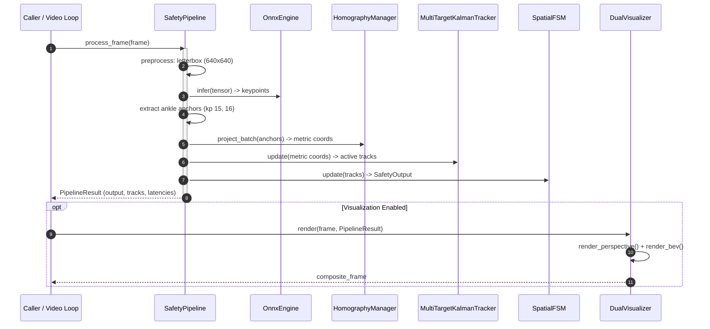

# Design: End-to-End Safety Pipeline & Dual Visualization

## Technical Approach
The `pipeline-visualization` change unifies perception, projection, kinematic estimation, spatial safeguarding, and monitoring into two core modules:
1. **`SafetyPipeline` (`src/pipeline/safety_pipeline.py`)**: A synchronous orchestrator running letterbox preprocessing ($640\times640$), ONNX pose inference (`OnnxEngine`), ankle keypoint ground-anchor extraction (indices 15, 16), planar homography (`HomographyManager`), Kalman tracking (`MultiTargetKalmanTracker`), and spatial FSM evaluation (`SpatialFSM`). High-resolution stage profiling enforces the ISO 13855:2024 reaction budget ($t_1 \le 50\text{ ms}$, $\ge 20\text{ FPS}$), with fail-safe fault containment forcing `SafetyState.FAULT` and `trip = True` on any internal exception.
2. **`DualVisualizer` (`src/utils/visualizer.py`)**: A synchronized dual-rendering engine generating an annotated perspective camera view (hazard polygons reprojected via $H^{-1}$, skeletons, and status banners) alongside an orthogonal metric Bird's-Eye View (BEV canvas at 100 px/m rendering grid, machine footprint, danger/release zones, tracks, velocity vectors, and dwell times), composited via Side-by-Side or Picture-in-Picture (PiP) layouts, with sub-millisecond headless bypass.



## Architecture Decisions

| Decision | Options Considered | Trade-offs | Selected & Rationale |
| :--- | :--- | :--- | :--- |
| **Pipeline Execution Model** | Threaded asynchronous queue vs. Synchronous sequential loop | Threading adds locking jitter and queue latency. Sync loop guarantees deterministic frame ordering and zero IPC overhead. | **Synchronous sequential loop**: Meets ISO 13855 $t_1 \le 50\text{ ms}$ requirement with lower tail latency ($p99$). |
| **Ground Anchor Extraction** | Bounding box center/bottom vs. Ankle midpoint (kp 15, 16) | Bbox bottom floats on leg stance; ankle midpoints pin true floor contact plane ($Z_w = 0$). | **Ankle midpoint with fallback**: Dual-ankle midpoint if $\tau_{\text{conf}} \ge 0.5$; single-ankle fallback; drop measurement to trigger Kalman coasting if occluded. |
| **Zone Reprojection** | Runtime inverse homography vs. Precomputed cached polygon vertices | Recomputing $H^{-1} \mathbf{p}$ per frame wastes GPU/CPU cycles. Static zones allow one-time reprojection. | **Precomputed static $H^{-1}$ reprojection**: Reproject $P_{\text{danger}}$ and $P_{\text{release}}$ once at visualizer init; dynamic drawing cost $< 0.5\text{ ms}$. |
| **BEV Canvas Architecture** | Dynamic redraw vs. Cached static background | Redrawing 100 px/m grid, distance markers, and machine footprint every frame exceeds 10 ms budget. | **Static background cache + dynamic overlay**: Pre-render metric grid, footprint, and zones to canvas; overlay tracks and vectors via `cv2.line`/`circle` in $< 1.5\text{ ms}$. |
| **Visualization Bypass** | Flag check in render loop vs. Headless mode bypass | Checking flags deep in render paths adds call overhead. | **Headless bypass**: `if self.headless: return frame` at entry point, guaranteeing $< 0.1\text{ ms}$ execution. |

## Data Flow

```
Frame (H,W,3) ──► Letterbox (640,640,3) ──► OnnxEngine (1,56,8400)
                         │                         │
                         ▼                         ▼
                  Un-letterbox ◄──────── Ankle Midpoint Filter
                         │
                         ▼
             HomographyManager.project_batch()
                         │
                         ▼
        MultiTargetKalmanTracker.update() ──► Confirmed Tracks
                         │
                         ▼
             SpatialFSM.update() ──► SafetyOutput (trip, state, dwell)
                         │
                         ▼
               PipelineResult (tracks, output, latencies)
                         │
          ┌──────────────┴──────────────┐
          ▼                             ▼
  Perspective Overlay               Metric BEV (100 px/m)
          │                             │
          └────────► Composite ◄────────┘
                         │
                         ▼
               Composite Video Frame
```

## File Changes

| File | Action | Description |
| :--- | :--- | :--- |
| `src/pipeline/safety_pipeline.py` | Create | `SafetyPipeline`, letterbox preprocessor, ankle anchor extraction, latency profiler, and `PipelineResult`. |
| `src/utils/visualizer.py` | Create | `DualVisualizer`, perspective overlay with $H^{-1}$ zone reprojection, metric BEV canvas, side-by-side / PiP compositing. |
| `tests/test_pipeline.py` | Create | Unit tests for pipeline orchestration, stage latencies, ankle anchoring, Kalman coasting, and fail-safe fault handling. |
| `tests/test_visualizer.py` | Create | Unit tests for perspective reprojection, BEV rendering, layout compositing, and headless bypass performance. |

## Interfaces / Contracts

```python
from dataclasses import dataclass, field
from enum import Enum
from typing import Dict, List, Optional, Tuple
import numpy as np
from src.core.kalman_filter import Track
from src.core.spatial_fsm import SafetyOutput, SafetyState

@dataclass(frozen=True)
class StageLatencies:
    preprocess_ms: float
    inference_ms: float
    keypoint_extract_ms: float
    projection_ms: float
    tracking_ms: float
    fsm_evaluation_ms: float
    total_t1_ms: float

@dataclass
class PoseDetection:
    bbox: Tuple[float, float, float, float]  # (x1, y1, x2, y2)
    keypoints: np.ndarray                    # (17, 3) [x, y, conf]
    anchor: Optional[Tuple[float, float]]    # (u, v) in original frame coords

@dataclass
class PipelineResult:
    frame_id: int
    timestamp: float
    safety_output: SafetyOutput
    tracks: List[Track]
    detections: List[PoseDetection]
    latencies: StageLatencies

class LayoutMode(str, Enum):
    SIDE_BY_SIDE = "SIDE_BY_SIDE"
    PIP = "PIP"

class SafetyPipeline:
    def __init__(self, engine: OnnxEngine, homography: HomographyManager,
                 tracker: MultiTargetKalmanTracker, fsm: SpatialFSM,
                 conf_threshold: float = 0.5) -> None: ...
    def process_frame(self, frame: np.ndarray) -> PipelineResult: ...

class DualVisualizer:
    def __init__(self, homography: HomographyManager, fsm: SpatialFSM,
                 bev_scale: float = 100.0, bev_size: Tuple[int, int] = (600, 600),
                 headless: bool = False) -> None: ...
    def render_perspective(self, frame: np.ndarray, result: PipelineResult) -> np.ndarray: ...
    def render_bev(self, result: PipelineResult) -> np.ndarray: ...
    def composite(self, perspective: np.ndarray, bev: np.ndarray, layout: LayoutMode = LayoutMode.SIDE_BY_SIDE) -> np.ndarray: ...
    def render(self, frame: np.ndarray, result: PipelineResult, layout: LayoutMode = LayoutMode.SIDE_BY_SIDE) -> np.ndarray: ...
```

## Testing Strategy

| Layer | What to Test | Approach |
| :--- | :--- | :--- |
| **Unit** | Ankle midpoint extraction & occlusions | Test dual ankle averaging, single ankle fallback, and low-conf dropout in `test_pipeline.py`. |
| **Unit** | Stage latency profiling & ISO budget | Measure `total_t1_ms` with synthetic ONNX model; verify $t_1 \le 50\text{ ms}$ ($\ge 20\text{ FPS}$). |
| **Unit** | Fail-safe fault containment | Inject corrupted frames / matrix exceptions; assert `trip == True` and `state == SafetyState.FAULT`. |
| **Unit** | Perspective $H^{-1}$ reprojection | Verify zone polygon vertices project accurately into frame pixel bounds in `test_visualizer.py`. |
| **Unit** | BEV canvas & compositing | Verify 100 px/m grid scale, track arrows, dwell text, and SIDE_BY_SIDE / PIP image dimensions. |
| **Unit** | Headless mode performance | Measure `DualVisualizer(headless=True).render()`; verify duration $< 0.1\text{ ms}$. |

## Threat Matrix
`N/A — no routing, shell, subprocess, VCS/PR automation, executable-file classification, or process-integration boundary.`

## Migration / Rollout
No migration required. Modules integrate on top of existing `src/core` and `src/inference` components.

## Open Questions
None.
